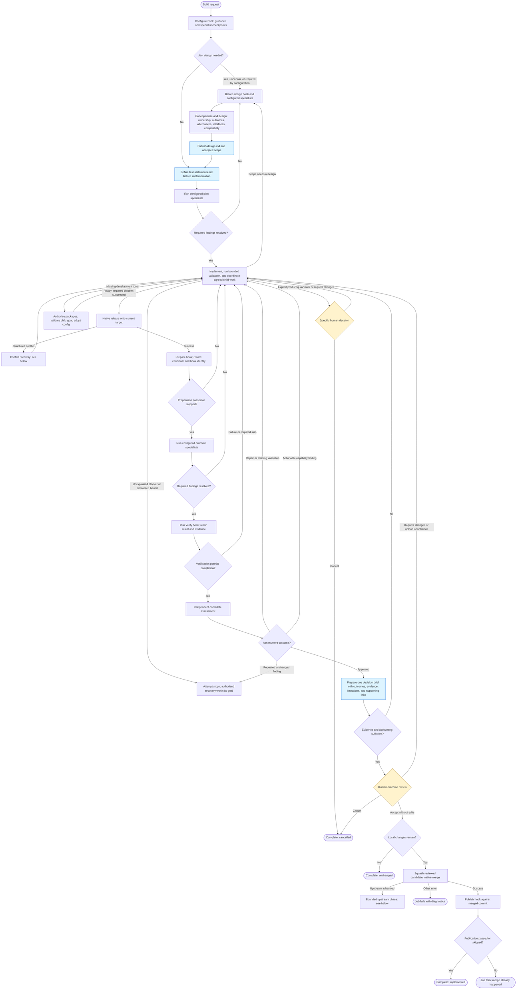
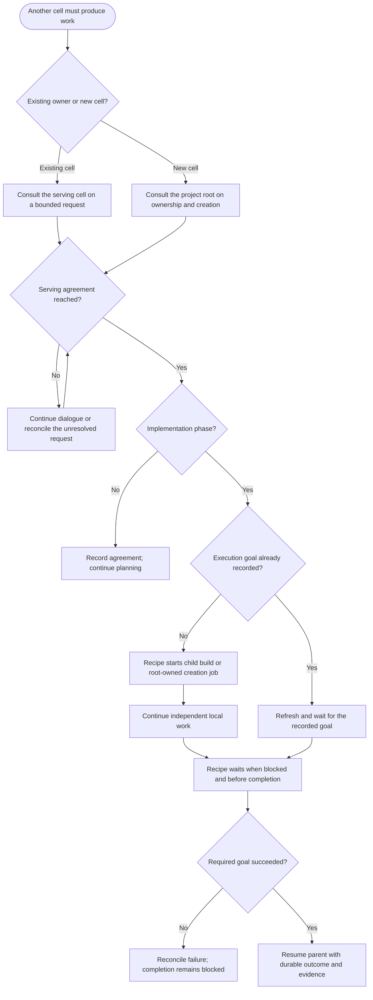

# Adaptive build process

Current flow selected by [build.yaml](build.yaml), implemented in
[recipes/adaptive](recipes/adaptive/README.md). Like the [original diagram](BUILD_PROCESS.md),
boxes group work and diamonds show decisions. Agents determine how to do the work;
the recipe controls phase transitions, prerequisite coordination, validation gates,
review, and publication. Authorized implementation agents can also submit bounded
validation attempts; the recipe monitors their goals and collects successful results automatically.

## Main workflow

- **Review:** normally one human outcome review; design has no routine approval gate.
  Specific agent questions can request earlier direction. Iteration limits stop
  the attempt for goal recovery without asking a product reviewer.
  Revision needs feedback or uploaded edits; acceptance with edits returns to work.
- **Intervention:** package requests use authorization and validation before resuming.
  Actionable capability findings return to the working agent first. Explicit product
  questions can request human direction; unexplained technical blockers and exhausted
  bounds produce operational failures. Codex decides implementation versus design.
  Failed job attempts leave goal waits pending for authorized recovery; explicit goal
  failure or a semantically failed validation result remains blocking.
- **Formal evidence:** test statements have stable IDs, expectations, filenames,
  importance, test level, and dependencies. Implementation reports results against
  that baseline; changing the plan requires redesign and preserves existing expectations.
- **Review documents:** exactly one current decision brief is primary. Current results,
  expectations, findings, and selected sources are supporting evidence. Raw execution
  diagnostics remain available without turning the whole inbox into a review bundle.
- **Failures:** verification execution, output, evidence, or mutation failures return
  to implementation. Cancellation remains cancellation. Other fatal errors can stop
  any phase; the chart omits repetitive error edges.

## Cross-cell coordination

Design, test planning, and implementation can request serving consultation. Only
implementation asks the coordinator to submit agreed prerequisite work. This
coordination returns to the current phase. Bounded validation jobs have the separate
submission path described below.

**Serving agreement is mandatory before prerequisite submission.** The recipe assigns
agreement references; agents use them only when requesting execution. Native state
outputs retain agreement and submission records, without carried status maps. Mixed
independent requests are allowed. Reusing execution waits for its recorded goal.
Consultations can request downstream owner advice and resume without human scheduling. Creation retains root-owned approval and readiness
requirements; creating a cell does not implement the original feature request.
Creation must be requested explicitly. Inaccessible workspaces return for investigation
and do not silently become root-cell creation requests.

### Agent-submitted validation

The test plan identifies the actor, authority, bounded invocation, and required
evidence for validation. During implementation, an agent may submit the assigned
c2j validation jobs when permitted by its task and current token. It checks
`c2j self` for permissions, availability, routes, and inherited child restrictions,
and `c2j submit --help` for submission details. `c2j cells` provides related-cell
discovery. Missing capabilities require intervention rather than weaker verification.

c2j automatically records jobs submitted as children of the task. The recipe
reads those outputs, deduplicates goal IDs, waits for goal success, and attaches
the successful attempt’s artifacts and status under `inbox/goals/validation-<goal-id>/`.
Native goal IDs are required; there is no job-ID fallback. The agent does not
maintain a second list of IDs. A failed attempt
is repairable while its goal remains open; an explicitly failed goal or semantic
validation failure blocks completion.

This permission applies to bounded validation during implementation. Planning,
read-only review, consultation, and response correction cannot submit jobs.
Project prerequisite builds and cell creation still use serving consultation and
the coordinator's recorded agreements. Working agents receive explicit package
request instructions. Exact policy lives in `package-policy.yaml`. Prior refusals
and approvals come from native package-state outputs; changed probes need a fresh
decision. Authorization precedes isolated validation and adoption. Failed goals
provide actual attempt diagnostics; setup failures before agent launch remain
operational recovery within the goal. See the
[gap-closure assessment](guides/ASSESSMENT_ADAPTIVE_GAP_CLOSURE.md).

## Native rebase recovery and upstream advancement

Conflict repair and upstream chasing have separate budgets. Neither retries
arbitrary Git failures or repeats publication after an already successful merge.

The agent reconciles the saved delta with concurrent changes; it never performs
the rebase itself. Native state run history supplies iteration and recovery counts.
Verification keeps only current evidence, separate from formal documents.

## Agent instructions, files, and recipe data

Authored prompts and human-review wording live in
[prompts.yaml](recipes/adaptive/prompts.yaml), an empty-sequence include that adds
no worker tasks. Named inputs render ordinary templates. Standing instructions
are supplied when a new session starts; resumed turns receive the current task
and artifact-directory paths. Agents use `c2j self` at task start and recheck after
lease or permission failures.

Each operation receives its own inbox and outbox, outside the repository. The
prompt supplies their actual paths for that turn; paths from another machine or
earlier task are not reusable. Agents write deliverables to the outbox and return
paths relative to it.

- `inbox/error/` contains current failure diagnostics, correction notes, or saved
  rebase-recovery evidence. Native execution logs retain the command, relative
  working directory, and timestamped output with stream labels. Additional setup
  and probe diagnostics remain individually accessible. Recipe summaries, returned
  files, and native diagnostic sets occupy separate subdirectories; original file
  paths are preserved. Failed goal attempts each get their own directory, and logs
  are collected from their native failure envelope as well as returned artifacts.
- `inbox/verification/` uses the same layout for successful check evidence. Hook
  filenames cannot overwrite the generated summary or approved work documents.
- `inbox/feedback/` contains human direction and reviewer feedback. Original
  documents remain available for annotation source links.
- Other inbox documents carry designs, formal test statements, results, and
  consultation evidence. Prompts direct agents to the relevant directories;
  they do not enumerate files or include a serialized workflow-state blob.

Phase, verification requirements, approval decisions, and hook settings remain
recipe data. Helpers receive specific values and read operation outputs and state
history directly. Hooks return values and original artifact references; c2j
enforces their declared output contracts. Existing hook interfaces may still
receive their declared `build-settings.json`, while the main loop uses the
configure outputs it needs. Log text is evidence, not the source of gate decisions.

Public build, creation, and adaptive consultation contracts use schema v2.
Annotations cross includes and child jobs as native arrays with typed artifact
references; sessions use `checkpoint`. No annotation JSON strings or transport
sidecars are needed. Internal helpers without declared input schemas remain
unversioned and already pass native values directly. See the
[schema v2 migration](guides/IMPLEMENTATION_RECIPE_SCHEMA_V2.md) and
[shared prompt notes](guides/IMPLEMENTATION_SHARED_PROMPTS.md).

The adaptive entry and its local helpers do not include kernel recipes. Serving
agreement asks humans only for explicit decisions; exhausted correction stops
the attempt for recovery. Every review uses a current brief plus its cited and
required evidence, excluding stale briefs and unrelated history. External child
build and root-creation jobs remain explicit integration boundaries.
