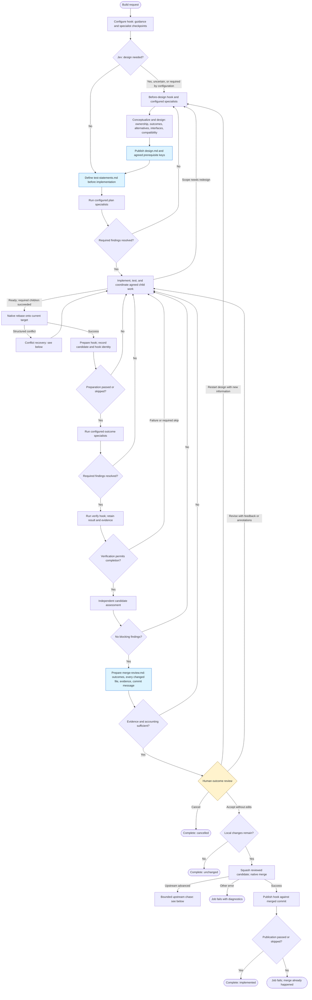
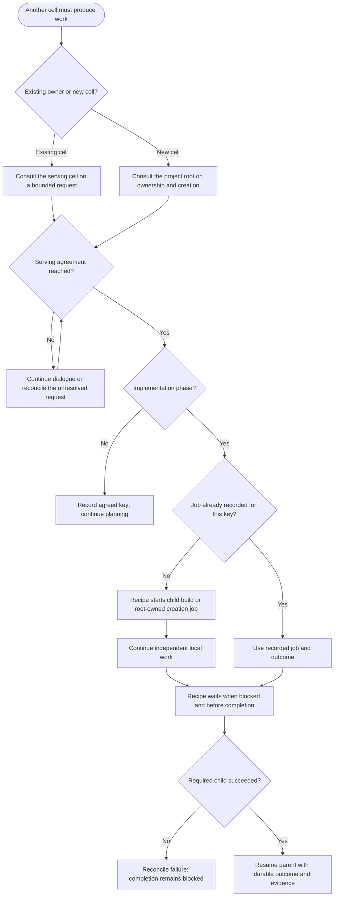
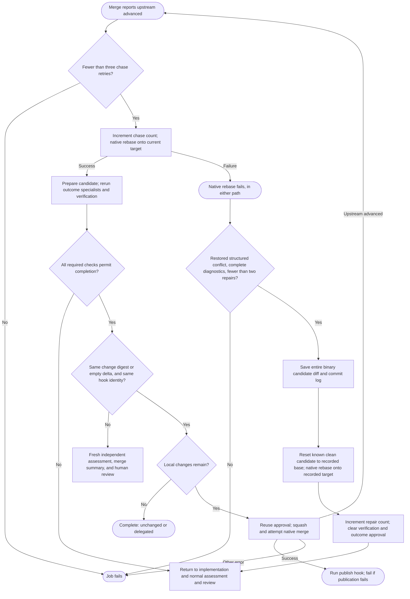

# Adaptive build process

Current flow selected by [build.yaml](build.yaml), implemented in
[recipes/adaptive](recipes/adaptive/README.md). Like the [original diagram](BUILD_PROCESS.md),
boxes group work and diamonds show decisions. Agents determine how to do the work;
the recipe controls validation, child jobs, review, and publication.

## Main workflow

- **Review:** normally one human outcome review; design has no routine approval gate.
  Specific agent questions and iteration limits can request earlier direction.
  Revision needs feedback or uploaded edits; acceptance with edits returns to work.
- **Formal evidence:** test statements have stable IDs, expectations, filenames,
  importance, test level, and dependencies. Implementation reports results against
  that baseline; changing the plan requires redesign and preserves existing expectations.
- **Review documents:** c2j annotations prioritize `merge-review.md`, test statements,
  test results, and independent findings, with design and implementation as support.
- **Failures:** verification execution, output, evidence, or mutation failures return
  to implementation. Cancellation remains cancellation. Other fatal errors can stop
  any phase; the chart omits repetitive error edges.

## Cross-cell coordination

Design, test planning, and implementation can request serving consultation. Only
implementation submits agreed work. This coordination returns to the current phase.

**Agreement is mandatory before submission.** Stable keys prevent duplicate jobs
across retries and redesign. Creation retains root-owned approval and readiness
requirements; creating a cell does not implement the original feature request.

## Native rebase recovery and upstream advancement

Conflict repair and upstream chasing have separate budgets. Neither retries
arbitrary Git failures or repeats publication after an already successful merge.

The agent reconciles the saved delta with concurrent changes; it never performs
the rebase itself. Small control state travels through inputs and outputs. Diffs,
documents, command output, and consultation transcripts remain artifacts. Hooks
return values and evidence directly, without a second report-inspection task.
