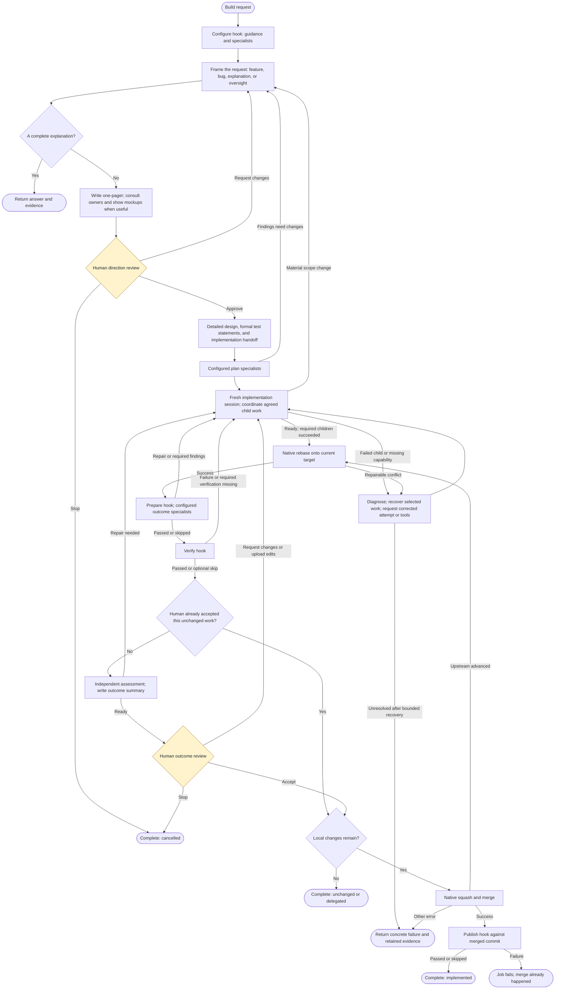
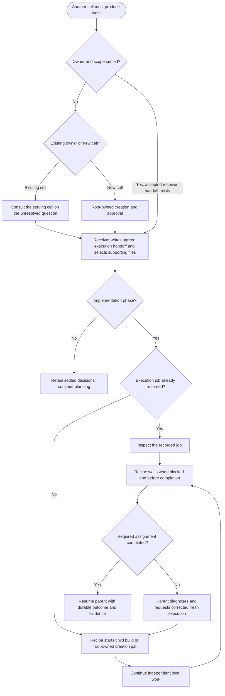
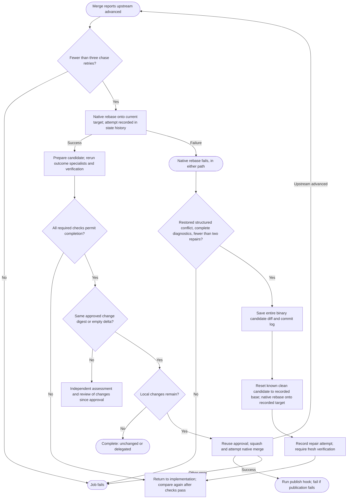

# Adaptive build process

Current flow selected by [build.yaml](build.yaml), implemented in
[recipes/adaptive2](recipes/adaptive2/README.md). Like the [original diagram](BUILD_PROCESS.md),
boxes group work and diamonds show decisions. Agents determine how to do the work;
the recipe controls phase transitions, prerequisite coordination, validation gates,
review, and publication. Authorized implementation agents can also submit bounded
validation jobs; the recipe returns their results and failures to the parent automatically.

## Main workflow

- **Framing:** the first agent identifies a feature, bug, explanation, or oversight
  assignment. Oversight coordinates work owned by other cells. A completed explanation
  can return `answer.md` directly; delivery starts with a one-pager even when the
  request already includes an execution handoff. No separate design classifier runs.
- **Direction review:** `one-pager.md` covers Problem Description, Non Goals,
  What we are planning to do, Compat/Upgrade, and key design questions and answers.
  Select consequential choices a reviewer could challenge or redirect, explaining recommendations,
  credible alternatives, and tradeoffs. Retain unresolved choices that could change direction with
  their impact and the decision or evidence needed. Avoid routine confirmations and invented dilemmas.
  The form names the cell
  and proposed change. Approval retains the exact document under
  `approved-direction/one-pager.md`; feedback returns to framing. An unanswered
  review cannot advance to detailed planning or implementation.
- **Outcome review:** after implementation and verification, the primary brief
  explains what changed, what others did, tests, omissions, interface changes, and
  differences from the approved direction. Supporting evidence stays linked.
  Acceptance with edits returns to work. Material scope changes return to framing;
  unchanged rebases reuse the existing outcome approval as described below.
- **Recovery:** ordinary debugging belongs to the working agent. Failed children,
  invalid target refs, preparation errors, and unexplained blockers return to the
  parent with their available diagnostics. A corrected execution request submits a
  fresh job in the explicit destination cell, starting from its normal target ref.
  It receives the agreed receiver-authored handoff and selected files. If the assignment
  changes, the receiver revises it through consultation. The parent can inspect intermediate
  outputs and export a snapshot, then include a reviewed patch for the next writable task
  to apply and retest. Sessions and execution history are not inherited. Cancellation stays distinct and never triggers an automatic retry.
  `next: fail` immediately ends an unsuccessful attempt with its reason and selected
  files, returning control to its parent. Three consecutive unsuccessful correction
  turns with an unchanged candidate also produce an operational handoff; rewording
  the blocker does not reset this count. Repeated negative assessments of the same
  candidate enter recovery regardless of how their findings are phrased. Candidate changes or intervening successful
  work permit further progress. The default has no fixed implementation
  turn cap; runtime budgets still apply. An explicit `max_iterations` counts substantive
  implementation turns, excluding planning, coordination, waiting, and response correction.
- **Formal evidence:** test statements have stable IDs, expectations, filenames,
  importance, test level, and dependencies. Implementation reports results against
  that baseline; changing the plan requires redesign and preserves existing expectations.
  Child baselines cover their own deliverables, with parent-wide integration checks
  as supporting context. Investigations may finish with specific unavailability if
  their acceptance allows it; this does not certify unresolved product behavior.
  Latest human scope decisions govern validation. Excluded platforms and optional
  environment checks do not become blockers; exact tool versions require a real need.
- **Review documents:** exactly one current decision brief is primary. Current results,
  expectations, findings, and selected sources are supporting evidence. Raw execution
  diagnostics remain available without turning the whole inbox into a review bundle.
  The overview explains the user-visible outcome, decision needed now, and what
  changed since prior approval. Detailed hashes and file accounting are supporting material.
- **Failures:** verification execution, output, or evidence failures return
  to implementation. Cancellation remains cancellation. Other fatal errors can stop
  any phase; the chart omits repetitive error edges.

Missing files should be retrieved from their producer with the
[job inspection commands](guides/JOB_INSPECTION_PLAYBOOK.md) before escalation.
Failure export preserves selected files, including an existing `recovery.md`, and
reports the reason in the failure; it does not add a generic colliding document.
Saved unpublished commits support snapshot/patch validation. Consumers requiring
ordinary remote Git or module resolution must instead wait for source publication;
the recipe does not publish implicitly to satisfy an investigation.

## Cross-cell coordination

Design, test planning, and implementation can request serving consultation. Only
implementation asks the coordinator to submit agreed prerequisite work. This
coordination returns to the current phase. Bounded validation jobs have the separate
submission path described below.

The requesting cell explains its problem and proposed requirements. The receiving
cell checks existing capabilities, recommends changes, and writes the agreed
`handoff.md` as a feature, bug, explanation, or oversight assignment. Public replies
and their selected documents remain accessible through `conversation.md`; the
receiver's summary explains its recommendation and differences from the request.

For execution, the parent returns `action: execute`, an explicit `cell`/`ref`, and
`handoff: work/<assignment>/`. That directory must contain the receiver's original
`handoff.md`; the coordinator checks that assignment against the accepted consultation.
It passes only currently selected files beneath that directory to the child.
Supporting evidence may be added, updated, moved, or omitted without another
agreement. A changed assignment requires the receiver to revise it; supporting
files cannot silently expand its scope.
A referral to a different delivery owner needs that owner's agreed assignment.

Children use the normal named `build` selector, preserving local build overrides;
the shared public build now selects adaptive2. Each delivery child currently has
its own direction review. Reusing a parent's approval for an unchanged child brief
and executing approved prerequisites during planning remain future work. Creation
continues through the existing root-owned creation workflow.

Agents use native job IDs for `replaces` when requesting a corrected attempt. The
coordinator retains submission records for durable replay, follows active or successful
attempts instead of duplicating them, and never automatically retries cancellation.
The parent interprets cancellation feedback: a correction can lead to an explicit replacement with selected
recovery evidence, or a receiver-revised handoff when scope changes; an instruction to stop the broader work is respected.
Design, test planning, and implementation start separate sessions. Consultation gets
its own requester and consultant checkpoints; returning advice preserves the original
working session and unpublished managed candidate. Creation retains root-owned approval
and readiness requirements and does not implement the original feature request.

A self-contained consultation question needs no attached documents. For supporting
contracts, use an optional handoff directory for that question. Historical artifacts
remain on their producing tasks. Subsequent progression turns receive the agent's
selected current files, with the main request, approved direction, current handoff,
and formal baseline retained explicitly. This also applies to `coordination/`:
consultation history remains in job records, not an accumulating inbox. Agents may
select unchanged inbox files without republishing them or retrieve older files
through c2j job inspection.

### Agent-submitted validation

The test plan identifies the bounded invocation and evidence needed to establish the
requested outcome. During implementation, agents use `c2j self` to discover the task's
connection, routes, and available actions, and `c2j submit --help` for submission
syntax. Missing optional metadata is not an additional acceptance requirement.

c2j automatically records child submissions. The recipe consumes their native job
IDs, inspects every tracked job, and returns available terminal results before
waiting. Results appear under `inbox/results/<job>/`, with exported files under
`artifacts/`; original failures appear under `inbox/error/children/<job>/`.
A failed execution is returned even if its goal remains OPEN. Pending siblings
remain tracked. Return `wait` when no independent work remains, or `continue` with a
concrete next action. A narrow Jev classification routes status-only continuations to
durable waiting; uncertainty returns a focused response correction. Direct and
coordinator children share status collection. If all children are pending, the current runtime can wait only on
one; prompt wakeup on any child completion needs the runtime addition described in
[recovery runtime requirements](guides/REQUIREMENTS_C2J_PARENT_RECOVERY.md).

Planning, consultation, read-only review, and response correction cannot submit
jobs. Inspection is separate from submission and follows existing JobDB read
permissions, including parents and siblings. `c2j job log`, `fields`, `artifacts`, and `artifact` expose saved
outputs even when no final result exists. `c2j job snapshot` exports cumulative state
to scratch. The agent selects useful files or a patch; the next writable task reviews,
applies, and retests it. Follow producer references before reporting a missing input.
Unavailable saved work permits a fresh start when a concrete correction can help;
otherwise return the exact unmet need instead of repeating an unproductive attempt.

Persistent worker tools use `packages: [{reference: ..., check: [...]}]`, for example
`check: [go, version]` or `check: [ruff, --version]`. The cell's
`.c2/recipes/hooks/build/package-policy.yaml` can approve exact reference/probe pairs;
other requests get a focused approval. Validation stages the proposed configuration
in a separate child. The parent adopts it only after a successful matching probe and
only if its own configuration has not changed. Bad package setup leaves management
usable. A corrected probe is a fresh validation job and can use an explicit policy
approval. Memory/Docker requests currently return their precise unmet need; dynamic
execution-requirement adoption still needs c2j and provisioner support.

## Native rebase recovery and upstream advancement

Conflict repair and upstream chasing have separate budgets. Neither retries
arbitrary Git failures or repeats publication after an already successful merge.

The agent reconciles the saved delta with concurrent changes; it never performs
the rebase itself. Native state run history supplies iteration and recovery counts.
Verification keeps only current evidence, separate from formal documents.

Approval comes from the actual human `accept` state, not a later model summary.
After checks pass, unchanged approved work proceeds to merge without another
assessment, summary, or human prompt. Hook changes do not invalidate approval;
the newly selected checks still execute and failures still return to repair.
An unresolved human revision or uploaded feedback prevents automatic reuse.

For a changed candidate, assessment and summary receive the exact last accepted
review and candidate artifacts under `approved/`. The follow-up form includes
those references explicitly, with one current primary brief focused on changes
since approval, their reason, updated evidence, and the decision needed now.
Previously approved and current diffs remain diagnostic supporting material.
The recipe restores the original references from native review history even if
an agent omits or returns a modified copy. This does not add a worker task or
an agent-maintained approval record.

## Agent instructions, files, and recipe data

Authored prompts and human-review wording live in
[prompts.yaml](recipes/adaptive2/prompts.yaml), an empty-sequence include that adds
no worker tasks. Named inputs render ordinary templates. Standing instructions
are supplied when a new session starts; resumed turns receive the current task
and artifact-directory paths. Agents use `c2j self` at task start and recheck after
lease or permission failures.

Each operation receives its own inbox and outbox, outside the repository. The
prompt supplies their actual paths for that turn; paths from another machine or
earlier task are not reusable. Agents write deliverables to the outbox and return
paths relative to it.

- `inbox/error/` contains current failure diagnostics, correction notes, or saved
  rebase-recovery evidence. Native execution logs retain the command, relative
  working directory, and timestamped output with stream labels. Additional setup
  and probe diagnostics remain individually accessible. Recipe summaries, returned
  files, and native diagnostic sets occupy separate subdirectories; original file
  paths are preserved. Child jobs each get their own directory, and logs
  are collected from their native failure envelope as well as returned artifacts.
- `inbox/verification/` uses the same layout for successful check evidence. Hook
  filenames cannot overwrite the generated summary or approved work documents.
- `inbox/feedback/` contains human direction and reviewer feedback. Original
  documents remain available for annotation source links.
- Other inbox documents carry designs, formal test statements, results, and
  consultation evidence. Prompts direct agents to the relevant directories;
  they do not enumerate files or include a serialized workflow-state blob.

Phase, verification requirements, approval decisions, and hook settings remain
recipe data. Helpers receive specific values and read operation outputs and state
history directly. Hooks return values and original artifact references; c2j
enforces their declared output contracts. Existing hook interfaces may still
receive their declared `build-settings.json`, while the main loop uses the
configure outputs it needs. Log text is evidence, not the source of gate decisions.

Public build, creation, and adaptive2 consultation contracts use schema v2.
Annotations cross includes and child jobs as native arrays with typed artifact
references; sessions use `checkpoint`. No annotation JSON strings or transport
sidecars are needed. Internal helpers without declared input schemas remain
unversioned and already pass native values directly. See the
[schema v2 migration](guides/IMPLEMENTATION_RECIPE_SCHEMA_V2.md) and
[shared prompt notes](guides/IMPLEMENTATION_SHARED_PROMPTS.md).

The adaptive2 entry and its shared adaptive helpers do not include kernel recipes. Serving
agreement asks humans only for explicit decisions; failures return to the parent
for correction before an exhausted recovery becomes a concrete handoff. Every review uses a current brief plus its cited and
required evidence, excluding stale briefs and unrelated history. External child
build and root-creation jobs remain explicit integration boundaries.

See the [default-build rollout](guides/adaptive2/ROLLOUT.md),
[initial assessment](guides/adaptive2/IMPLEMENTATION.md), and
[recovery assessment](guides/ASSESSMENT_AGENT_AUTONOMY_AND_PARENT_RECOVERY.md)
for verified paths and remaining limitations.
