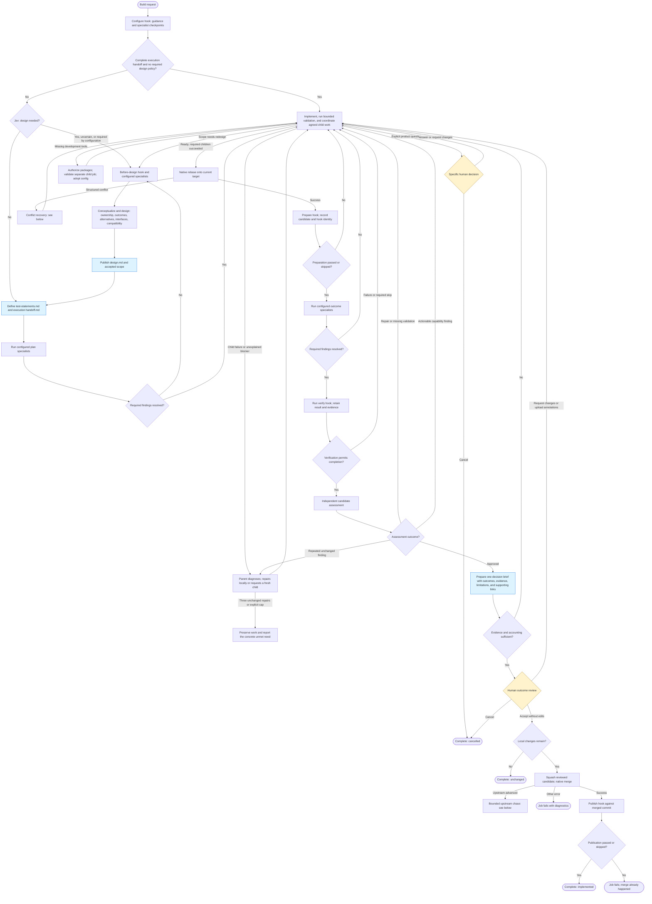
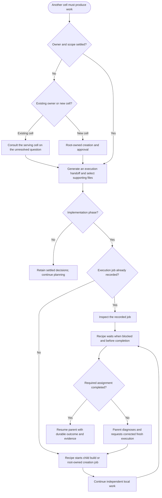

# Adaptive build process

Current flow selected by [build.yaml](build.yaml), implemented in
[recipes/adaptive](recipes/adaptive/README.md). Like the [original diagram](BUILD_PROCESS.md),
boxes group work and diamonds show decisions. Agents determine how to do the work;
the recipe controls phase transitions, prerequisite coordination, validation gates,
review, and publication. Authorized implementation agents can also submit bounded
validation jobs; the recipe returns their results and failures to the parent automatically.

## Main workflow

- **Review:** normally one human outcome review; design has no routine approval gate.
  Specific unresolved decisions can request earlier direction with a current brief.
  Revision needs feedback or uploaded edits; acceptance with edits returns to work.
- **Recovery:** ordinary debugging belongs to the working agent. Failed children,
  invalid target refs, preparation errors, and unexplained blockers return to the
  parent with their available diagnostics. A corrected execution request submits a
  fresh job in the explicit destination cell, starting from its normal target ref.
  It receives a corrected handoff and selected files. The parent can inspect intermediate
  outputs and export a snapshot, then include a reviewed patch for the next writable task
  to apply and retest. Sessions and execution history are not inherited. Cancellation stays distinct and never triggers an automatic retry.
  Three unsuccessful correction turns with the same reason and unchanged candidate
  produce an actionable operational handoff. The default has no fixed implementation
  turn cap; runtime budgets still apply. An explicit `max_iterations` counts substantive
  implementation turns, excluding planning, coordination, waiting, and response correction.
- **Formal evidence:** test statements have stable IDs, expectations, filenames,
  importance, test level, and dependencies. Implementation reports results against
  that baseline; changing the plan requires redesign and preserves existing expectations.
- **Review documents:** exactly one current decision brief is primary. Current results,
  expectations, findings, and selected sources are supporting evidence. Raw execution
  diagnostics remain available without turning the whole inbox into a review bundle.
- **Failures:** verification execution, output, evidence, or mutation failures return
  to implementation. Cancellation remains cancellation. Other fatal errors can stop
  any phase; the chart omits repetitive error edges.

## Cross-cell coordination

Design, test planning, and implementation can request serving consultation. Only
implementation asks the coordinator to submit agreed prerequisite work. This
coordination returns to the current phase. Bounded validation jobs have the separate
submission path described below.

The parent synthesizes settled consultation and planning outcomes into an execution
assignment. It requests `action: execute`, explicit `cell`/`ref`, and `handoff:
work/<assignment>/`. That directory must contain `handoff.md`; only selected files
beneath it are bound at the child's inbox root. Formal statements and exact supporting
contracts belong there when needed. The execution owner can differ from the consultant;
referrals do not require another acknowledgment consultation.

Agents use native job IDs for `replaces` when requesting a corrected attempt. The
coordinator retains submission records for durable replay, follows active or successful
attempts instead of duplicating them, and never automatically retries cancellation.
Design, test planning, and implementation start separate sessions. Consultation gets
its own requester and consultant checkpoints; returning advice preserves the original
working session and unpublished managed candidate. Creation retains root-owned approval
and readiness requirements and does not implement the original feature request.

A self-contained consultation question needs no attached documents. For supporting
contracts, use an optional handoff directory for that question. Historical artifacts
remain on their producing tasks. Subsequent progression turns receive the agent's
selected current files, with the current handoff and formal baseline retained explicitly.

### Agent-submitted validation

The test plan identifies the bounded invocation and evidence needed to establish the
requested outcome. During implementation, agents use `c2j self` to discover the task's
connection, routes, and available actions, and `c2j submit --help` for submission
syntax. Missing optional metadata is not an additional acceptance requirement.

c2j automatically records child submissions. The recipe consumes their native job
IDs, inspects every tracked job, and returns available terminal results before
waiting. Results appear under `inbox/results/<job>/`, with exported files under
`artifacts/`; original failures appear under `inbox/error/children/<job>/`.
A failed execution is returned even if its goal remains OPEN. Pending siblings
remain tracked. Return `wait` when no independent work remains, or `continue` with a
concrete next action. A narrow Jev classification routes status-only continuations to
durable waiting; uncertainty returns a focused response correction. Direct and
coordinator children share status collection. If all children are pending, the current runtime can wait only on
one; prompt wakeup on any child completion needs the runtime addition described in
[recovery runtime requirements](guides/REQUIREMENTS_C2J_PARENT_RECOVERY.md).

Planning, consultation, read-only review, and response correction cannot submit
jobs. Inspection is separate from submission: these tasks can inspect their own job
and direct children. `c2j job log`, `fields`, `artifacts`, and `artifact` expose saved
outputs even when no final result exists. `c2j job snapshot` exports cumulative state
to scratch. The agent selects useful files or a patch; the next writable task reviews,
applies, and retests it. Unavailable saved work permits a fresh start. Parent and sibling
reads are not available to ordinary task tokens; report specific missing inputs instead
of starting another consultation to message the parent.

Persistent worker tools use `packages: [{reference: ..., check: [...]}]`, for example
`check: [go, version]` or `check: [ruff, --version]`. The cell's
`.c2/recipes/hooks/build/package-policy.yaml` can approve exact reference/probe pairs;
other requests get a focused approval. Validation stages the proposed configuration
in a separate child. The parent adopts it only after a successful matching probe and
only if its own configuration has not changed. Bad package setup leaves management
usable. A corrected probe is a fresh validation job and can use an explicit policy
approval. Memory/Docker requests currently return their precise unmet need; dynamic
execution-requirement adoption still needs c2j and provisioner support.

## Native rebase recovery and upstream advancement

Conflict repair and upstream chasing have separate budgets. Neither retries
arbitrary Git failures or repeats publication after an already successful merge.

The agent reconciles the saved delta with concurrent changes; it never performs
the rebase itself. Native state run history supplies iteration and recovery counts.
Verification keeps only current evidence, separate from formal documents.

## Agent instructions, files, and recipe data

Authored prompts and human-review wording live in
[prompts.yaml](recipes/adaptive/prompts.yaml), an empty-sequence include that adds
no worker tasks. Named inputs render ordinary templates. Standing instructions
are supplied when a new session starts; resumed turns receive the current task
and artifact-directory paths. Agents use `c2j self` at task start and recheck after
lease or permission failures.

Each operation receives its own inbox and outbox, outside the repository. The
prompt supplies their actual paths for that turn; paths from another machine or
earlier task are not reusable. Agents write deliverables to the outbox and return
paths relative to it.

- `inbox/error/` contains current failure diagnostics, correction notes, or saved
  rebase-recovery evidence. Native execution logs retain the command, relative
  working directory, and timestamped output with stream labels. Additional setup
  and probe diagnostics remain individually accessible. Recipe summaries, returned
  files, and native diagnostic sets occupy separate subdirectories; original file
  paths are preserved. Child jobs each get their own directory, and logs
  are collected from their native failure envelope as well as returned artifacts.
- `inbox/verification/` uses the same layout for successful check evidence. Hook
  filenames cannot overwrite the generated summary or approved work documents.
- `inbox/feedback/` contains human direction and reviewer feedback. Original
  documents remain available for annotation source links.
- Other inbox documents carry designs, formal test statements, results, and
  consultation evidence. Prompts direct agents to the relevant directories;
  they do not enumerate files or include a serialized workflow-state blob.

Phase, verification requirements, approval decisions, and hook settings remain
recipe data. Helpers receive specific values and read operation outputs and state
history directly. Hooks return values and original artifact references; c2j
enforces their declared output contracts. Existing hook interfaces may still
receive their declared `build-settings.json`, while the main loop uses the
configure outputs it needs. Log text is evidence, not the source of gate decisions.

Public build, creation, and adaptive consultation contracts use schema v2.
Annotations cross includes and child jobs as native arrays with typed artifact
references; sessions use `checkpoint`. No annotation JSON strings or transport
sidecars are needed. Internal helpers without declared input schemas remain
unversioned and already pass native values directly. See the
[schema v2 migration](guides/IMPLEMENTATION_RECIPE_SCHEMA_V2.md) and
[shared prompt notes](guides/IMPLEMENTATION_SHARED_PROMPTS.md).

The adaptive entry and its local helpers do not include kernel recipes. Serving
agreement asks humans only for explicit decisions; failures return to the parent
for correction before an exhausted recovery becomes a concrete handoff. Every review uses a current brief plus its cited and
required evidence, excluding stale briefs and unrelated history. External child
build and root-creation jobs remain explicit integration boundaries.

See the [implementation assessment](guides/ASSESSMENT_AGENT_AUTONOMY_AND_PARENT_RECOVERY.md)
for verified paths, runtime limitations, and differences from the approved plan.
