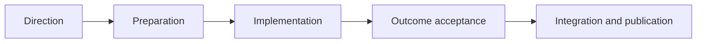
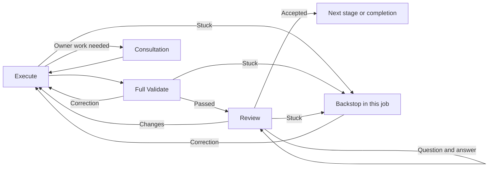

# Adaptive build process

[build.yaml](build.yaml) now invokes [adaptive3.yaml](adaptive3.yaml). The public
wrapper supplies inputs and returns the adaptive3 result. The activity definitions
live in [recipes/adaptive3](recipes/adaptive3/README.md).

## Stages

Each stage uses the same activity cycle:

A scope change can return to Direction. Every return begins at Execute and runs
that stage's full validation. An accepted explanation can finish after Direction.

| Stage | Work | Review |
| --- | --- | --- |
| Direction | Investigate and write a one-pager, consulting owners when needed. | Human decides the direction. |
| Preparation | Develop useful design details and test statements. | Independent agent assesses the plan. |
| Implementation | Change code, run meaningful checks and obtain needed external work. | Independent agent assesses the verified candidate. |
| Outcome acceptance | Explain changes, external work, tests, omissions and API changes. | Human accepts the result. |
| Integration/publication | Use native Git operations and the publication hook. | Agent checks the actual outcome. |

## Human review and files

Questions stay with a read-only review agent. Requested changes carry the original
human words and current uploads to Execute. Human discussion does not consume
an automatic attempt allowance. Only native human input records human acceptance.

The producing agent selects a current `review/` collection and primary document.
Validation checks local links and readable images; agents assess relevance and
truthful claims. Review receives the same artifact identities. Errors remain in
files, and useful older work can be retrieved through native job inspection.

The [todo list](guides/adaptive3/TODO.md) records the agreed follow-ups for human-
directed model changes, incomplete-result correction, and qualitative per-cell
scope in the one-pager with measured code changes in the final review.

## Owners, hooks and recovery

Owner advice runs inline in the receiving workspace, including nested advice.
The receiver writes the delivery assignment. Native child submission and waiting
retain the actual outcome. A child failure returns the parent to resolution.
Helping a still-open child remains a [runtime requirement](guides/adaptive3/RUNTIME_REQUIREMENTS.md).

The configure, before-design, prepare, verify and publish hooks retain the
[existing cell-owned API](guides/BUILD_HOOKS_USER_GUIDE.md). Required verification
cannot be waived by model judgment. Package requests receive policy or human
approval before a fresh probe job runs, then the tested configuration is adopted.

An unchanged rebase can reuse its native approval after full validation. Publication
recovery preserves an already completed merge. Ordinary caught failures enter the
same-job backstop; human cancellation stays terminal. Template/schema failures
and unavailable runtime infrastructure are not universally recoverable yet.

Backstop diagnoses completed effects, remaining work and separate failure
boundaries before recommending recovery. It investigates within existing authority
and resumes concrete available corrections within the existing limits. Apply is
offered only for an available action at an allowed stage with readable evidence;
diagnosis and external prerequisites support discussion without execution. Questions,
settings changes and fresh approval cannot supply missing technical capabilities.
New human text and attachments are reconsidered while retaining completed effects
and prior approvals.

## Implementation and validation

See the [implementation assessment](guides/adaptive3/IMPLEMENTATION.md),
[tests and environment limits](guides/adaptive3/TEST_RESULTS.md),
[actual review examples](guides/adaptive3/results/README.md), and
[default rollout](guides/adaptive3/ROLLOUT.md).

The previous [adaptive2 process](ADAPTIVE2_BUILD_PROCESS.md) and explicit
[adaptive2 entrypoint](recipes/adaptive2/build.yaml) remain available.
