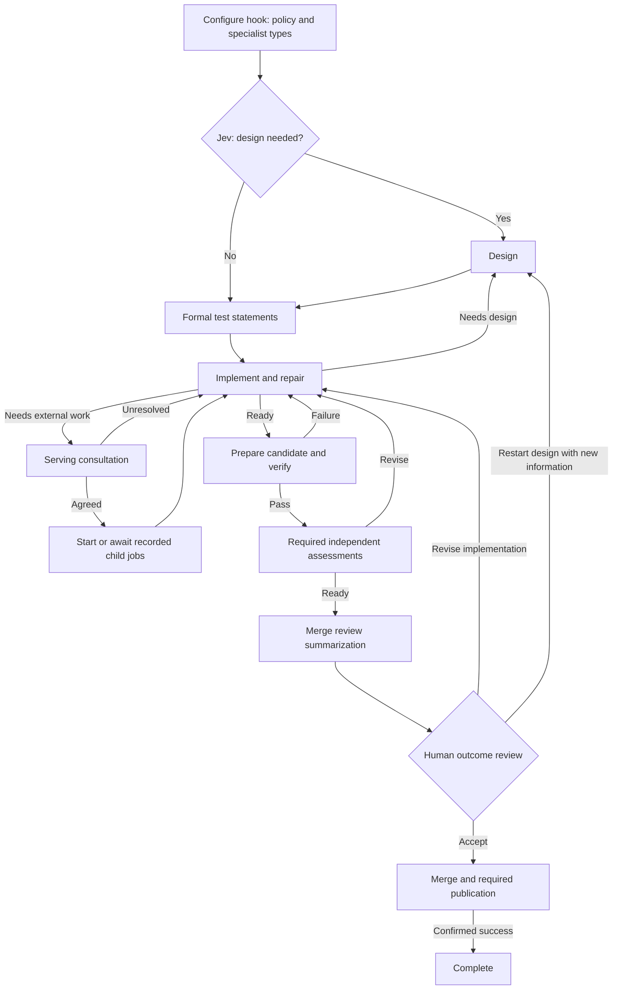

# Brainstorm: a simpler build workflow

Proposal that informed the [adaptive implementation](ADAPTIVE_BUILD_PROCESS.md).
Based on [the prompt inventory](BUILD_PROMPTS.md) and [original flow](BUILD_PROCESS.md).
Recipe changes belong here; changes to runtime operations belong to c2j/c2ops.

## Direction

One adaptive workflow. Jev decides whether design is needed; there is no light/heavy
split. Agents investigate, design, implement, test, and repair. The recipe controls
verification, durable child jobs, iteration limits, human decisions, and publication.

**Normally one human review per job, at completion.** Design and test statements
are formal artifacts, not automatic human approval gates. Earlier human input occurs
only when an agent requests specific direction or an iteration limit is reached.

## Seven compact prompt roles

| Role | Responsibility |
| --- | --- |
| Jev | Decide whether this cell's work needs design before implementation. |
| Design | Define behavior, scope, alternatives, interfaces, and acceptance outcomes. |
| Test statements | Define and maintain formal expectations before implementation. |
| Work | Implement, test, and repair within scope; consume feedback and child results. |
| Assess | Independently inspect design or implementation; report concrete findings. |
| Serving consultation | Agree bounded work with another cell before starting its job. |
| Merge summary | Produce the final human review document from the actual candidate and evidence. |

These are maintained templates, not seven mandatory calls on every pass. Reuse the
work prompt for verification failures, rebase repair, and response correction.
Keep merge summarization as a distinct step; do not replace it with raw agent output.

There is no generic consultation stage in every local work loop. **Keep the upfront
configure hook:** it declares applicable specialist consultation types, when they
run, and whether their findings are required or advisory. Use the assessment role
for those assignments. Other-cell jobs always go through serving consultation.

## Explain cells simply

Include this short explanation in the working prompts:

> A cell is one repository with a responsibility. Read PURPOSE.md when present;
> otherwise infer that responsibility from the repository. A task directory does
> not change ownership. Do local work here. If another cell must change, request a
> serving consultation with the desired outcome and a stable request key. After
> agreement, the workflow starts and tracks its job. Continue independent work;
> wait when its result is needed. Check recorded requests before starting more work.
> Propose new cells through the project root. Creating a cell establishes ownership;
> implementing its features is separate work. The workflow owns job submission and
> publication.

Using an existing dependency does not itself require consultation. Request one when
another cell must produce new work. Preserve agreed scope, job IDs, and outcomes
across retries and redesign; never launch duplicates merely because a turn restarted.

## Proposed flow

Configured specialists also run at their declared earlier milestones. Agents can
request focused human input from any phase; iteration limits can pause for direction.
Neither creates a routine design-review requirement. Cancellation remains explicit.
Unresolved required children block completion through durable waits, not agent polling.

## Formal test statements remain essential

Every implementation path establishes test statements before code changes, including
work that skips design. Persist that baseline as an artifact before implementation;
this is a deterministic handoff, not another human review.

- Markdown statements, each at most 30 words, describing expected behavior.
- Annotate filenames, priority, unit/integration level, and required dependencies.
- Include positive and negative cases for critical behavior and integration boundaries.
- Use stable statement IDs; report passed, failed, skipped, or not-run with evidence
  against those IDs. A command succeeding does not automatically satisfy every statement.
- Add statements for new behavior. Preserve existing expectations; changes or removals
  require an explicit deprecation plan, not weakening tests to make a build pass.
- Redesign revisits the statement set and records additions and permitted changes.
  Verification and assessment use that version; the final review exposes gaps.

## Defined review documents and c2j annotations

| Document | Required content | Presentation |
| --- | --- | --- |
| `merge-review.md` | Outcomes, grouped change accounting, verification, unresolved risks, child outcomes, proposed commit message | Overview; primary, first |
| `test-statements.md` | Identified expectations and their required annotations | Primary |
| `test-results.md` | Statement-by-statement results, evidence references, skips and limitations | Primary |
| `design.md` | Scope, choices, interfaces, acceptance outcomes; present when design ran | Supporting; primary when reconsidering design |
| `implementation.md` | Delivered behavior, rationale, deviations, limitations; no-change justification when applicable | Supporting |
| `assessment.md` or named specialist reports | Findings, severity, evidence, and disposition | Blocking findings primary; otherwise supporting |
| Candidate diff, command stdout, logs, hook reports | Exact changes and underlying evidence | Supporting or diagnostic as appropriate |

**Use c2j review-item annotations to organize the review**, including meaningful
`title`, `description`, `role`, `order`, and source-document references. Bind annotations
to the actual artifact identities and preserve them through child-result handoff.
Select `merge-review.md` as the overview. Surface unresolved findings and skipped
critical tests prominently; do not bury them in diagnostic logs or sort by filename.

The summarizer reads these documents and actual candidate data, produces the overview,
and supplies presentation annotations. It must preserve adverse findings and distinguish
reported results from verified evidence. The recipe validates required document bindings
and candidate identity; it does not add another model task to review the summary.

The human form offers **accept**, **revise implementation**, **restart design with
additional information**, and **cancel**, with feedback and attachments. Restarting
design carries that direction into design and test statements, preserving useful work
and recorded children. Revised work returns to this same outcome milestone.

## Hooks: return values and report artifacts directly

A hook runs once and returns typed values such as status and summary, plus report
artifact references. The state machine reads those values and chooses the next path.
**No second task inspects, reformats, or revalidates the report contents.** Reports
are evidence for agents and human review, not another routing protocol to parse.

Validate the output contract and artifact references at the existing invocation
boundary. Hook load, execution, schema, or binding failures become structured failures;
any verify-related failure returns to implementation. Cancellation stays cancellation.
Choose a configured alternative only when selecting the implementation, never silently
after a failing verifier. Required verification cannot succeed by being skipped.

Keep configure upfront. Preparation may change the candidate; verify the resulting
candidate. Use existing runtime metadata and mutation enforcement, avoiding extra
shell tasks merely to capture state or render a report. Do not introduce a new hook
adapter just to read artifacts the hook already returned.

## Small state in inputs and outputs; documents in artifacts

Pass request, phase, session reference, action, counters, child keys/IDs/status,
approval identity, and compact failure details through typed inputs and outputs.
Keep durable orchestration state in the recipe/runtime. Do not introduce `context.json`,
`feedback.json`, or similar files just to move a few fields between tasks.

Use artifacts for designs, test statements/results, review documents, diffs, logs,
command stdout, and substantial transcripts. Small outputs carry their references.
A resumed agent gets the current typed inputs and relevant artifacts; it should not
need to reconstruct workflow state from prose or synchronize a separate state file.

## Boundaries to retain

- Consult before starting other-cell work; record stable request keys and job IDs.
  Reconcile uncertain submission before retrying. Require acceptable child outcomes.
- Verification applies to the actual candidate. Failed checks and malformed hook
  outputs return to work with evidence; failed report plumbing never becomes success.
- Approval reuse after rebase remains allowed when the reviewed change is equivalent.
  Reverify the rebased candidate; material changes require renewed outcome review.
- Rebase conflict repair uses native structured diagnostics and known restored state.
  Unknown workspace state requires reconciliation rather than blind continuation.
- A successful merge followed by publication failure is incomplete, not success.
  Recover publication without repeating already completed effects.

Prototype one loop alongside the existing recipe. Measure tasks and human interruptions,
not just prompt count. Preserve negative tests for these boundaries, test-statement
traceability, annotated review ordering, and restarting design from outcome review.
