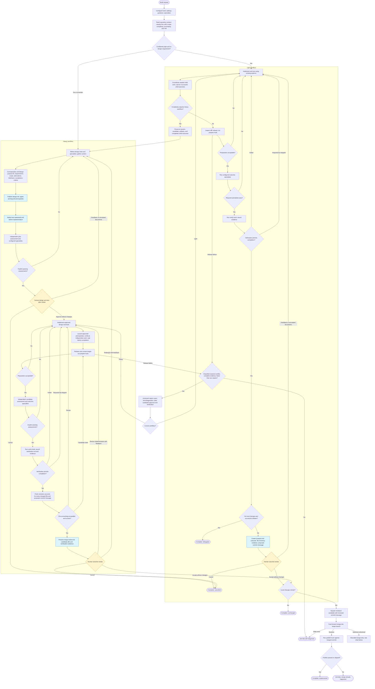
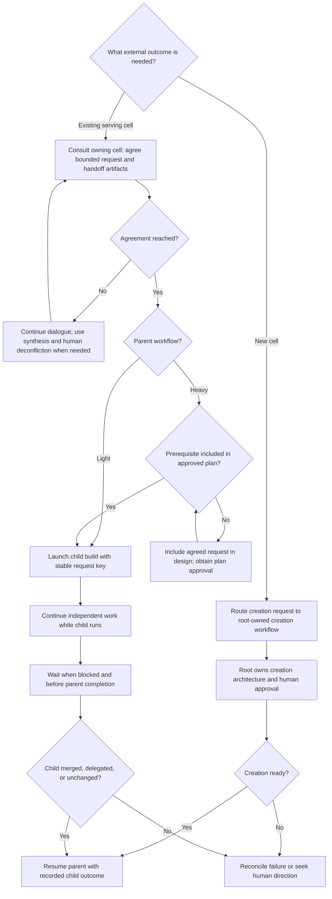
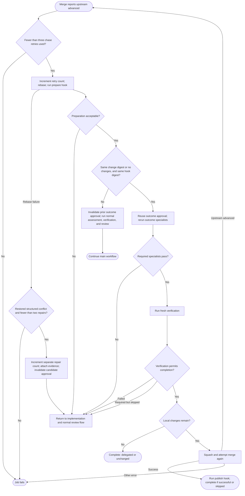

# Build recipe process

Conceptual view of [build.yaml](build.yaml), the
[light workflow](recipes/light/develop.yaml), and the
[heavy workflow](recipes/develop/develop.yaml). Boxes group related operations;
diamonds show decisions. This documents the current recipes, not a proposed flow.

## Main workflow

- **Light selection:** usable context and a valid Jev probability of heavy work
  between 0 and 0.10. `require_design` or configured design-stage specialists force
  heavy. Classification concerns this cell's work, not the size of the overall project.
- **Conceptualization:** part of heavy design, rather than a separate recipe phase.
  Design covers alternatives, compatibility, acceptance criteria, and ownership.
  A missing `PURPOSE.md` does not block work; repository evidence supplies context.
- **Clarification and ownership:** during agent work, focused questions pause and
  then resume the current phase. Answers do not approve a plan. A request outside
  the cell's purpose can finish with `outside`; light first settles launched children.
- **Verification:** skipped checks permit normal review unless
  `require_verification` is true. Required skips and hook execution, validation,
  or report failures return to implementation with diagnostics. Cancellation
  still stops execution. Light delegated outcomes also pass through
  preparation, specialists, and verification. Heavy no-change outcomes still
  require independent assessment and human acceptance.
- **Review:** approval accompanied by feedback or uploaded edits requires revision
  and another review. A revision selection without actionable feedback repeats the
  review prompt. Required specialists must explicitly pass.
- **Recovery:** correctable agent-output errors get up to two automatic corrections,
  then human direction. Dependency failures require reconciliation rather than
  silently completing or duplicating child jobs. Execution errors can fail a job
  at any stage; the chart does not draw every error edge.

## Cross-cell coordination

This flow can interrupt agent work and then return to its current phase. Heavy
design must identify agreed prerequisite keys before plan approval; implementation
can launch only approved prerequisites. Light has no local plan-approval gate.

Creation also follows the parent's applicable prerequisite approval rules.
Each child build classifies its own work. Completed outcomes and stable request
keys are retained across retries and light-to-heavy escalation.

## Merge retry when upstream advances

Both paths catch `MERGE_UPSTREAM_ADVANCED` from the merge operation and allow at
most three upstream-chase retries. This is a targeted recovery path, not a retry
of arbitrary merge or publish failures.

Fresh review follows the selected path: light produces a synopsis; heavy performs
independent assessment and file accounting. Light delegation without local changes
retains its normal exception to local outcome review.
