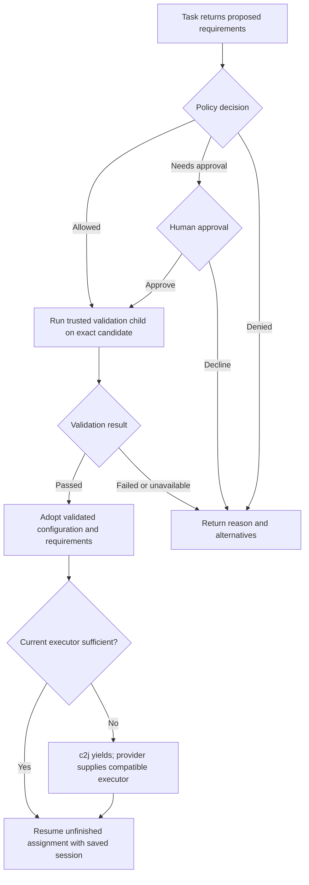

# Adaptive environment requirements

Brainstorm, 2026-11-04. This describes options, not implemented recipe behavior.
Checked against c2j main `5ba2aea`. Recipe requests, policy routing, review, and
validation belong to this cell. Runtime control contracts belong to c2j; actual
allocation and enforcement belong to the executor/provider.

## Starting point

Treat an environment requirement as a normal reason to hand control back to the
recipe: “I have preserved my work, but need these requirements to continue.”
c2j already supports durable requirement changes and suspension/resumption. We
need to expose that capability appropriately to agents and recipes, rather than
invent another job-restart mechanism.

There are three distinct decisions:

1. **Request:** what does this work need, and why?
2. **Authorize:** may this job use it, and may it become a cell default?
3. **Activate:** validate the approved environment and continue under it.

An existing, approved requirement that the current worker cannot satisfy should
use c2j's ordinary environment handoff without another review. A new requirement
outside the approved policy must reach the recipe's decision path before it
becomes an active runtime directive or triggers installation/provisioning.

## What exists today

| Mechanism | Current behavior | Consequence for this design |
| --- | --- | --- |
| `ops.SuspendExecution` | A Go operation attaches a requirement directive to a successful durable result. Subsequent unfinished work checks the new requirements. | Reuse the runtime mechanism after authorization. It does not suspend a running process stack or save an unfinished agent conversation by itself. |
| Scoped `execution_needs` | Nodes can require resources, packages, images, platforms, and capabilities. Resource/image/platform values support expressions. | Prefer scoped needs for temporary work; leaving the scope restores enclosing requirements. |
| Job-wide directives | Durable directives survive replay and override node requirements; capabilities accumulate. | A convenient continuation mechanism, but a poor default for temporary capabilities that should disappear afterward. |
| `.c2/config.yaml` packages | Each live task loads packages from its restored workspace before its operation body. | Repository edits affect later tasks, not the already-running agent. Retrying a task uses its original input snapshot. |
| Workspace submissions | `--from-workspace` captures the task's incoming state; `--from-workspace-now` captures current edits. | Use the latter when validating a candidate assembled during the submission task. Neither pushes changes. |
| Child jobs | Submission records lineage automatically; the recipe must wait and evaluate the result. | Validation can use a real child without asking agents to maintain child-ID lists. |
| Environment handoff | An insufficient executor yields the same job with `environment_required`; an external provider resumes it. | A successful handoff is not successful validation. |

The inspected cell config supports `packages`, but does not yet define general
cell-level CPU, memory, or Docker requirements. A broader cell environment contract
would be an addition. Also, current node package/capability lists are literal;
arbitrary approved lists cannot simply be substituted like a memory expression.

Sources: [execution lifecycle](https://github.com/colony-2/c2j/blob/5ba2aea/GUIDE-Execution-Tracking.md),
[tools and repository config](https://github.com/colony-2/c2j/blob/5ba2aea/EXECUTION_TOOLS.md),
[workspace submission](https://github.com/colony-2/c2j/blob/5ba2aea/README.md#starting-from-workspace-state),
[capabilities](https://github.com/colony-2/c2j/blob/5ba2aea/pkg/execution/README.md#execution-capabilities),
[node resolver](https://github.com/colony-2/c2j/blob/5ba2aea/pkg/template/execution_needs.go), and
[config fields](https://github.com/colony-2/c2j/blob/5ba2aea/pkg/config/config.go).

## Options for presenting requests to the recipe

| Option | Shape | Advantages | Limitations |
| --- | --- | --- | --- |
| Agent response outcome | Add `next: environment` and a proposed config artifact or native requirements to the response schema. | Small recipe change; naturally preserves the session and completed work before review. | Only agents using that response contract participate. Does not cover a process killed before it returns. |
| Standard task control outcome | c2j exposes a durable `requirements_requested` control outcome, separate from ordinary outputs and failures. | Commands, extensions, and agents share one recipe-visible signal. The recipe can approve, decline, or revise it. | Needs a public contract and a clear distinction between requesting approval and applying an authorized directive. |
| Direct suspension by the operation | A trusted operation applies already-authorized requirements through the existing runtime mechanism. | Minimal orchestration for known requirements; continuation is already durable. | Applying arbitrary agent requests immediately would bypass approval. It also does not establish cell defaults. |
| Proposed config plus adoption | The task returns a candidate `.c2/config.yaml` and asks to adopt it for subsequent work. | A persistent, reviewable source of requirements; useful across sessions and future jobs. | Must stage the proposal outside the active config, validate it, and define when it becomes effective. |

These can compose. A useful long-term shape is a standard task request whose
payload identifies a candidate config; the recipe authorizes it, validates it,
then uses c2j's existing suspension mechanism when adopting the requirements.
An agent response outcome can implement the first version of that interaction.

The requesting operation can finish successfully as a durable step while the
business assignment remains incomplete. Preserve its session, workspace changes,
and artifacts, then resume a new invocation of the unfinished assignment. Do not
model this as an arbitrary execution failure and blindly retry the same task.

## Persistence: scope and configuration

Requirements may have different lifetimes:

| Scope | Persistence |
| --- | --- |
| One validation or implementation scope | Approved recipe state and scoped execution needs; discarded on scope exit. |
| Remaining job | Recorded authorization and effective requirements; survives session changes and replay. |
| Future work in this cell | Reviewed `.c2/config.yaml` committed and merged through normal cell integration. |

Session state is not the source of requirements. For future jobs, an unmerged
config change is only a candidate. Jobs pinned to an older snapshot do not
automatically adopt newly merged defaults.

Two plausible persistent shapes:

- **One cell default:** extend `.c2/config.yaml` with resources and capabilities
  alongside existing `packages`. Simple, but may give every task an expensive
  environment even when only integration tests need it.
- **Defaults plus named requirements:** retain common packages and declare named
  requirements for work such as integration tests. The recipe explicitly selects
  the relevant requirements. More expressive, but introduces selection semantics.

Illustrative second shape, **not current c2j syntax**:

```yaml
packages:
  - uv:ruff==0.11.2
environments:
  integration:
    resources:
      memory: 16Gi
    capabilities:
      - docker
      - docker.workspace-mounts
```

The package version illustrates pinning, not a version recommendation. Python
libraries imported by the project still belong in its dependency manifests;
uv tool declarations supply CLI applications. Docker client software and a usable
Docker service are separate requirements.

For either shape, specify precedence between cell defaults, selected requirements,
recipe nodes, submission overrides, and durable directives. Validate the effective
requirements, not just the proposed file. An existing job override must not
silently neutralize a newly approved requirement, and child jobs must receive
the required execution settings explicitly rather than assume parent inheritance.

## “Move to the new config” needs an activation boundary

Writing `.c2/config.yaml` immediately and asking for approval afterward is too
late: the next task may install its packages before its review code runs. This
also creates a recovery trap if the new package cannot be installed.

Prefer a staged proposal under the existing artifact conventions:

```text
outbox/environment/c2-config.yaml   proposed complete config
outbox/environment/request.md      reason, intended scope, and blocked work
```

The proposed config is the source of the change; do not also copy the entire
config into the agent response or an additional workflow-context document. Return
the normal artifact references and a small control outcome. For temporary needs,
a native requirements value is sufficient; no config file is required.

The recipe compares the candidate with the active config, preserves unrelated
settings, evaluates policy, and asks for human approval only when necessary.
Changes to discovery, credentials, or policy are not ordinary tool additions.

After approval, validate a candidate workspace while the parent retains its
working config. On success, adopt the exact validated candidate for the parent
continuation. Keep that config edit in the ordinary changeset for final review
and merge. “Adopt” must mean an explicit config/workspace revision, not whatever
the file or branch contains when a later task starts.

This is a desired contract. Existing workspace submission captures the workspace
it is given; it does not itself provide an atomic stage/validate/adopt transaction.
Possible implementations include a separate candidate workspace with explicit
handoff, or a c2j-supported candidate config overlay. We should verify the simplest
supported workspace path before introducing a new operation.

## Validation child: start with echo, then test the claimed capability

The proposed order is:



No speculative install, execution, or provisioning before policy authorization
or human approval. Static parsing and diff inspection can precede approval.

Use a trusted, pinned validation recipe, independent of any recipe changes in the
candidate workspace. Submit the approved workspace snapshot with the equivalent
of `--from-workspace-now` after assembling its proposed config. A submission from
the configured branch would miss unmerged changes; `--from-workspace` would miss
edits made during the submitting task. Keep the parent lineage and consume the
runtime-recorded child output. Do not merge or publish from this child.

An echo operation is a useful first probe: reaching its body establishes that
the worker admitted the requirements and completed package preparation. It does
not establish that Docker can run a container, workspace mounts function, or a
tool can perform the intended work. Add bounded, known probes as appropriate:

- A tool's version check or a small operation using its native libraries.
- A provider-approved Docker image that runs and is removed afterward.
- A temporary workspace marker round trip when mounts are required.
- Provider-reported memory capacity and, when useful, a bounded representative
  test. Avoid filling all requested memory merely to prove it exists.

The recipe should select probes from trusted definitions. Arbitrary agent-supplied
shell code is not implicitly authorized by approval of a memory or package change.
Include permitted image pulls, network use, and cleanup in the validation policy.

The result must identify the tested workspace/config, effective requirements,
validation recipe, and resolved tools/image identities when available. Use native
job provenance and output fields where possible. A pass applies to those inputs;
a changed proposal or relevant policy requires reevaluation. Pinned dependencies
make reuse more reliable, but a previous pass never guarantees a later provider
is healthy. The resumed task still needs normal runtime admission and setup.

## Avoiding excessive human reviews

Define an approval policy owned by the project or platform administrator. The
recipe evaluates it; the agent cannot grant itself additional authority by
editing a policy in the same candidate config.

If policy is stored in Git, load the trusted approved policy revision, not the
agent's proposed version. An administrative ceiling should still apply. Proposed
policy changes go through their own authorized review and cannot authorize their
own validation run.

Useful policy dimensions:

| Dimension | Example decision rule |
| --- | --- |
| Package sources and identities | Auto-approve approved pinned tools from approved sources; review new sources or identities. A trusted registry alone is not a blanket approval of all packages. |
| Resources | Allow up to an absolute CPU/memory/storage ceiling, with job-wide cost/time limits; review increases beyond it. Avoid repeated small increases bypassing the ceiling. |
| Capabilities | Allow explicitly listed facilities; request approval for Docker or workspace mounts if not already granted. Privileged Docker and KVM require separate decisions. |
| Lifetime | Permit a temporary test environment without automatically approving a permanent cell default. |
| Validation | Allow specific probes, images, network destinations, and cleanup behavior. |
| Reuse | Reuse a grant for the same candidate requirements, scope, and policy revision; do not ask again on every continuation or provider handoff. |

The human reviews the concrete delta once: “Use 16 GiB and Docker workspace mounts
for integration validation; retain these as the cell's integration requirements.”
They can approve temporary use only, approve persistence too, or decline. Final
outcome review shows the adopted change and evidence without requesting the same
environment authorization again. A failed probe under the same grant can retry
within a bounded budget; expanding the request reevaluates policy.

## Failure paths that need deliberate handling

- **No suitable executor:** remain waiting or request operator direction with a
  bounded timeout; do not repeatedly dispatch onto the same insufficient worker.
- **Package preparation fails:** preserve the parent's working config and attach
  native diagnostics under `error/`. A recovery task must be able to run without
  loading the broken candidate's packages.
- **Agent dies before requesting:** an OOM or lost process cannot return a useful
  request. Use provider termination evidence to propose recovery; exit code 137
  alone does not establish an OOM. Do not silently escalate resource limits.
- **Candidate changes after approval:** reevaluate authorization for the changed
  requirements and rerun affected validation. Never apply untested config bytes.
- **Human declines:** return the reason through `feedback/`; continue feasible
  independent work or stop blocked, preserving required validation expectations.
- **Replay or repeated submission:** reuse native durable results and child
  lineage; do not create another validation child or approval on every resume.

## Suggested direction and remaining questions

Prefer the hybrid: an explicit environment request, staged cell config for lasting
changes, policy-first authorization, a trusted validation child, then deliberate
adoption using c2j's existing continuation mechanism. Allow scoped temporary needs
without forcing every request into the repository's permanent configuration.

Before implementing, settle these contracts:

1. **Recipe-visible request:** start with an agent outcome, or add a standard task
   control outcome that all operations can produce? Keep requests distinct from
   authorized runtime directives.
2. **Cell requirements:** add flat defaults first, or named environments? Which
   operations select them, and what does configuration adoption mean for a job
   whose recipe source and workspace history are already pinned?
3. **Candidate validation:** can existing workspace scopes produce an isolated,
   exact candidate and adopt only the validated config afterward? If not, define
   that capability in c2j rather than rely on temporary edits to the active file.
4. **Dynamic requirements:** expose approved package/capability values to recipes
   and preserve scoped behavior; avoid a permanent union of every temporary need.
5. **Policy authority:** where is the trusted policy, who can change it, and how
   do provider ceilings remain effective for child jobs and direct submissions?
6. **Recovery and inspection:** provide a minimal preparation-recovery path and
   show current requirements, actual allocation, and configuration revision in
   `c2j self`, with unknown values represented explicitly.

The recipe can own the decision loop. c2j already owns suspension and replay;
the provider must implement allocation, capability readiness, limits, and cleanup.
The first implementation should test approval-before-use, rejected requests,
successful adoption, failed preparation, changed candidates, and resumption
without repeated approvals or duplicate validation children.
