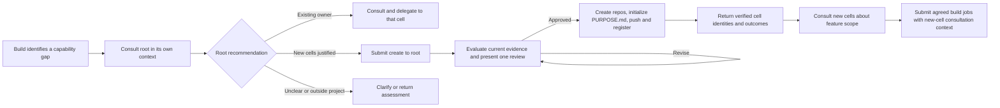

# Goal: a small recipe kernel for building software and creating cells

Status: consolidated goal for design and implementation planning, 2026-10-20.
Build, consultation, and the shared [create entrypoint](../create.yaml) are implemented.
See the [current workflow](../README.md) and native recipe suites.
Build defaults to the shared create selector and carries root's consultant
checkpoint into its consolidated proposal review. Creation uses c2j empty
workspaces and ordinary first publication through gitvend.
This document retains the complete target design. It incorporates the
[cleaner review proposal](PROPOSAL_REVIEW_UX.md) and supersedes that draft's
assumptions about `evolve` and mandatory mandate initialization.

## Intended outcome

Provide a small set of reusable workflow units that compose into:

- **`build`**: build the requested software.
- **`create`**: evaluate and create one or more new cells, served by the project's
  root cell.

Agents exchange substantial context as artifacts, return structured decisions
through the Codex op's schema support, and ask people for direction through
native reviews containing useful assets and focused questions. Recipes remain
responsible for orchestration, authorization gates, and correct continuation.

## Decisions established by this goal

| Area | Target behavior |
| --- | --- |
| Human interaction | Use native reviews: assets, actual questions, and explicit user direction. Remove result dumps and redundant one-option decisions. |
| Model results | Supply the Codex op's output schema and consume its validated response. Remove duplicate recipe-level schema validation. |
| Development entrypoint | Keep `build`; remove `evolve` and its mode-specific prompts, defaults, and branches. |
| Cell purpose | Read root `PURPOSE.md` when present. Otherwise infer purpose and responsibility contextually; its absence does not trigger setup or block work. |
| Context exchange | Put substantial briefs, findings, feedback, and evidence in artifacts. Keep short control values typed and inline. |
| Expression authoring | Prefer native maps/lists, direct references, and readable multiline YAML over string-built JSON. |
| New cells | Consult the root cell, then submit an agreed request to its shared `create` recipe as a prerequisite job. |
| Root installation | Supply root-specific consultation instructions and the shared recipe at execution time; require no copied workflow boilerplate in every root repository. |
| Session setup | Use Codex `instructions` for stable cell guidance on new sessions only; send current task content and changes through `prompt` and artifacts. |
| Consultation | Reuse one recipe conversation atom for cell changes, root eligibility, and expert advice; the target consultant assesses agreement. Allow four iterations by default, then summarize unresolved disagreement for expert review. |
| Progress and waiting | Pursue independent work and consultations before yielding; distinguish schedulable consultation work from a blocked outcome that requires waiting. |
| Job handoff | Carry the serving cell's consultation context, agreement, and assets into the actual job as starter context. |

## Reusable units

These are conceptual boundaries. Use existing ops directly where sufficient;
extract recipe fragments where they remove repeated policy or orchestration.
Avoid replacing the current complexity with a universal recipe full of flags.

| Unit | Responsibility |
| --- | --- |
| Agent turn | Run or resume Codex with initial session instructions, a current-turn prompt, bound assets, and an output schema; expose its result, artifacts, and session. |
| Human review | Present current assets and questions; return the exact answers and attachments to the requesting continuation. |
| Consultation | Sustain a bounded conversation between separate requester and consultant sessions, exchange artifacts, and return the consultant's agreement decision or an explicit unresolved disposition. |
| Prerequisite job | Submit agreed work with the serving consultation's starter context, track its outcome, and wait only when progress requires it. |
| Verification | Execute appropriate checks and publish evidence that distinguishes passed, failed, and skipped checks. |
| Integration | Apply the relevant approval and verification conditions, then use native Git operations to integrate the candidate. |

Design, test planning, implementation, and independent inspection specialize the
agent turn with instructions, assets, and result contracts. `build` composes
these units. `create` reuses them with a different evaluation and creation flow;
it need not inherit every development checkpoint.

## 1. Cleaner reviews

Implement the review proposal using the existing c2j/Cortex capabilities.

- Put rationale, proposals, and evidence in review assets. Use question fields
  for the specific answer or judgment needed now.
- Let the producing agent supply explicit questions for `ask_user`; do not
  extract them later from a generic summary or render its result object.
- Use real choices where alternatives are known and text where an open answer
  is necessary. Answer-only reviews need no extra “Revise” selection.
- Keep plan approval and merge acceptance as explicit recipe-owned decisions.
  Explain what proceeding will do.
- Show relevant, current documents and appropriate upload fields. Explain why
  insufficient responses need another answer. Support attachment-only feedback
  where a document is a valid response.
- Return answers to the phase that asked. Preserve scope approval, independent
  review, and verification requirements after changes.
- Keep original assets immutable. Annotations request revision and another
  review; they do not approve a silently changed candidate.

No new form protocol is assumed. Validate actual forms in Cortex before
requesting any additional renderer or input capability. Automatic author/critic
repair loops remain a separate policy decision from this presentation work.

## 2. Codex owns response-schema enforcement

The inspected Codex manifest exposes **`inputs.output.schema`**, optional
`output.max_repair_attempts`, and a validated **`outputs.response`**. Use that
contract for agent and consultation results. Confirm the published package
revision used by the recipes includes it.

Remove schema text injected into prompts solely to enforce output shape, the
secondary JSON-schema gate, and the `result.json` write/read path where it exists
only to recover the structured answer. Prompts still explain task semantics,
such as when to ask a question or request a consultation.

Check the op's execution/validation outcome before consuming its response.
Exhausted repair, failed execution, and missing responses must follow explicit
failure handling. Do not rebuild schema repair inside the recipe.

Retain checks for workflow meaning and real-world effects: required artifacts,
approved scope, completed dependencies, tests, and permission to merge or create
a repository. A schema-valid answer does not establish those facts.

## 3. One development recipe and contextual purpose

`build` is concerned with building the requested software. Recipe development,
workflow self-modification, and an evolve mode are outside this workflow's remit.
Remove `evolve.yaml`, evolve-only instructions and fixtures, `mode` branches, and
redundant type inputs where their only purpose is that distinction. Preserve
useful task targeting and deployment-time recipe specialization; do not instruct
the build agent to author or evolve its workflow. Coordinate named-recipe/default
changes with c2j.

Replace `.c2j/mandate.md` expectations with the following instruction:

> This cell encompasses the entire repository. Read `PURPOSE.md` at its root if
> it exists. Use it, the repository's contents and history, project context, and
> relevant consultations to evaluate the cell's purpose and responsibilities.
> If it is absent, infer that context from the available evidence. Distinguish
> observations from uncertain inferences and ask about genuine scope ambiguity
> when needed. Missing documentation alone is not a blocker.

`PURPOSE.md` is not a path allowlist or comprehensive dependency catalog. Discover
dependencies through normal project tooling; use c2j's cell listing to identify
relationships we may influence. Do not assume inferred context authorizes
unrelated work or a unilateral expansion of another cell's responsibilities.

Delete the mandatory setup check, mandate-construction child build, bootstrap
flag, and associated refresh path. Native refresh remains useful elsewhere;
removing mandate setup does not remove the Git operation itself. New cells get
an initial `PURPOSE.md` as an explicit output of creation. Existing cells need
not manufacture one before ordinary builds can proceed.

## 4. Artifacts and a smaller agent interface

The current `agent.yaml` has separate context, evidence, feedback, dependency
history, consultation history, and review-response inputs, several serialized
as JSON and woven into the prompt. Much of that is content for a particular
turn rather than a permanent part of the generic agent interface.

Move substantial content into bound artifacts. A small working convention could
use `brief.md`, `feedback.md`, and `review.md`, plus the actual design, test
statements, implementation summary, and verification evidence. These names are
roles, not a requirement to emit every file on every turn. Reuse filenames across
invocations; c2j's producer references preserve distinct revisions. Bind two
simultaneously needed versions under distinct local names or directories.

Keep phase, target, session, output schema, child-job identity, and routing
decisions as typed control data. Keep structured answers and artifact references
structured when the recipe must inspect them. Do not make the workflow read
Markdown to discover what state to enter, or replace seven inputs with one opaque
file containing seven unrelated sections.

The target is a small common agent interface plus explicit artifact bindings.
Short instructions and questions can remain inline. Phase-specific assembly
belongs near the phase that knows which evidence matters. Keep consultation and
dependency session/history state in orchestration rather than repeatedly dumping
it into the agent's prompt.

### Initial instructions; skills as a separate packaging decision

Move stable cell dynamics into Codex's **`instructions`** input: repository-wide
cell context, optional `PURPOSE.md`, ownership boundaries, consultation-before-job
requirements, and the obligation to continue useful work before waiting. The op
applies these only when creating a session; resumed turns use their recorded
instructions. Establish consultation purpose, role, and phase permissions once
per participant, using its first prompt when entering an existing session.
Follow-ups carry new messages, file pointers, and new expert direction without
repeating setup or the full artifact inventory.

This is a change from the present recipes: `agent.yaml` and `consult.yaml` reuse
the same long context-bearing prompt on fresh and resumed turns. The inspected
local Codex manifest and implementation already contain the new-session-only
`instructions` behavior; confirm the published package before implementation.

The separate [instructions and skills discussion](PROPOSAL_AGENT_INSTRUCTIONS_AND_SKILLS.md)
compares comprehensive initial guidance, a small mandatory core plus optional
expertise, and extensive skill-based guidance. Recommend the small core plus
optional expertise. This choice does not change consultation orchestration:
recipes own the dialogue, session separation, iteration budget, and gates under
all options. Each profile supplies sufficient role prompts and assessment criteria
without requiring a skill. Skills may enrich domain analysis; they do not carry
the consultation protocol.

## 5. Clearer expressions before more functions

Use CEL maps/lists and direct artifact references. Serialize once at a boundary
that actually requires text. Avoid `json_parse(json_stringify(...))` round trips
and constructing JSON objects by concatenating strings.

For example, the existing helper can combine document maps directly:

```yaml
documents: >-
  ${{
    jq(
      [
        state_output("design", "review_documents", {}),
        state_output("test_plan", "review_documents", {})
      ],
      "add"
    )
  }}
```

This illustrates the target authoring style, not a tested implementation change.
Use `|-` for prose and `>-` for readable expression blocks. Export named outputs
at composition boundaries; do not duplicate long expressions to reach through
other containers. Existing artifact bindings already support local naming and
directory prefixes, so use them before introducing helpers that rewrite refs.

**Potential c2j helper:** a shallow `merge_maps([a, b, ...])`, with documented
rightmost-wins behavior, could make repeated map composition clearer than
`jq(..., "add")`. This is a candidate, not an assumed API or prerequisite.
Unrelated artifact-name collisions should still be surfaced rather than silently
overwritten. First simplify with existing capabilities, then submit a small
function request only if a repeated readability problem remains.

## 6. Consultation, agreement, and waiting

Consultation is a reusable recipe atom with separate requester and consultant
sessions and bidirectional messages and artifacts. Use it for target-cell changes,
root evaluation of proposed cells, and expert advice such as security review.
Profiles select the consultant's workspace, role, and assessment criteria; they
reuse the same conversation loop. Expert review uses the current candidate in a
separate session, including unmerged work, rather than an upstream checkout.

The **target consultant assesses agreement**, not the requester. Use a default
budget of **four iterations per consultation**, including the first exchange.
An iteration is a requester message followed by the consultant's response and
agreement assessment. Retries do not consume another logical iteration or reset
the budget. A material counterproposal requires requester acceptance before the
consultant can declare agreement. Conversation agreement does not itself approve
implementation or make an expert assessment a passing verification result.

If agreement remains absent after the fourth exchange, run a separate summary
agent over both sides' discussion and evidence. It prepares a human review of the
disagreement, assumptions, tradeoffs, and concrete questions for the user expert.
The consultation recipe itself presents the review and waits for answers and
optional attachments. Either participant can request this deconfliction before
the limit. The expert's direction goes back to both participants; the consultant
reassesses agreement. There is no automatic fifth iteration or budget reset.
Further negotiation requires an explicitly recorded new bounded round.

Consultation turns use a Codex output schema with `outcome`, a short shareable
`thinking` response, and a list of relevant files. Pass those files through
iteration/participant inbox and outbox prefixes such as `iter1/consultant/`;
retain immutable artifact references and earlier revisions.

The included recipe returns **both participant session checkpoints**, the retained
starting requester checkpoint, final artifact pointers, and an optional short
summary. The caller can continue the requester discussion or resume its
pre-consultation checkpoint with the summary and final documents. If the caller
has since advanced, deliver the summary to its current checkpoint instead.
Record the chosen branch; never merge divergent histories or overwrite later
progress. An unresolved thread exports its state so other work can advance.

The calling snippet applies the decision separately from choosing its own
continuation. For cell creation or feature work, it submits the appropriate job
with the **consultant session and relevant documents**, after the existing gates.
For expert advice, it applies findings to the current build. The consultation atom
does not itself submit the implementation job.

The agent should advance all independent consultations and local work before
declaring itself blocked. A proposed `consult` route requests more schedulable
conversation work; a proposed `blocked` route identifies outstanding jobs or
expert decisions on which progress actually depends. Dependency waiting must
not be represented as `ask_user` when no human decision is needed.

For example, negotiate three existing-cell changes and one new-cell request with
root, submit each agreed and authorized prerequisite asynchronously, and continue
independent local work. Then yield a blocked outcome identifying the outstanding
dependencies. Unresolved consultation in one thread must not stall unrelated
threads. The recipe tracks submission and waiting durably, without blind polling
or duplicate jobs.

The actual job receives the **serving cell's consultation context as starter
context**, including the agreed brief, exchanged assets, expert direction if any,
and the serving session checkpoint. The continuation strategy must account for
initial instructions being immutable on resume. The
[consultation specification](PROPOSAL_CONSULTATION_SESSIONS.md) defines the atom,
profiles, and caller continuation, and compares checkpoint continuation
with starting a fresh execution session from the consultation assets; it does not
assume an unverified session-fork API.

## 7. Root consultation and the `create` recipe

### Placement of the responsibility decisions

The requesting build assesses its own scope. When another capability is needed,
it consults the serving cell. For a proposed new cell, the serving cell is the
configured project root. Resolve that root from project configuration rather
than assuming that the caller is root or hard-coding a repository.

Run the consultation inside the root workspace with its own session/context,
using the common consultation unit and its four-iteration/escalation behavior.
Supply root cell dynamics through initial `instructions`; supply the root-evaluation
role and criteria through the profile's turn prompt and assets. Keep this
conversation separate from the requester's session and unrelated root discussions,
and resume it for follow-ups.
It should direct the root agent to:

- Understand the project's purpose from root `PURPOSE.md` and repository context.
- Determine whether the proposed responsibility fits the project.
- Examine the cell catalog and inspect plausible existing owners for overlap.
- Compare extending an existing cell, splitting responsibilities, using an
  existing dependency, and creating a new cell or coherent set of cells.
- Evaluate interfaces, responsibility boundaries, and expected coupling.
- Recommend technologies by balancing fitness for the work against the cost of
  adding languages, runtimes, tooling, deployment paths, and maintenance burden.
- Return an evidence-based recommendation, alternatives, uncertainties, and an
  agreed creation brief when creation is justified.

The root owns project-wide fit and overlap assessment. The requester supplies
requirements and local context. Reuse relevant findings; do not duplicate the
same architectural analysis independently in every phase. Root consultation is
advisory and does not itself provision repositories.

### Creation as an ordinary prerequisite

Once the requesting workflow reaches the point where it may submit agreed
prerequisite work, submit **`create` to the root cell**, carrying the brief and
the root consultation's starter context and assets. Track its result while doing
independent work; wait when progress requires it, just as for work served by an
existing cell. Consultation with root is not a substitute for consultation with a
newly created cell about the product work it will subsequently implement.

Use two distinct consultations: root first evaluates whether the cell should
exist; after approved creation provides a real workspace, the new cell evaluates
the feature request. Seed root `create` with root's checkpoint and assets. Start
the new-cell conversation in its own context with the creation brief; its own
checkpoint seeds the subsequent `build`. A provisional workspace before creation
is a possible later variant, not an assumed capability.



`create` rechecks the current catalog, names, and relevant evidence before acting
on a consultation brief. It presents **one consolidated creation review** for
the proposed set, with:

- Each proposed cell's purpose, boundaries, initial `PURPOSE.md`, name, and repo
  location.
- Project fit and the existing cells considered, with evidence explaining why
  each plausible alternative was excluded.
- Technology guidance and the reasons for introducing any new stack components.
- Relationships between proposed cells, initial contents, and follow-up work.
- The exact creation/push/registration effects the user is approving.

Use the shared review unit with approve, request-changes, and decline directions.
There should be no separate per-cell approval or duplicate build-style plan and
outcome approval for the same creation. Revisions or materially changed evidence
return to this review; approval does not authorize a different set of cells.

After approval, create the repository locations, initialize each repository with
its approved `PURPOSE.md` and necessary minimal configuration, commit and push,
and update the authoritative project catalog as needed. Verify that the cells
are discoverable and usable before reporting success. Each repository has its
own commits; do not combine root catalog and child repository changes into one
cross-cell commit.

Return cell identities, repository locations, dispositions, and evidence to the
requester. Creation establishes cells; subsequent product implementation uses
ordinary `build` jobs in those cells. Declines and redirects must not be reported
as successful creation.

The shared `create` recipe and consultation instructions should resolve from
the shared recipes distribution, with optional root-local overrides. No default
copy of this boilerplate should be installed into each root repository.

## Ownership and capability checks

This is **partially fitting** as a whole: this cell owns recipes, prompts,
artifact contracts, review policy, tests, and authoring guidance. External
outcomes have distinct owners:

| Owner | Responsibility or question |
| --- | --- |
| c2j | Remove evolve routing/defaults; support shared create resolution, reliable root identity, and consultation-context handoff; retain durable job, review, artifact, and Git semantics. |
| c2ops | Publish and maintain Codex schema enforcement and initial-session instructions; confirm supported checkpoint handoff behavior; supply any missing reusable repository-provisioning operation. |
| Project root / repository provider | Project policy, destination naming/access, authorized repository creation, and authoritative cell registration. |
| Cortex | Render the existing asset-and-question reviews and verify their usable presentation. |

There is an older [root-create-cell design](../recipes/root-create-cell/DESIGN.md),
but no implementation beside it. Treat it as prior analysis, not an established
contract. In particular, do not inherit its stringified request interface,
large fixed artifact inventory, assumed `c2r` commands, or mandatory all-or-none
evaluation policy without justification.

Implementation should resolve these remaining details:

1. **Provisioning mechanism (resolved):** use c2j `initial: empty` workspaces
   and `squashrebasemerge`; gitvend creates authorized missing repositories on
   push. Root registration uses the existing catalog.
2. **Resolution:** verify how `create` falls back to shared recipes and how a job
   obtains root identity. Request c2j support only for demonstrated gaps.
3. **Partial completion:** recommend approving a concrete set but reporting each
   repository's actual outcome. Resume incomplete approved work without duplicate
   repos; do not assume multi-repo creation is atomic or delete successful repos
   automatically to simulate rollback. Agree the recovery contract during design.
   The implementation stops on failure and preserves successful publications.
   Lost-push-outcome reconciliation remains a deferred c2j issue; see
   [current failure handling](../recipes/create/README.md).

## Delivery and migration

1. Define outcome-focused test statements and the small kernel contracts.
2. Adopt Codex schema output and typed expressions; remove duplicate shape checks
   while preserving semantic gates.
3. Move phase context into artifacts, separate initial instructions from turn
   prompts, and implement cleaner native reviews.
4. Converge on `build`, adopt contextual `PURPOSE.md`, and remove mandate setup.
5. Implement bounded multi-turn consultation, summary-agent escalation, starter
   context handoff, and progress-before-wait routing; reuse these for root
   consultation and the shared `create` workflow.
6. Validate native recipe behavior, real review presentation, and provisioning
   through an approved disposable project before wider rollout.

Coordinate incompatible contracts with consumers and c2j. Follow the repository's
deprecation process: mark while supported, migrate callers, then remove in a
separate merge, with a structured JSON plan and detection commands. This is a
migration sequence, not a reason to retain evolve or mandate setup in the final
design. Update this repository's purpose document, AGENTS guidance, tests, and
authoring examples consistently. Preserve recorded forms and in-flight job
contracts rather than rewriting history.

## Completion criteria

- `build` builds the requested software without recipe-development instructions;
  the completed migration has no active evolve entrypoint or evolve-specific
  control branches.
- Existing cells run with or without `PURPOSE.md`; no job requires or bootstraps
  `.c2j/mandate.md`.
- Agent results use the Codex schema contract, without prompt-only enforcement
  or a second schema validator for the same result.
- Reviews expose relevant assets and focused questions; answers, revisions, and
  approvals preserve their distinct continuation rules.
- Shared units have small interfaces. Repeated content uses artifact references;
  routing uses typed values rather than parsing prose.
- Cell setup guidance is injected through `instructions` only for new sessions;
  later turns carry current work, evidence, and direction without repeating it.
- Consultation exchanges messages and assets for at most four iterations by
  default, then presents an independent summary and questions for expert review
  if the target consultant has not established agreement. The requester and
  summary agent cannot declare agreement on its behalf.
- Consultation returns both participant checkpoints and final artifact pointers.
  Callers may resume the discussion or consume an optional summary from the
  retained starting session without losing decisions or intervening progress.
- Calling snippets apply consultation decisions. Every submitted dependency job
  receives its serving cell's checkpoint and agreed starter context, regardless
  of the caller's continuation choice. Expert direction remains attached.
- Multiple independent consultations and prerequisite jobs can progress before
  the requester yields a blocked outcome with explicit wait dependencies.
- Normal composition does not require JSON string concatenation or redundant
  parse/stringify round trips.
- Root consultation checks overlap, project fit, and technology tradeoffs before
  a creation proposal reaches the user. A second consultation with the resulting
  cell agrees its feature request before product implementation is submitted.
- Expert consultation inspects the actual candidate in a separate session;
  agreement about an assessment does not erase adverse findings or bypass gates.
- One consolidated creation review authorizes the named set. Creation pushes
  initial purpose documents, establishes discoverable cells, and reports actual
  outcomes without duplicating resources on resume.
- Both entrypoints reuse the kernel and shared distribution without mandatory
  root-repository workflow scaffolding.

These criteria guide the later test statements and implementation. This
deliverable is the goal document; recipe implementation and provisioning are
subsequent work.

## Expression simplification after implementation

Prompts use multiline YAML and template interpolation; substantial phase state and
human feedback are artifacts. Codex results are typed and schema-enforced, with no
result JSON readback or second validator. JSON encoding is limited to persisted
artifact boundaries; one native artifact-map conversion handles c2j's typed refs.

A native `merge_maps(a, b, ...)` template function, with documented rightmost-wins
behavior and support for native artifact refs, would remove many `jq([...], 'add')`
expressions. This belongs to c2j; the current recipes use supported expressions.
The namespace include centralizes artifact delivery aliases without rewriting their
storage identities. No custom expression runtime or prompt schema generator is needed.
