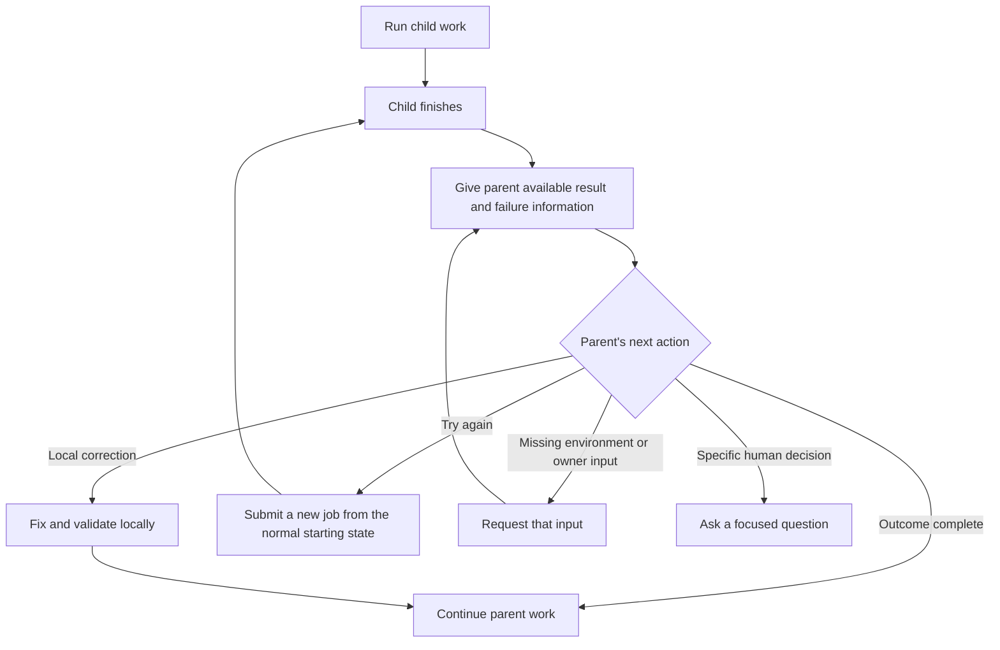

# Agent autonomy and parent-owned recovery

Status: implemented in recipes on 2026-11-06, with explicit runtime gaps. See the
[implementation assessment](ASSESSMENT_AGENT_AUTONOMY_AND_PARENT_RECOVERY.md) for
changes, tests, and the two incomplete runtime integrations. The requirements below
remain the approved plan; this document does not claim production jobs were recovered.

This proposal follows the [latest-run audit](AUDIT_LATEST_RECIPE_RUNS_2026-11-06.md)
and the subsequent feedback: give agents a useful sandbox and the information
needed to solve problems; let parents receive and repair child failures. It
supersedes the audit's suggestion that child recovery depends on a separate,
unspecified goal supervisor. The parent owns recovery for work it delegates.

For this implementation, recovery means diagnosing the available failure and
submitting a **new job that starts the assignment again**. It does not retrieve
intermediate child results, restore the failed child's workspace, or restart its
execution. Reusing selected intermediate outputs is a separate
[future enhancement](PROPOSAL_CHILD_RECOVERY_WITH_INTERMEDIATE_RESULTS.md), to
implement after c2j provides the required inspection and retrieval capabilities.

This work fits the recipes cell's purpose. Recipes owns instructions, orchestration,
artifact delivery, review behavior, and regression cases. c2j/JobDB owns missing
runtime operations; c2ops owns the model adapter; the provisioner owns actual
worker isolation and capabilities. Those dependencies are called out explicitly.

## 1. Decision: clear assignments and enforced capabilities

Remove generic instructions such as “act within your authority,” “where your
assignment and token permit,” and “ready is not a guarantee” from ordinary work
prompts. They make the agent repeatedly reason about permissions without telling
it how to finish its task.

Instead, give the agent:

- The requested outcome, current assignment, and repository it is working in.
- A direct instruction to inspect, implement, test, diagnose, and repair as needed
  for an implementation assignment.
- A short explanation of persistence, input/output files, and communication with
  the recipe or parent.
- A concrete mechanism for requesting something the environment cannot supply.

The runtime and sandbox enforce the available operations. A denied operation is
an actionable environment result. The agent should identify the missing capability
and return the relevant error, rather than turn an ordinary repair into a human
permission question.

An assignment still needs meaning: a consultation answers a question; an
implementation task changes and validates software; an assessment reviews it.
Explain those roles directly. “This is an advisory task; return the answer and any
implementation needed” is clearer than asking the consultant to decide whether it
has authority to implement. Publication remains a separate recipe step with its
existing review decision.

**The sandbox must be real.** The inspected c2j README says commands/extensions
execute in the worker environment and container isolation is provisioned externally.
A workspace path or `const` task alone does not establish process, network, or
credential isolation. The deployment must supply the intended sandbox, and the
recipe must expose the actions appropriate for the assignment. This is an
implementation responsibility, not an authorization checklist for the agent.

## 2. Replace the shared prompts with a short operating model

Update `recipes/adaptive/prompts.yaml`. Keep shared text in the existing empty
sequence include. Supply common context at session creation and the current
assignment on each turn, including resumed sessions. Do not add another task to
load prompts or dump execution-context JSON into them.

Proposed common context, with IDs and paths filled by the recipe:

```text
You are working on <outcome> in cell <cell>, in c2j job <job>.
A cell is a repository and its area of responsibility. This recipe coordinates
the work; your current assignment appears below.
Read applicable AGENTS.md and root PURPOSE.md when present for repository
practices and responsibilities. Missing documentation does not prevent work.

c2j saves repository changes between tasks. Work in the supplied checkout;
the recipe handles Git persistence and publication. Write deliverables and
useful evidence to outbox. Later tasks receive selected files through inbox.
Use scratch space for downloaded source, dependencies, and build output.

Use c2j self to discover this task's environment and available c2j actions.
Use c2j cells to discover related cells. For c2j calls, use the current task's
reported connection and routes; a repository's configuration may describe a
different deployment.
Missing optional environment metadata does not by itself block the assignment.

Errors are feedback for continuing the work. Read error/ for failed commands
and child results, and feedback/ for reviewer or human comments. Diagnose and
repair problems, then rerun the relevant check. Preserve work already completed.

When you need another cell or an environment change, return the request using
the supplied response schema. The recipe arranges it and returns the result.
Explain what you need and why; you do not need to resolve internal workflow
bookkeeping. Ask the human only for a decision or information needed to proceed.
```

Proposed implementation assignment:

```text
Implement and validate the requested outcome. Use the tools available in this
workspace, make the necessary code and test changes, and investigate failures.
Routine debugging, dependency installation through project tooling, and rerunning
checks are part of the assignment; they do not need separate confirmation.

If a check fails, fix the cause and continue. If something outside this task is
needed, report the specific missing input, tool, capability, or other-cell work,
with the relevant error. Continue useful independent work in the meantime.

For a small c2j validation experiment, inspect c2j self and submit --help, use
the provided submission route, and inspect the execution result. c2j records
child submissions automatically. Return failures as well as successes so the
recipe can help recover them.

Finish with the changes made, checks performed, remaining limitations, and the
deliverables needed by the next step. Match validation to the requested outcome.
```

Proposed return after a child failure:

```text
The child execution finished without completing its assignment. Its result,
available errors, and any exported final results are in error/ and results/.
If it failed before exporting results, the failure information may be all we have.

Diagnose the cause and continue the parent task. Correct a local problem here,
request a new job with corrected instructions, or request the specific environment
change needed. A new job starts the assignment again from the cell's normal
starting state; it does not inherit the failed child's unpublished work or session.
Explain what should change so the next attempt can succeed. Do not repeat an
unchanged attempt unless there is evidence that the cause was transient.
```

Proposed consultation assignment:

```text
Answer the supplied question using this cell's code and documentation. Run useful
local checks and experiments; experiment changes are discarded. Publish the
answer and supporting files.

If implementation is needed, state the work, owning cell, and expected result.
Return that need to the coordinator. If another owner's advice is needed first,
request that advice. Once the question is answered or the scope is agreed, finish
the exchange; no acknowledgement ceremony is needed.
```

Examples must distinguish project dependencies from additional worker tools.
For a missing Go executable, show `check: [go, version]`; for Ruff, show
`check: [ruff, --version]`. Persistent worker-tool changes use the package flow
below. The agent is not asked to install a missing worker capability through an
unrelated project dependency mechanism.

## 3. Wait for child jobs and return every terminal result

Use exact job completion for parent-child control flow. Goals may retain outcome
grouping, but an OPEN goal must not prevent the parent from receiving a failed
execution. This is a deliberate replacement of the goal-only waiting behavior,
not a job-ID fallback or compatibility layer.

The existing c2j operation supports the needed single-job wait:

```yaml
- id: await_child
  op: recipe.await_result_soft
  inputs:
    target:
      job: ${{ inputs.job }}
    wait:
      on: job
      condition: complete
    return_when: terminal
```

Concrete recipe changes:

| File / component | Change |
| --- | --- |
| `await-goal.yaml` | Replace parent-child usage with an `await-child.yaml` helper returning the exact job's status, original failure, outputs, and available artifacts. |
| `coordinate.yaml` | Retain the native submitted `job_id`; wait on that execution. When the parent requests another attempt, submit a new job and record its returned ID as the execution now being followed. |
| `validation-goals.yaml` | Replace with a child-result collector over the runtime's automatically recorded jobs. Return failed, cancelled, and successful results to the parent. Remove the requirement that goal IDs must exist before results can be consumed. |
| `packages.yaml` | Wait for the validation job; route failed preparation/probes back to correction. A failure must not strand adoption on an OPEN goal. |
| `create-request.yaml` and custom-consultation waiting | Apply the same result-return contract at these child boundaries; cancellation and publication decisions retain their meaning. |
| `develop.yaml` | Remove immediate `operational_failure` transitions based solely on `children_failed` or unsuccessful child results. Route the evidence to a parent work turn first. |

Keep structured runtime results in recipe values. Present the agent a short result
summary plus files; do not turn them into another large prompt context object.
After a successful replacement job, completion gates use the replacement's result
for that assignment. Historical failures remain visible evidence but must not keep
blocking completion through the current “any previous failed await” checks. Keep
tracking unrelated required children; submitting a replacement does not satisfy
their work or make the replacement successful before it finishes. Goal grouping
is not required to decide which submitted execution to follow.

For multiple children, inspect all current statuses and process completed results
before waiting. Prompt notification of a later failure while a sibling is still
running requires a native “any tracked child changed/completed” wakeup. Verify
whether c2j already exposes that primitive; otherwise it is a specific runtime
dependency. Serial waits on the first child do not meet this requirement. Do not
replace it with an unbounded polling command.

## 4. Give the parent a complete recovery loop



Normal command/test failures should first be handled by the agent already doing
the work. A child only hands the problem up when its task has ended or it needs
help that the parent can arrange. The parent can then change the approach or submit
a fresh assignment with corrected instructions. This is an ordinary new
submission, not a replay or restoration of the failed execution.

Change the routing in `develop.yaml` explicitly:

| Event | Next action |
| --- | --- |
| Failed local command or verification | Resume the working agent with the original error files and current candidate. |
| Child finished unsuccessfully | Resume the parent agent with the available failure and final result; let it decide whether to request a fresh attempt. |
| Agent requests packages or other-cell work | Service that request, then return its result to the requesting agent. |
| Agent returns `blocked` with only an explanation | Give it one focused turn to turn the explanation into a concrete repair or request; do not immediately invoke `stop_attempt`. |
| A concrete dependency cannot be supplied or repeated recovery makes no progress | Preserve the current job's work and pass the specific unmet need to the parent or root execution owner. |
| Explicit cancellation | Preserve cancellation; do not start recovery automatically. |

Use the existing work/session machinery for these turns. An operational stop is
the final handoff after recovery is exhausted, not the first response to an error.

Use the existing execution-request and child-submission path. Do not introduce
an `action: resume`, a restart operation, or a checkpoint-selection protocol.
The parent states the corrected assignment; the coordinator handles submission
and waiting. A correction within already agreed scope does not need another
consultation merely because the previous job failed.

The concrete sequence is:

1. Return the terminal status, original failure message, and whatever final
   outputs/artifacts the existing soft-wait result actually supplies. Say when
   these are absent. Do not fetch chapters or wait for intermediate-result APIs.
2. Let the parent diagnose the problem from that information and choose the next
   action. If the evidence is insufficient, a fresh job can include investigation
   in its assignment; do not invent a cause or automatically ask the human.
3. For another attempt, reuse the original assignment, target cell, recipe,
   configured starting ref, and necessary original inputs/attachments. Add the
   parent's correction and a concise account of the known failure. Apply corrections
   to the actual inputs where needed, such as a validation command's arguments;
   explanatory prose alone does not change a configured command. Read the normal
   starting ref afresh; do not use the failed child's unpublished SHA, session,
   intermediate artifacts, or the parent's workspace as a substitute.
4. Submit a new job. Run its normal workflow from the start, including its usual
   review and publication rules. Prior successful publication may already be
   reflected in the repository; the assignment should inspect existing state
   before repeating external effects. No completed execution prefix is replayed.
5. Record the returned native job ID as the replacement for this assignment and
   wait on that job. Re-entering the coordinator after a recorded submission must
   follow that job rather than submit it twice. Other required children remain
   tracked independently. Cancellation does not trigger another attempt.

For example, a package validation job that failed on `go --version` is replaced
by a new validation job whose instructions use `go version`. It performs setup
and validation again. We accept this repeated work in the first version.

Unpublished work remains attached to the old job and is **not carried into the
replacement**. This may cost additional execution time or repeat useful work;
it keeps the current recovery path implementable with ordinary submission and
exact-job soft waiting. Recovery still requires a reason the next attempt can
succeed and follows the progress/budget rules below.

The [future intermediate-results proposal](PROPOSAL_CHILD_RECOVERY_WITH_INTERMEDIATE_RESULTS.md)
specifies how the parent could inspect tasks and select outputs to carry forward.
Those capabilities are not prerequisites for this implementation. No new restart
API, background supervisor, or administrative token is required for fresh attempts.

## 5. Make the files required for repair actually available

Use the existing inbox model with a small consistent layout:

```text
inbox/
  error/        Current command, validation, preparation, and child failures
  feedback/     Current parent, reviewer, and human guidance
  results/      Child summaries, partial deliverables, and validation results
  ...           Existing design, implementation, and test documents
```

Subdirectories distinguish producers when necessary. The recipe handles those
names and native artifact references; prompts say to read the directory rather
than enumerate logs or reproduce IDs. Existing execution logs retain the command,
relative working directory, timestamps, and stdout/stderr supplied by c2j.

Change `agent-turn.yaml`, `artifact-result.yaml`, `response-repair.yaml`,
`task-documents.yaml`, and the child-result collector so that:

- A repair turn receives the prior response and the original files needed to fix
  it. Retaining an inventory solely for later reference matching is insufficient.
- A directory descriptor such as `evidence/` can be corrected using the published
  file inventory and the relevant subtree. Expand to individual stored references;
  do not require the model to regenerate missing files or test results.
- Only relevant files are carried forward. Large incidental outbox contents remain
  on their producer; preserve focused evidence and indexes for large useful sets.
- Original identities and distinct paths survive; summaries cannot overwrite a
  command log or another producer's evidence.
- Response-only repair preserves the previous substantive decision. Correcting a
  filename does not reopen an accepted consultation or create another approval.
- A missing or unreadable artifact is reported accurately, with enough producer
  information for the runtime to retrieve it. It is not evidence that a test passed.

For child jobs in the current implementation, this delivery uses only artifacts
already exposed by the existing result contract. Local agent/response repair can
still use its own recorded outputs. Do not make child recovery depend on finding
unexported intermediate files. When a failed child has no final artifacts, deliver
its failure message and explain that limitation; a fresh attempt proceeds without
restoring its work. Intermediate retrieval belongs to the separate future proposal.

Fix the related workspace bug in `consultation.yaml`: the requester must return
to its managed candidate, including persisted local changes. Do not create a fresh
workspace whose upstream ref is an unpublished candidate SHA. Use c2j's supported
snapshot restoration; never silently substitute the branch tip.

## 6. Finish consultations instead of recursing into implementation requests

Keep inline advice. Change `consultation.yaml`, `consultation-start.yaml`, and
`coordinate.yaml` at the handoff:

1. A factual answer or accepted scope ends the exchange.
2. A request for another owner's advice can continue an advisory exchange.
3. A request for implementation is returned to the enclosing work coordinator,
   with the actual serving cell and accepted documents. It does not start another
   advisory turn asking someone else to dispatch it.
4. Nested serving acceptance is exported to the coordinator as a usable result.
   The parent does not need another consultation to register the same agreement.
5. A request to retry failed implementation uses an ordinary new execution with
   corrected instructions. Reuse settled scope without repeating the consultation;
   start the new job's work from the normal cell starting state.

Reuse the existing consultation/execution request concepts and artifact outputs.
Add only the routing distinction needed to bubble execution requests to the
coordinator; use the agent's stated intent. Do not classify dispatch by matching
phrases in prose or introduce a new set of human-maintained work keys.

For invalid target refs, return the actual resolution error to the requesting
agent. A missing branch should produce a correction opportunity, not generic
agreement instructions followed by an iteration-limit failure.

## 7. Keep acceptance and human questions proportional to the task

Update the design, test-plan, assessment, and review prompts together. Retain
formal test statements and outcome review, while changing what they ask for:

- Required checks establish the requested behavior and relevant regressions.
- Useful diagnostic metadata is recorded when available. Its absence does not
  automatically become a new requirement.
- Conditional integration checks explain the conditions under which they matter.
  Configuration edits do not automatically certify the entire worker platform.
- Agents may adjust test commands and validation procedures to obtain the same
  evidence. Fixing `go --version` does not change the desired outcome.
- A real change to agreed behavior remains an explicit scope revision; the recipe
  must not disguise an unmet requirement as a passing test.

Concrete example for the configuration rollout: check the requested URLs,
preservation of existing settings, valid configuration, and availability of the
required tools. An exact container-image hash is useful environment metadata.
Require it only when identifying that exact image is part of the requested outcome.
If browser execution is required, a real browser launch still needs to succeed.

The current open review asking for a historical operator/archive should become a
report: what failed, the evidence, likely cause, owner, proposed fix, and specific
unknowns. Missing historical metadata need not block delivery of useful findings
or a bug report. Ask for a contact only if a concrete next action requires one.

For human questions, require a short current `review.md` that explains what is
blocked, the actual choice or missing fact, a recommendation, and its consequence.
Completed consultation, routine debugging, internal phase selection, and acceptance
of an unspecified evidence gap are not default human decisions. Reuse the working
merge and package approval flows for the decisions they already represent.

## 8. Make environment requests workable without repeated permission reasoning

Ordinary use of installed tools and project dependency managers is part of the
implementation assignment. Persistent worker-tool additions and resource/capability
changes go through a concrete request path because they change the environment
provided by the system.

For packages, keep the existing `packages` request shape and the flow:

```text
request → policy decision → prepare/probe child job → adopt validated config → continue
```

Change the failure path to return diagnostics to the parent and requester. The
runtime distinguishes preparation failure from probe failure through the actual
result; an invalid probe does not imply the package failed to install.

`package-policy.yaml` currently approves nothing automatically. Define an explicit
cell/operator policy for common pinned tools and bounded validation commands.
Repeated use of an approved request should reuse that decision. A probe correction
can be covered by a policy that explicitly permits it; package or capability
expansion follows the configured policy. Agents request what they need without
first deciding whether a human will approve it.

Package-changing config tasks also need to stage the candidate configuration until
validation succeeds. A newly written `.c2/config.yaml` must not prevent the very
next management task from starting, as happened with the pnpm installer. Use a
supported last-working management environment and a separate candidate probe.
c2j must supply the environment boundary if current recipe scopes cannot express it.

For memory, Docker, and similar capabilities, connect requests to c2j's execution
requirements and `environment_required` handoff. A suspended task needs a real
provisioner to fulfill that request. Do not promise that c2j itself provisions it,
or represent a missing environment as an unexplained terminal build failure.

## 9. Bound unproductive recovery without stopping useful work arbitrarily

Replace the default global twelve-work-turn stop as the normal progress decision
in `develop.yaml`. Design, consultation, waiting, and correction should not consume
an implementation allowance that suddenly stops the parent after launching work.

Use the job's configured execution/time budget as the overall limit. Within it,
start with a policy of three consecutive unsuccessful repairs of the same blocker
before asking the responsible parent agent to choose a different approach or name
the missing input. This is a recovery checkpoint, not an automatic human review.
Use existing summaries, errors, and actual work changes to make that judgment;
do not add an elaborate progress-scoring schema.

Before consuming the remaining budget on a retry, record what changed and why it
could succeed. Identical retries need a transient cause. Budget exhaustion preserves
partial work and an actionable handoff; cancellation remains distinct. An explicitly
configured hard turn cap must be reported as such rather than called a product
decision. Root attempts without a parent need an explicit owner notification when
they cannot continue; that deployment obligation is separate from child recovery.

## 10. Fix native response schemas as part of this work

The audit found all 187 recorded model turns using prompt fallback after an initial
native-output rejection. Fix this before evaluating the new flow.

Update the actual annotation contract across `agent.yaml`, `consultation.yaml`,
and other model schema producers: `title` and `role` are strings, `order` is numeric,
and `source_paths` is an array of strings. Coordinate optional/null representation
with c2ops so the complete schema satisfies the provider, rather than fixing only
the first property reported in an error.

The repair, cancellation, request, and file-reference shapes must all be covered.
Use native acceptance of the full schema as evidence. A mock declaring
`output_schema_valid: true` does not validate the adapter contract.

## 11. Implementation sequence and external dependencies

| Step | Concrete deliverable | Validation boundary |
| --- | --- | --- |
| 1 | Correct schema types and shared operating context; add focused assignment/recovery prompts | Actual adapter/schema acceptance; prompt rendering for new and resumed sessions |
| 2 | Add exact-child result helper and replace goal-only child waits in all callers | Real child success/failure/cancellation reaches the parent; OPEN goal does not suppress failure |
| 3 | Route child/command failures back to agent work; bind original evidence; fix consultation candidate return | Real materialized inboxes and local candidate restoration |
| 4 | Export nested accepted work and finish advisory exchanges; preserve substantive decisions through response correction | No dispatch-advice recursion, duplicate registration, or acknowledgement review |
| 5 | Submit fresh child attempts through the existing execution path; track replacement results; connect child-change notification | Actual failure → parent diagnosis → new job from normal starting state → successful consumption, without intermediate-result retrieval |
| 6 | Complete package/provisioner request paths and proportional validation/review behavior | Corrected probe succeeds without premature adoption; management remains usable on candidate setup failure |
| 7 | Replace indiscriminate allowance handling and update authoring/process documentation | Progressing work and repeated failures take distinct paths; budgets and cancellation remain effective |

The runtime baseline inspected for this proposal is c2j main commit `089061be7a21`
and the supplied node-permissions guide; reconfirm newer capabilities when
implementing. Confirmed available in that source: ordinary child submission,
exact-job soft waits, status inspection, original execution diagnostics, execution
requirements, and automatic child submission records. Fresh-attempt recovery uses
those capabilities; it does not require restart or intermediate-task retrieval.

To verify against the latest c2j for the other proposed improvements: a wakeup on
any tracked child completion and a management environment independent of an invalid
proposed package configuration. Record concrete gaps with the owning cell.
Agent-facing intermediate-task inspection and artifact retrieval are specified
separately in the [future enhancement](PROPOSAL_CHILD_RECOVERY_WITH_INTERMEDIATE_RESULTS.md).
Do not block fresh-attempt recovery on those future capabilities or build chapter
decoders and an alternative lifecycle system in this repository.

The gateway's unsupported private Go-module route and pnpm lifecycle-script
support still need their respective owners. Better recovery should expose those
problems to an agent that can arrange the fix; it does not make the underlying
transport or package preparation work by itself.

This proposal replaces the failed-child wait/stop contract. Update all recipe
callers and corresponding expectations together in the planned change. Do not
retain dual goal-wait/job-wait modes as compatibility scaffolding. Existing
production jobs retain their captured recipe; applying the new behavior to them
requires submitting a new job using the updated recipe. Its assignment starts
again with the original inputs and any corrected instructions. Do not assume a
new commit changes an already captured execution or transfers its unpublished work.

## 12. Behavioral statements and tests

These statements describe the proposed behavior before implementation. They are
not claims that the current suite passes it. Update the affected recipe-test
specifications and fixtures with the implementation; retain unrelated working
coverage and the established publication checks.

All paths below are relative to `recipes/adaptive/`. Each expectation is at most
30 words and names its importance and validation dependencies.

| ID | Importance | Level / dependencies | Files | Expectation |
| --- | --- | --- | --- | --- |
| AR-01 | Critical | Integration / c2j native child lifecycle | `await-child.yaml`, `develop.yaml` | A failed child reaches its parent with the original failure even while its goal remains open. |
| AR-02 | Critical | Integration / native child submission and soft wait | `coordinate.yaml`, `develop.yaml` | Parent correction starts a new job from the normal starting state; successful replacement results satisfy that assignment despite the earlier failure. |
| AR-03 | Critical | Integration / c2j cancellation | `await-child.yaml`, `coordinate.yaml` | Child cancellation is reported distinctly and does not automatically start another execution. |
| AR-04 | High | Integration / c2j child notification | `await-child.yaml`, `coordinate.yaml` | A failed child reaches the parent while an earlier sibling is still running. |
| AR-05 | Critical | Integration / native artifacts | `agent-turn.yaml`, `response-repair.yaml` | Correction receives the original relevant evidence bytes without copying incidental output or changing producing identities. |
| AR-06 | High | Integration / native artifacts | `artifact-result.yaml`, `error-documents.yaml` | Distinct original diagnostics survive delivery and cannot be replaced by generated summaries. |
| AR-07 | Critical | Integration / native workspaces | `consultation.yaml` | Returning from foreign advice restores the requester's unpublished candidate without fetching it from upstream or substituting the branch tip. |
| AR-08 | High | Integration / scripted model replies, native orchestration | `consultation.yaml`, `coordinate.yaml` | Accepted nested implementation work reaches its serving coordinator without advisory dispatch recursion or repeated registration. |
| AR-09 | High | Integration / scripted model replies, native artifacts | `consultation.yaml`, `response-repair.yaml` | File-only correction preserves substantive agreement and does not request a human acknowledgement. |
| AR-10 | Critical | Integration / package preparation and actual probe | `packages.yaml`, `package-check.yaml` | A failed version probe returns its diagnostic for correction; configuration adoption requires a successful probe of the intended candidate. |
| AR-11 | Critical | Integration / c2j environment scopes | `packages.yaml`, `package-tools.yaml` | Invalid proposed packages cannot prevent the management task from correcting the proposal. |
| AR-12 | High | Integration / configured package policy | `package-policy.yaml`, `packages.yaml` | Policy-approved tooling proceeds without repeated review; an expansion outside that policy reaches the configured decision path. |
| AR-13 | High | Integration / scripted model replies, runtime budgets | `develop.yaml` | Dependency waiting and completed advice do not exhaust implementation turns; exhausted budgets preserve actionable work for the responsible parent. |
| AR-14 | High | Integration / scripted model replies | `develop.yaml`, `resolve-target.yaml` | An invalid consultation ref reaches the requester as its actual resolution error before another repair is attempted. |
| AR-15 | Critical | Integration / c2ops native schema contract | `agent.yaml`, `consultation.yaml` | The full response schemas are accepted natively; invalid annotations are rejected without silently relying on prompt-only output. |
| AR-16 | High | Integration / prompt rendering, scripted replies | `prompts.yaml`, `review.yaml` | An answered consultation returns its result; a genuine unresolved user decision receives a specific question and current decision brief. |
| AR-17 | Critical | Integration / native submission and coordinator re-entry | `coordinate.yaml` | Re-entering after a recorded replacement submission follows that job without launching another; unrelated required children remain tracked. |
| AR-18 | High | Integration / child failure before final outputs | `await-child.yaml`, `coordinate.yaml` | A child without final artifacts can be retried using its available failure and original inputs, without retrieving intermediate outputs or inheriting its session. |

Add a native positive/negative package case using a prepared executable and a
deliberately invalid probe, then correct the probe and check adoption. Add a real
changed-workspace consultation case and a repair case whose next task must read
the original evidence. For lifecycle cases, create and fail a child, return its
failure to the parent, submit a corrected fresh job, and observe its result.
Verify the new job starts from the configured cell ref with original inputs and
corrected instructions, without inheriting the failed child's unpublished changes.
Mocking a final success is insufficient.

Scripted agent outputs are appropriate for deterministic routing tests. We do not
need to test whether Codex is generally capable of debugging or understanding a
task. Test that our framework supplies the information and operations required
for it to do so, and report unsupported fixture boundaries explicitly.

## Proposed outcome

A child failing `go --version` should result in the parent receiving that exact
error, correcting the probe, and consuming a successful fresh attempt. An agent
missing a tool should make one concrete request and receive the tool or an
actionable result. A consultation should return useful advice or work to execute.
An audit should deliver findings with stated unknowns. None of those situations
should require the agent or user to decipher an internal authority, registration,
or infrastructure-certification problem before useful work can continue.
