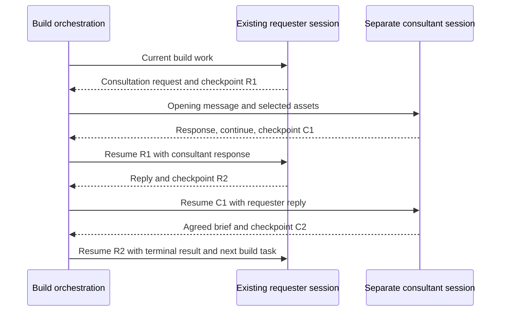
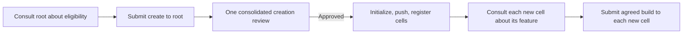

# Draft specification: the consultation recipe

Status: contract with an initial implementation in
[`recipes/kernel/consultation.yaml`](../recipes/kernel/consultation.yaml) and native
runtime suites. See the [kernel usage guide](../recipes/kernel/README.md) for the
implemented interface. Build now uses this atom for assessments and cross-cell
coordination; root provisioning remains a separate workflow. Expert responses
include `assessment: pass|revise|not_applicable`, independent of agreement.

The public recipe uses separate short consultant role/cell/ref inputs and an
artifact for durable continuation because c2j's `object` input type denotes a
checkpoint, not an arbitrary map. Internal conversation state remains typed;
`state` exposes it for callers, while `continuation` references its persisted
artifact. Optional absent `summary`/`review` outputs are empty maps. The conceptual
contract below describes the behavior independently of those entrypoint details.

Agent instruction packaging and optional skills are discussed
[separately](PROPOSAL_AGENT_INSTRUCTIONS_AND_SKILLS.md). Consultation always uses
recipe orchestration, regardless of that choice.

## Purpose and boundaries

A consultation is a bounded conversation between a requester and a consultant,
with separate sessions, explicit workspace selection, and messages and artifacts
flowing both ways. The **consultant determines whether agreement has been
achieved**. For a cell change this is the target cell; for creation eligibility
it is root; for specialist advice it is the designated expert.

Use one included conversation recipe, specialized by small role/workspace
profiles. The recipe owns turn order, session continuity, iteration counts,
result routing, and escalation. Profiles supply the consultation objective and
assessment criteria. They do not duplicate the conversation loop. Submission,
implementation, provisioning, and merging remain outside this atom.

The requester may be an existing build agent. Entering consultation does not
replace that agent with a new negotiator or give the consultant its private
conversation. Each sees the messages and assets explicitly exchanged.

## Profiles using the same atom

| Profile | Consultant workspace and session | Objective and assessment | Consumer of the result |
| --- | --- | --- | --- |
| Change an existing cell | Target cell repository; separate target session per topic | Assess purpose fit and agree scope, interfaces, compatibility, acceptance outcomes, and conditions for serving the request | A target-cell `build` job, once authorized |
| Expert advice or review | Requester's candidate repository state; separate expert session with the relevant expertise | Resolve the requested assessment, questions, findings, and tradeoffs against a named candidate | Requester's existing build; retain expert context for follow-up |
| New-cell eligibility | Configured project root repository; separate root session | Evaluate project fit, overlap with existing cells, responsibility boundaries, and technology choices | Root's `create` job, once eligible and authorized |
| New-cell feature | Newly established cell repository; separate session belonging to that cell | Agree the feature it will provide, within its initial purpose and interfaces | New cell's `build` job, once authorized |

The last profile uses the existing-cell change mechanism; its initial assets also
include root's creation decision. Expertise, questions, and criteria are content,
not reasons to introduce another conversation implementation.

For example, a security expert can agree that an assessment is complete while
reporting blocking vulnerabilities. **Conversation agreement is not a passing
security verdict.** Keep findings and their disposition in the assessment asset;
keep any workflow-critical verdict in a typed profile result. Existing review,
verification, and acceptance gates still apply. Disputed findings can reach the
same human expert escalation path as other unresolved disagreements.

## Contract and durable state

The following names describe the proposed recipe contract, not new runtime APIs.
Use native typed values for control data and artifact bindings for substantial
content. Do not serialize the contract into a prompt or require a second schema
validator after Codex's `output.schema` enforcement.

| Input | Meaning |
| --- | --- |
| `requester` | Existing session checkpoint, owning cell, and managed workspace/candidate identity. A standalone caller may explicitly request a fresh requester session. |
| `consultant` | Target cell or expert identity, workspace selection, and initial role guidance; a previous checkpoint is supplied only for the same thread. |
| `request` | Short opening message and bound assets defining the objective, requested outcome, and assessment criteria. |
| `max_iterations` | Positive limit, default **4**, set by workflow policy rather than raised by an agent. |
| `continuation` | Optional previously exported conversation state for resumption, including any recorded expert direction. |
| `include_summary` | Request a short consultation summary with pointers to final artifacts; default false. A summary must be available before choosing summary-based caller continuation. |

The recipe allocates a stable thread identity. Do not index sessions solely by
cell: two unrelated requests to one cell require two threads. A thread records:

- Profile, topic, requester and consultant identities, and workspace provenance.
- Separate latest session checkpoints and the original requester checkpoint,
  with explicit branch provenance and the caller's chosen continuation recorded.
- Current bounded round, completed iteration count, and next participant to run.
- Ordered message records with sender, exchange identity, artifact references,
  and the candidate/brief revision being discussed.
- Latest consultant decision, accepted brief or assessment reference, outstanding
  conditions, and any human direction or review identity.

### Structured turn response

Supply an output schema directly to Codex. Put `outcome` first in the schema for
readability, followed by `thinking` and `files`. Field order is not a routing
contract; consumers access fields by name. A consultant-turn schema can start as:

```yaml
type: object
additionalProperties: false
required: [outcome, thinking, files]
properties:
  outcome:
    type: string
    enum: [continue, agreed, declined, redirected, needs_review]
  thinking:
    type: string
    description: >-
      Shareable response explaining the decision, relevant evidence,
      questions, proposed terms, and remaining disagreements concisely.
  files:
    type: array
    items:
      type: object
      additionalProperties: false
      required: [path, description]
      properties:
        path:
          type: string
          description: File path relative to this turn's outbox.
        description:
          type: string
          description: What the recipient should use this file for.
```

`thinking` is the explanation intended for the other participant, not private
reasoning or a transcript of internal deliberation. Keep substantial specifications
and evidence in files. An empty `files` list is valid when the reply needs none.
A requester's turn uses the same envelope with outcomes `continue`, `needs_review`,
or `cancelled`; acceptance is expressed in its response and documents, and only
the consultant can return `agreed`. Runtime failures are recipe outcomes, not
successful model responses describing an execution error.

The `files` list identifies relevant generated or edited documents to pass to the
other participant. Write their transferable versions to outbox; repository edits
made during an experiment are not automatically shared. An existing document may
also be republished unchanged when it is the accepted final version. The recipe
resolves listed paths against the op's captured artifacts and passes the response
and those files to the other side. Reject missing files, paths outside outbox,
and ambiguous bindings; these are artifact-integrity checks, not a second schema
validator. The model never invents producer IDs or session tokens.

### Iteration-based inbox and outbox layout

Use `iter1`, `iter2`, and so on, with participant directories so both sides can use
the same filenames. For example, the first two turns produce:

```text
requester outbox/iter1/requester/brief.md
consultant inbox/iter1/requester/brief.md
consultant outbox/iter1/consultant/feature-spec.md
requester inbox/iter1/consultant/feature-spec.md
requester outbox/iter2/requester/feature-spec.md
consultant inbox/iter2/requester/feature-spec.md
```

The recipe supplies the current output prefix in the turn prompt. A returned
`files[].path` might be `iter1/consultant/feature-spec.md`. If the initial requester
message already exists, bind its selected assets into the iteration-one requester
namespace without an extra model turn. Paths are relative to each op's runtime
inbox or outbox, not shared absolute filesystem locations.

Within one invocation the thread is implicit. When binding several threads into
one op, prefix each with its thread identity. Keep iteration labels increasing
across expert-directed rounds (`iter5` follows `iter4`); separately record the
round's four-iteration budget. Retries reuse the same logical prefix and recorded
producer selection rather than creating a new iteration.

Each delivery binds the latest response's listed files and any earlier references
needed to answer it. Preserve all versions in the durable exchange record; do not
assume an inbox persists across ops or dump every historical file into every
prompt. Reuse names like `feature-spec.md` and `test-statements.md` inside each
prefix. Immutable producer references remain authoritative; directory names
organize the view but do not replace version identity. Export artifacts explicitly
at recipe boundaries.

The recipe result exports the following values, separately from the model's turn
response. Session handles come from the Codex op, not generated response fields.

| Output | Meaning |
| --- | --- |
| `outcome` | Conversation disposition below. |
| `requester_session` | Latest requester session checkpoint/token, usable for later continuation. |
| `consultant_session` | Latest consultant session checkpoint/token, usable for follow-up or a target job. |
| `requester_start_session` | Original caller checkpoint retained for summary-based continuation. |
| `continuation` | Durable thread state, counts, provenance, and delivery position. |
| `artifacts` | Explicit references to exchanged documents and the conversation record. |
| `final_artifacts` | Selected terminal documents, with descriptions and immutable references to exact versions. |
| `summary` | Optional short synopsis with pointers into `final_artifacts`. |

Preserve native session objects (currently `c2ops.codex.session/v1`), rather than
reducing them to display IDs or strings that may not be sufficient to resume. On
failure return the last available checkpoints and identify any participant that
never produced one. A first-response agreement may leave `requester_session`
equal to `requester_start_session`. The saved delivery position says whether that
requester checkpoint has seen the consultant's terminal response.

On `agreed`, the consultant's terminal file list selects the final deliverables:
publish the accepted versions, including any unchanged documents needed by the
caller. The recipe resolves that list into `final_artifacts`. Earlier evidence
remains available through `artifacts`. For other outcomes, terminal documents are
disposition or disagreement evidence, not an approved implementation brief.

Outcomes are:

| Outcome | Meaning |
| --- | --- |
| `agreed` | Consultant has established agreement on the identified revision and conditions. This does not authorize implementation by itself. |
| `declined` | Consultant will not serve this request, with reasons. No implementation submission follows. |
| `redirected` | Consultant recommends another owner or approach. A new target requires its own consultation. |
| `needs_review` | Unresolved disagreement requires independent synthesis and human expert direction. Preserve the thread for resumption. |
| `cancelled` / `failed` | Explicit cancellation or execution failure. Neither counts as agreement nor as an additional negotiation iteration. |

These are conversation outcomes. The enclosing build still uses its own `consult`,
`blocked`, review, and completion routes. Profile results may add a typed assessment
or recommended destination without changing the generic loop.

## Turn order and agreement authority

One iteration is **one requester message followed by one consultant response and
its agreement assessment**. The opening exchange counts as iteration one. The
consultant returns one of `continue`, `agreed`, `declined`, `redirected`, or
`needs_review`, plus the response and relevant assets.

1. Receive the request and caller checkpoint; preserve the caller's repository
   state and pause its ordinary build turns while a negotiation turn uses it.
2. Run or resume the consultant in the selected workspace, with the latest
   requester message and assets. Persist its response, checkpoint, and decision.
3. If the consultant reports `agreed`, `declined`, or `redirected`, return that
   outcome. If it requests expert direction, enter the atom's human-review step.
4. If it reports `continue` and fewer than four iterations have completed,
   resume the requester session with the response and assets. Ask it to answer,
   clarify, accept a proposal, or explain remaining objections. Send that reply
   to the same consultant session for the next iteration. A requester response
   of `needs_review` instead enters escalation; `cancelled` ends the thread.
5. If iteration four still reports `continue`, enter human review before any
   fifth negotiation exchange. Agreement on the fourth response is valid.

The requester can express acceptance, objections, or withdrawal. It cannot set
the conversation's `agreed` outcome. Withdrawal cancels the thread. The consultant
must check agreement against the latest requester requirements and explicit
acceptance where terms changed. It cannot introduce a material counterproposal
and mark that unaccepted proposal agreed in the same response. If the opening
request already specifies acceptable terms, the consultant can agree immediately.

Agreement identifies one concrete brief revision, acceptance outcomes, and any
conditions. Conditions that require unresolved scope decisions prevent executable
agreement; ordinary documented dependencies can remain conditions for later work.
A schema-valid `agreed` response still needs required assets and matching thread
and revision identities. Such semantic checks are not duplicate schema validation.

Op retries, schema repairs, artifact reads, and replay do not count as additional
iterations. Persist a logical exchange identity and advance the count only once
for a successfully recorded consultant response. Failure handling retains the
last durable state rather than restarting negotiation with a fresh budget.

## Integration with the existing build session

The included recipe uses the supplied requester checkpoint for negotiation and
returns both participants' latest checkpoints. The caller chooses how its own
work continues; the atom does not automatically adopt a checkpoint or apply the
decision.

| Caller continuation | Session and input | When useful |
| --- | --- | --- |
| Continue the discussion | Resume `requester_session`, delivering the terminal response if not already seen, plus final assets and the next build task | The caller benefits from the full negotiation history. |
| Consume the result | Resume retained `requester_start_session` with `summary`, final artifacts, outcome, conditions, and any human direction | The caller wants the consultation's decisions without adding every exchange to its working conversation. |

The second mode deliberately starts an alternative continuation from a saved
checkpoint. It does not merge session histories or undo Git state. Record which
branch the caller adopts. If normal work has advanced since consultation began,
deliver the summary to the caller's current checkpoint instead of replacing that
progress with the old checkpoint. Both returned consultation sessions remain
available for follow-up, even when the caller selects summary-based continuation.
Verify supported immutable-checkpoint reuse before implementing this mode; do not
simulate it by mutating an active session's history.

When requested, the short summary states the outcome, agreed scope or assessment,
remaining conditions or disagreement, relevant human direction, and the exact
final documents to read. For example, it can point to a final feature specification
and test statements without reproducing them. A summary is not a new agreement
assessment: it must preserve the consultant's disposition and any adverse findings.
It can be produced as a small optional finalization step using the recorded result
and assets; it need not run when the caller will simply resume the discussion.
If summary-based continuation is chosen later, generate the summary before
resuming the caller. Missing summaries must not silently discard context.

The following diagram shows the first continuation choice. Never resume the
requesting build with the consultant's checkpoint or combine their histories.



Within the consultation, requester turns negotiate; they do not recursively run
the entire build loop or silently submit jobs. New dependencies discovered during
negotiation return as follow-up work for the parent. This keeps the atom bounded.
The parent's next build turn receives either the undelivered terminal response or
the requested result summary, plus final assets and appropriate phase permissions.

Session checkpoints, Git state, and artifacts are separate channels. A checkpoint
does not restore the repository or materialize an artifact. Keep the parent's
managed candidate available when resuming its session. Consultation experiments
must not mutate that candidate or produce accepted implementation changes.

### Several consultations and progress before waiting

A build may request several threads in one route. Advance all currently actionable
independent requests and useful local work before declaring the build blocked.
Three existing-cell requests plus one new-cell request should all be able to
progress, even if one needs expert direction.

For discussion continuation, serialize turns of the shared requester session and
always use its latest checkpoint. Separate consultation branches may return
summaries to a caller when immutable-checkpoint reuse is supported, but their
histories are never merged. Each branch has its own identity and checkpoints;
applying its summary to the caller is a serialized turn. Independent
consultant turns can run concurrently when the scheduler supports this, with
responses delivered to the requester in recorded order. Sequential thread
advancement is a valid initial implementation; parallel scheduling is not needed
to establish the atom's contract.

An unresolved thread waits for human direction inside the consultation recipe.
An included call therefore also waits; a parent that needs independent progress
should schedule separate consultation jobs through the runtime's job facilities.
A separate branch resumes its own requester checkpoint and eventually returns a
summary to the parent. It must not replace intervening build progress with an old
checkpoint. The thread record preserves what each side last saw and which
continuation policy applies. Higher-level scheduling remains a separate integration.

A ready agreement may be submitted once its own gates permit, without waiting for
unrelated consultations. `consult` means there is dialogue work to schedule;
`blocked` identifies actual outstanding jobs or expert decisions and what can
resume progress. Never submit unresolved work merely to obtain a job ID to await.

## Workspace and session setup

For cross-cell requests, consultant turns run inside the target cell's repository;
requester turns run in the caller's managed workspace. Root eligibility uses the
configured root identity, not an assumption that the requesting cell is root.
For same-cell expertise, the consultant must inspect the exact candidate under
review, including unmerged work, rather than merely checking out that cell's
upstream branch. A distinct expert session is required even in the same workspace.

Use native workspace/snapshot controls and advisory execution policy. Do not
assume selecting the same cell creates a copy of the caller's candidate. The
[workspace announcement](../FEATURE-ANNOUNCEMENT-Node-Workspaces.md) documents fresh
explicit workspaces and no automatic merge into the enclosing workspace. Verify
candidate binding and isolation before implementing expert review; report any
missing capability to c2j rather than inventing a Git workaround.

Use Codex `instructions` for initial guidance: the whole repository is
the cell, use root `PURPOSE.md` if present and infer context if absent, respect
ownership, consult before delegating changes, and progress until blocked.
Establish consultation purpose, participant role, and permissions once per
participant. For fresh sessions these accompany initial instructions; for an
existing requester session they belong in its first consultation prompt, since
`instructions` is ignored on resume. Scope permissions to the consultation phase
so the checkpoint can later seed implementation. Follow-ups deliver the latest
message, new file pointers, and the output prefix. Retain earlier assets in the
inbox without repeating their inventory or the original objective each turn.

The kernel's pinned Codex revision supports this new-session-only behavior.
The older
[agent.yaml](../recipes/develop/agent.yaml) and
[consult.yaml](../recipes/develop/consult.yaml) repeat setup in their shared
fresh/resume prompts. That older consultation also retains only a latest result and
session per cell, lacks the bounded loop, and does not explicitly export the
proposed bidirectional artifact contract.

## Unresolved disagreement and human direction

On `needs_review`, the atom runs an independent summary-agent turn and a native
human review, waiting for its response before negotiation resumes. No caller-side
review wrapper is required. The summary agent gets the original objective,
complete exchange record, assets, and any prior direction. It is neither party's
session and does not decide agreement for the consultant.

Produce a review asset explaining what is agreed, remaining disagreement, each
side's evidence and assumptions, alternatives, tradeoffs, and a recommendation
where justified. Present focused questions and attachments through native review
inputs. Do not put a serialized conversation into a question field or use a dummy
one-option multiple-choice question.

Record the human's answers and assets verbatim, with review references and receipt,
and deliver new direction once to each participant.
Direction may stop the request, redirect it, or authorize reconsideration. If
negotiation resumes, open an explicitly recorded new bounded round, default four
iterations, and retain all prior history. Failure to agree never resets the budget
automatically. The consultant reassesses agreement under the direction; neither
the requester nor the summary agent can relabel unresolved work as agreed. A
human instruction to change the scope also preserves normal downstream gates.

Failed review preparation returns saved unresolved state and an explicit error.
Resuming that state without direction retries preparation and presents the review;
it cannot reopen negotiation or reset the budget on its own.

An explicit consultant decline/redirect is a terminal disposition, not a forced
four-turn argument. If the requester disputes that disposition, it can seek the
same expert review rather than bypassing the consultant's decision.

## Two consultations for a new cell

The two conversations answer different questions and have different owners:

1. **Root eligibility:** should this responsibility become a new cell? Root
   inspects project purpose, the cell catalog and plausible existing owners,
   overlap, boundaries, and technology tradeoffs. It may redirect to an existing
   cell, decline, or agree a concrete creation brief. It supplies evidence for
   the later consolidated creation review.
2. **New-cell feature:** what should the resulting cell build to serve this
   requirement? Its own consultant agrees interfaces, scope, compatibility,
   acceptance outcomes, and dependencies using its new repository and purpose.

Recommended order:



These are consecutive consultations in the dependency lifecycle, with provisioning
between them so the second has a real target workspace. Root agreement covers
creation, not automatic approval of a product implementation. The root checkpoint
seeds `create`; a fresh new-cell consultant receives the creation brief and
relevant assets, and its checkpoint seeds the new cell's `build`. Do not reuse
root's identity as the new cell's context.

A provisional new-cell consultation before provisioning is a possible later
variant, but requires explicit temporary workspace and identity semantics. It
is not assumed by this specification. A redirect from root goes straight to the
existing owner's feature consultation and skips creation.

`create` rechecks relevant evidence and presents one review covering purposes,
existing alternatives rejected and why, technology guidance, repository locations,
and exact creation effects. Root instructions and recipes come from the shared
distribution; no boilerplate installation in every root repository is required.

## Applying the decision in the calling snippet

The recipe snippet that includes consultation consumes its result and applies the
decision. Keep this action outside the conversation atom: agreement should not
implicitly create a job or provision a repository.

| Calling snippet | Action after a suitable consultation result and required gates |
| --- | --- |
| Existing-cell feature | Submit target `build` with `consultant_session`, final feature/test documents, and relevant discussion assets. |
| New-cell eligibility | Submit root `create` with the root `consultant_session`, creation brief, alternatives analysis, and technology guidance. |
| New-cell feature | Submit the new cell's `build` with its own consultant session and final feature documents. |
| Expert review | Apply findings to the current build, or route outstanding decisions to review; no new implementation job is inherent. |

The caller chooses its requester continuation separately from the target-job
handoff. Choosing a short summary for the caller does not remove the consultant
checkpoint or full relevant documents from the serving job's starter context.

Consultation completes before submitting the actual implementation job. The
calling snippet checks agreement, remaining conditions, and the workflow's
authorization, then supplies the **serving consultant's context** as starter context:

- Agreed brief/assessment revision and acceptance decisions.
- Relevant exchange history and assets, including rejected alternatives.
- Expert direction and attachments, when present.
- Latest consultant checkpoint, target identity, and workspace provenance.
- The execution request and independently established approvals.

Prefer continuing the serving checkpoint in the target job when supported and
appropriate. Verify cross-job checkpoint transport and isolation; do not assume
a session-fork API. Stable instructions must remain compatible with execution:
put advisory-only permissions in consultation turns and execution controls, not
in permanent instructions of a session intended to continue into a build.

If permanent role instructions differ, start a fresh execution session with the
full starter assets and retained source checkpoint. Record this choice; do not
silently fall back to a short paraphrase if checkpoint import fails. Neither
handoff strategy changes the target's repository without normal Git operations.
For same-workspace expert advice, the caller continues its own build session;
the expert checkpoint is retained for further review, not substituted for it.

Submission retries must reconcile native child-job metadata and prior outcomes
before creating another job. Failure, cancellation, or stale agreed evidence
returns for assessment. A material request or candidate change requires renewed
consultation as appropriate; it does not silently inherit an earlier agreement.

## Implementation acceptance cases

- The requester cannot declare agreement; the target consultant can agree on
  iteration one or four, and a changed unaccepted proposal remains unresolved.
- Four unresolved iterations cause independent synthesis and expert review;
  replay and schema repairs do not reset or increment the logical count.
- Both parties return schema-enforced `outcome`, shareable `thinking`, and a file
  list; listed artifacts are delivered under iteration/participant prefixes.
  Missing listed files are surfaced and unlisted temporary edits are not shared.
- Both parties can revise and exchange artifacts across turns without losing
  prior revisions. Retries and expert-directed rounds preserve unambiguous paths;
  separate topics in one target cell keep separate contexts.
- Both native session checkpoints are returned. The caller can continue the
  requester discussion or consume a summary from its retained starting checkpoint;
  both routes deliver final artifacts, conditions, and expert direction.
- Summary-based continuation never overwrites intervening caller progress.
  Optional summaries point to exact final revisions and preserve adverse findings.
  The candidate survives consultation experiments under either continuation mode.
- An expert reviews the actual unmerged candidate in a separate session; an
  agreed assessment containing blocking findings does not become a passing gate.
- Three target changes and a root-creation thread can advance before waiting;
  caller turns are serialized, branch provenance is explicit, and stale
  checkpoints never replace intervening build progress.
- Human direction reaches both participants and the eventual job; only the
  consultant assesses agreement after reconsideration.
- Root and new-cell feature conversations use distinct target identities,
  checkpoints, and objectives; creation retains one consolidated approval review.
- Calling snippets apply decisions and submit target jobs with the serving
  context independently of the caller's continuation choice; missing context or
  unsupported checkpoint import fails explicitly rather than dropping history.
- Fresh sessions receive initial cell guidance once; follow-ups and repair turns
  receive current prompts and bound assets without reinjecting that setup.

The recipe specification fits this cell's responsibility. c2j owns durable
workspace/candidate selection, scheduling, and cross-job transport; c2ops owns
Codex session and instruction behavior. Verify those contracts during
implementation and report demonstrated gaps to their owners. No new runtime API
or skills mechanism is a prerequisite assumed by this draft.
