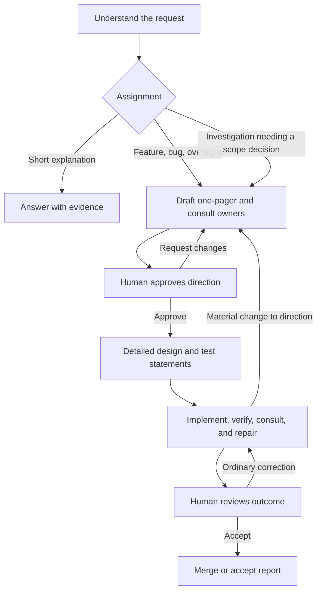

# Adaptive2 design and implementation proposal

**Current status:** `build.yaml` now selects adaptive2 for new submissions.
See [the rollout assessment](ROLLOUT.md). The plan and initial trial results below
record the earlier opt-in milestone; pending capabilities remain identified.

Read the [one-page proposal](PROPOSAL.md) first. This records the target design. The [implementation assessment](IMPLEMENTATION.md)
distinguishes the initial working slice from follow-up work. Baseline: recipes commit `33f6474`.
The work **fits** the [recipes cell's purpose](../../PURPOSE.md).

## What the current recipe establishes

| Current source | Consequence |
| --- | --- |
| [build.yaml](../../recipes/adaptive/build.yaml) and [classify.yaml](../../recipes/adaptive/classify.yaml) choose whether design is needed; a supplied handoff can bypass it. | There is no universal direction checkpoint. |
| [prompts.yaml](../../recipes/adaptive/prompts.yaml) explicitly excludes routine design approval. [develop.yaml](../../recipes/adaptive/develop.yaml) sends a completed design to test planning. | Better prose alone cannot restore early human oversight; a transition must change. |
| [consultation.yaml](../../recipes/adaptive/consultation.yaml) retains a structured conversation, but exports the current message as its summary. | The last reply is not necessarily a useful account of the exchange. |
| The consultation prompt asks participants to answer or agree scope. | It allows disagreement, but does not explicitly ask whether an existing interface or different approach would be better. |
| The merge summary asks for extensive accounting; [review.yaml](../../recipes/adaptive/review.yaml) already supports one primary document and supporting evidence. | We can improve document structure without rebuilding review transport. |

These are source findings. The concern about overly quick agreement comes from
the user's observations; this proposal does not claim a new measured job audit.

## Four assignments, one workflow

The first working agent reads the request and repository, identifies the assignment,
and states it in ordinary language. Use one `work_kind` value: `feature`, `bug`,
`explanation`, or `oversight`. Keep c2j's workflow `type` and creation-routing
`kind` separate; neither currently means this classification.
For delegated work, the receiving cell selects this value when it writes the
handoff. The child uses that assignment; a material mismatch calls for a revised
agreement rather than silently reclassifying the work.

| Assignment | Frame the work around | Completion means |
| --- | --- | --- |
| Feature request | Who needs what capability, why, and what is excluded? | The agreed behavior works, with relevant tests. |
| Bug report | What should happen, what happened instead, and who is affected? | The reported behavior is corrected and regression evidence exists. Do not invent a confirmed cause before investigation. |
| Explanation | What question must be answered, and what would a useful answer settle? | A clear answer with evidence, uncertainties, and any suggested next step. Negative findings can be valid. |
| Oversight | What overall outcome needs coordination, who owns its parts, and in what order? | Required work is complete and the combined outcome has been checked, or a precise unmet need is returned. |

Use oversight when the request is not one of the first three. Decompose it into
named feature, bug, or explanation assignments, running independent work in
parallel and dependent work in order. Oversight does not expand a cell's ownership.
A root cell often coordinates; another cell can coordinate its own dependencies.
A feature that needs one other cell remains a feature; it need not be relabeled.

Do this in the existing first agent turn, not an additional Jev classification
task. The category determines the deliverable and review path, not a rigid script
for the agent. Read it from recipe outputs rather than a generated state file.

Suggested first-turn instruction, alongside the existing c2j task context:

> Explain what we are being asked to do: add a capability, fix a bug, explain
> something, or oversee several pieces of work. Start with the user's problem
> and who needs the result. Inspect the repository before proposing a solution.
> For delivery work, write one-pager.md using the five review headings. Resolve
> important questions with the relevant cells and show useful alternatives.
> Keep the framing concise and preserve every important design question and
> answer, even when that section is long. Give the review a descriptive title
> naming the cell, kind of work, and proposed change. Return it for human direction approval before detailed
> specification or implementation. For a straightforward explanation, answer
> the question with evidence and limits.

## Checkpoint 1: agree the direction

The first review's primary document is `one-pager.md`, using the five sections in
the proposal. Its opening identifies the assignment, owning cell, user outcome,
and decision requested. Keep the opening narrative concise. “One-pager” describes
the alignment document; there is no page, word, or question-count limit.

The questions-and-answers section may be the largest part. Retain every important
design question, including settled choices whose rationale matters and questions
still open. Group related questions into labeled tables when that helps scanning.
Each answer gives the decision or recommendation, its reason, and any consequential
tradeoff; label uncertainty plainly. Link supporting technical detail, while
keeping the essential question and answer in the one-pager. Do not truncate, take
only the first few questions, or move important choices out of sight to meet a
length target. Answer what agents can establish before spending expert attention
on the choices that require it.

For UI work, include a small mockup or before/after sketch of the relevant journey,
including important failure/empty states. Bind images or HTML as supporting
artifacts, label them as proposals, and describe the interaction in text. Do not
use a mockup as evidence that the implementation works.

Ask for clarification when an answer would materially change the proposal. First
inspect what the repository and consulted cells can answer. Offer a recommendation
and explain the tradeoff; do not interview the human about every implementation
choice. An optional deeper questioning mode can borrow the assumption-testing
approach described in [grill-me](https://www.aihero.dev/skills-grill-me). That
article also distinguishes questions that need a prototype from those conversation
can settle. We are not installing or automatically invoking that skill.

Review title: **“Approve 1p for <cell> <work kind>: <specific change>”**, for example
**“Approve 1p for c2j feature: add CLI debug capabilities.”** The review title and
document heading should identify the work even in a list of other reviews. Stable
artifact filenames such as `one-pager.md` can remain simple. Use the same descriptive
approach for merge reviews, consultation titles, progress documents, and answers;
“Approve the direction” or “Review changes” alone does not orient the reader.
Rewrite a long title to fit the field while preserving its meaning; do not clip it.

Choices: **Approve direction**, **Request changes**, **Stop this work**. Feedback is needed for a revision.
An unresolved consequential question is a concrete decision, not an empty
“approve” form. Uploaded comments count as a revision.

Approval records the exact one-pager, selected mockups/child briefs, and human
response using existing artifact references and review receipts. Approval covers
the behavior, boundaries, and constraints; it does not claim that tests passed.
Do not use a handoff's presence, an agent's agreement, or an `approved` sentence
as evidence of a human decision.

After approval, continue with `design.md` as needed, `test-statements.md`, and
`handoff.md`. Each cell writes its own execution handoff; another cell's assignment
comes from that receiving cell's consultation. Keep detail proportional: do not
expand a tiny fix into a long spec.
Implementation starts in a fresh writable session. Advisory and planning sessions
remain read-only. Material behavior, ownership, compatibility, or cost changes
return a revised one-pager that highlights the difference from approval. The agent
decides whether feedback changes the direction or only the implementation.

## Dependencies during planning and implementation

Keep inline consultation for advice. Actual work in another cell becomes a new
job with its own assignment and selected handoff. New-cell work still goes through
root's creation review and registration process. An agreement is a proposed
commitment, not a completed dependency or authorization to publish it.

Current coordination permits execution requests only during implementation.
Adaptive2 must also allow an **approved prerequisite** during detailed planning
when its result is needed to finish the spec. Gate that path on the recipe's
recorded direction approval, while keeping the planning agent read-only. Do not
mislabel planning as implementation or remove the execution guard globally.
If a prerequisite must run before the overall direction is settled, present a
small one-pager approving that investigation or prerequisite first.

Suspend work that depends on the result; continue genuinely independent work.
Follow actual child attempts, return their failures to the parent, and retain the
current selective recovery and corrected replacement behavior. Show the wait as
“Waiting for cell X to fix Y; then we can test Z,” not an internal status label.

To avoid duplicate design reviews, a parent may present a child's self-contained
brief as supporting material in its direction review, explicitly naming the work
being approved. The coordinator passes the exact reviewed brief and recorded
approval reference. The child checks whether its proposed work fits that scope.
If it does, detailed planning can proceed; a new material choice goes back for
review. Missing or unverifiable approval takes the normal review path. This is
human approval reuse, not permission for a parent agent to approve arbitrary work.
The parent goal alone cannot bypass a child's checkpoint.

Keep final merge approval for each publishing job in the first version. A parent
that only coordinates presents a completion review, not a fictitious merge.
Removing or consolidating those final reviews is a later policy decision.

## Make consultation useful and visible

Address each agent as the owner of its cell, speaking directly to another owner.
The requester proposes work and asks what should change; the receiver examines
it and writes its recommended assignment. See the
[plain-language iteration](PLAIN_LANGUAGE_ITERATION.md) and its actual examples.

> Read the request and our code. Tell the other owner what you can provide, what
> you suggest changing, and why. Explain an existing alternative when it helps.
> Write the revised request yourself and point out its important differences.
> Ask the other owner when a choice needs their answer. Finish when the answer
> or recommendation is useful; an acknowledgment alone needs no additional turn.

Use a fresh advisory session for each participant and retain its own continuation.
Never carry those instructions into implementation. **The receiving cell writes
the execution handoff from the settled result.** The requester supplies the
original problem, explains what it needs, challenges the proposal when necessary,
and checks that the proposed outcome satisfies that need. The receiver owns the
concrete assignment and revises it as the discussion changes.

### A receiver-authored, typed handoff

Every follow-up assignment explicitly names one of the four work types. Its title
states the cell and intended outcome. Its opening preserves the parent's problem
and why this work is needed; the body uses the structure for that type:

| Work type | Required substance in the handoff |
| --- | --- |
| Feature request | Desired behavior; scope and non-goals; interface/compatibility constraints; acceptance outcomes. |
| Bug report | Expected and observed behavior; reproduction or available evidence; fix scope; regression expectations. Mark an unconfirmed cause as unknown. |
| Explanation | Exact question; context and bounds; what the answer must establish; expected sources and deliverable. |
| Oversight | Overall outcome; named feature, bug, or explanation assignments and owners; dependency order; completion and integration checks. |

All types identify the receiving owner, needed inputs, important unresolved
choices, and relevant consultation references. Keep these as ordinary Markdown
sections in `handoff.md`. A machine-readable `work_kind` and the selected artifact
reference support routing; do not repeat the prose in a compound state object.

Suggested receiver instruction:

> If this cell needs to do follow-up work, write its handoff.md. Frame it explicitly
> as a feature request, bug report, explanation, or oversight assignment using the
> matching structure. Explain how it serves the requester's original problem.
> State the scope and what would count as completion. Resolve objections with the
> requester and revise your document accordingly. Return the agreed document and
> only the supporting files that execution needs.

The requester selects the agreed receiver-authored handoff for execution; it does
not regenerate or paraphrase the assignment. The coordinator retains the original
artifact references and binds that version into the child. Receiver authorship
and agreement do not replace the human approval required by the direction gate.
The receiver's brief is also the source when a parent presents child scope for
human approval.

If the consulted cell redirects work, the actual receiving owner authors the
handoff, using the existing nested consultation path when appropriate. A referral
does not authorize the requester to invent that owner's assignment. If advice
fully answers the request and no follow-up work is needed, return the answer;
do not create a handoff or child just to satisfy a format.

For a corrected attempt, the parent can carry the receiver's existing handoff
alongside failure feedback and selected recovered work. A changed assignment
requires the receiver to revise its handoff; unchanged scope does not require
another consultation merely to attach diagnostics.

### Summary and exchange history

Each exchange has a descriptive directory, for example
`consultations/storage/save-draft/`. Reuse the existing thread identity internally
to distinguish repeated topics; do not expose synthetic identifiers as titles.

- `summary.md`: a short recommendation in the receiver's own voice, explaining
  the important changes from the request and why they help. Include a question
  when the other owner needs to answer it. Link the revised assignment and
  supporting evidence; avoid repeating a report checklist in each reply.
- `conversation.md`: the original request and each participant's public reply in
  order, labeled by cell, with evidence links. Render from retained conversation
  records after each exchange; no new summarizer agent or invented dialogue.
- Supporting files: selected examples, interface notes, or checks. Keep native
  conversation/session data as diagnostic material for continuation.

Have the participants maintain the short summary as part of their existing turns.
Do not display an internal field named `thinking` as private reasoning: its current
contract is already a shareable reply. Adaptive2 can name that field `reply` in its
own response schema. Publish only the explicit answer and explanation.

Close a thread as answered, scope agreed, declined, redirected, or unresolved.
Neither the label nor speed of agreement proves quality. The human should see
what was checked and why the recommendation follows.

## An inspectable story between checkpoints

Use a small hierarchy: **user outcome → this assignment → current decision or
action → evidence**. The first lines of every primary document follow it.

Optimize for how quickly an arriving expert can understand the task and make a
sound decision. The title provides recognition; the opening explains the problem,
why it matters, and what is needed now. The questions-and-answers section makes
the consequential choices inspectable. Agents gather context, reconcile cell
replies, and propose answers so the human need not reconstruct the story.

Preserve the submitted request as an immutable `request.md` artifact for human
navigation, alongside links to later human corrections. This is a source record,
not another JSON payload injected into prompts. A child handoff starts with its
parent's problem and why this assignment helps; it links the original request and
the relevant consultation. Include the small essential context directly, and
retain producer references for retrieving more. Do not copy every parent document.

`progress.md` is a short current view, updated by existing working turns at a
changed decision, dependency wait, failure/recovery, or completed milestone:

> **Bug report · checkout · Waiting on payments**
> Customers sometimes pay twice after retrying. Payments is adding a safe retry
> key. Our UI fix is ready; we will test the combined behavior when that lands.

Link the current one-pager, relevant conversation, and latest child result. Native
job/task records remain authoritative for status and execution history; this
document explains them. No heartbeat agent, parallel status database, or polling
loop. A sudden failure may leave an earlier progress document; display its producer
and time rather than claiming it is current.

Keep runtime instructions in agent context, not in the human-facing documents.
Prefer concrete phrases such as “the test could not reach storage” to internal
terms such as “dependency evidence is unsatisfied.” Name the relevant consequence
and next action. The assignment label supplies context; it is not a substitute
for explaining the problem.

Use artifact annotations to make one document primary, a few links supporting,
and raw logs/diffs diagnostic. Existing inspection tools provide deeper access.
Record producer references even where a UI cannot render a cross-job link.

## Checkpoint 2: review the outcome

Keep `merge-review.md` to preserve the useful existing approval/rebase mechanism.
Use a title such as **“Merge c2j feature: add CLI debug capabilities.”**
Use a short lead: **assignment, outcome, recommendation, decision**. Then:

1. **What changed** — user-visible behavior and how it matches the approved plan.
2. **What we needed others to do** — owner, requested outcome, actual result; link
   consultation summaries. Agreement and submission are not completion.
3. **How we tested** — a few expectation/result rows with evidence links. State
   failed, skipped, and untested behavior plainly.
4. **What we did not do** — exclusions, gaps, and worthwhile follow-ups. Distinguish
   optional ideas from unmet acceptance; do not turn every suggestion into a blocker.
5. **Interfaces and upgrade** — public APIs, ownership/encapsulation changes,
   compatibility, migration, and operational consequences when relevant.
6. **Changes from the approved plan** — a short explicit answer, including “None.”

Target 300–500 words. Use “None” or one sentence for genuinely empty sections.
Keep full file accounting, detailed tests, candidate hashes, and logs in supporting
documents. UI outcomes include actual current screenshots, clearly distinct from
design mockups. Keep a small **Read more** footer, not a directory dump.

Retain independent assessment and actionable repair before human review. Retain
approval reuse when a rebase leaves the approved diff unchanged; changed work gets
a focused follow-up linked to the original review. No hook fingerprint is needed.

For explanations, lead with **Answer**, then **Why**, **Limits**, and **Next step**
only if useful. Check claims against sources; do not force a source-code test plan
or a merge question onto a read-only answer. For a substantial approved investigation,
review the report against its agreed scope without pretending it fixed the problem.

## Concrete recipe changes

| Area | Proposed change |
| --- | --- |
| `recipes/adaptive2/build.yaml` | Opt-in public schema/entrypoint, based on the current root build contract. Preserve title, hooks, artifacts, package policy, and explicit child selectors. |
| `adaptive2/develop.yaml` | Fork the current loop. Add first scoping turn, direction review, recorded approval, and explanation exit. Route approved work to detailed planning. Reopen direction only for material changes. |
| `adaptive2/prompts.yaml` | Keep the empty-sequence include pattern. Add the four assignments and document templates; shorten human-facing language. Preserve operational capabilities and recovery instructions. |
| `adaptive2/agent.yaml`, `agent-turn.yaml`, response schemas | Select the new prompts and phase schema; keep separate sessions, permission inheritance, and writable implementation. Return the initial `work_kind` once and reference it directly. |
| `adaptive2/consultation.yaml`, its initializer, and response schema | Retain inline/nested workspaces and bounded conversations. Add summaries and Markdown replies. Return receiver-authored execution handoffs with `work_kind` and selected files; preserve truthful outcomes. |
| `adaptive2/coordinate.yaml` | Pass the agreed receiver handoff's original artifact references, type, parent context, and any recorded approval. Allow approved planning prerequisites and route children to adaptive2. Retain replacement and duplicate prevention. |
| `adaptive2/review.yaml`, `inspect.yaml` | Primary one-pager or outcome document, explicit form titles, selected supporting evidence, full accounting kept out of the primary brief. |
| Recovery, packages, hooks, Git helpers | Reuse current behavior and tests. Share an unchanged helper directly where its include graph permits; copy wiring that would otherwise load adaptive prompts. |
| `recipe-tests/adaptive2/` and a live trial area | Test transitions and artifact provenance natively; evaluate prose through actual model runs and human inspection. |

Start with the current implementation, not a new engine. Do not refactor adaptive
to make the experiment possible. Audit includes and child recipe selectors so
adaptive2 does not silently fall back into adaptive prompts or gates. A temporary
fork has a maintenance cost: until promotion, port relevant fixes and run both
regression sets. Extract shared abstractions only after the trial shows a need.
Start trials with fresh jobs and sessions; do not resume an adaptive checkpoint
under different adaptive2 instructions.

## Ownership and remaining limits

These changes are recipe-owned: new transitions, prompts, artifacts, and review
selection use existing operations. Cortex owns any needed visual grouping,
cross-job navigation, or preview improvements; c2j owns inspection and lifecycle
transport. Validate how existing annotations actually render before requesting a
UI change. The basic documents must remain understandable without a new UI.

Keep the existing [cancellation-message requirement](../FEATURE_REQUEST_C2J_CANCELLATION_MESSAGES.md)
and [child wakeup limitations](../REQUIREMENTS_C2J_PARENT_RECOVERY.md) visible.
Clearer documents do not supply missing runtime messages or change wait semantics.

Related contracts: [adaptive process](../../ADAPTIVE_BUILD_PROCESS.md),
[hooks](../BUILD_HOOKS_USER_GUIDE.md), [artifact bindings](../RECIPE_ARTIFACTS_REFERENCE.md),
[review annotations](../REVIEW_ARTIFACT_ANNOTATIONS.md),
[inspection](../JOB_INSPECTION_PLAYBOOK.md), and
[handoff/recovery](../ASSESSMENT_HANDOFF_ROUTING_AND_RECOVERY.md).
