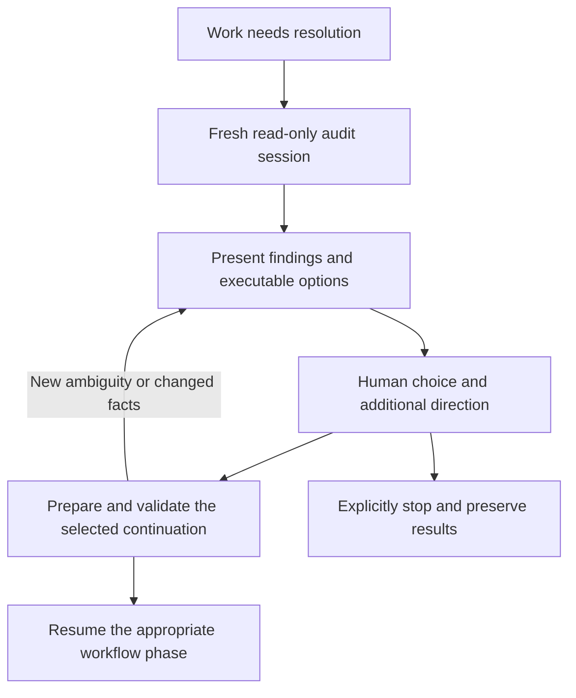

# Replace agent-declared failure with job resolution

Status: proposal for review, 2026-11-11. No recipe implementation or live-job changes are included.

## Proposed outcome

When a working agent concludes that it cannot proceed, keep the development job
unfinished and start a fresh audit session inside that job. The auditor checks the
claim against current evidence, proposes concrete options, and asks the human to
choose. The selected option becomes an explicit assignment and transition back
into the workflow. Stopping the work is an explicit human choice.

Remove terminal failure as a working-agent decision. An unresolved requirement,
permission problem, dependency, or exhausted correction loop should enter this
resolution flow whenever the recipe can still execute it. A failed verification
result remains failed; preserving the job does not convert it into acceptance.

This fits the recipes cell's purpose: orchestration, review, handoffs and recovery.
JobDB lifecycle and authorization remain owned by JobDB/c2j; deployment owners
control actual grants and executor availability.

## Why this is needed

Two inspected jobs show the same terminal mechanism with different underlying
problems:

| Job | Finding | What the workflow did |
| --- | --- | --- |
| `3LwJYdNiGWMsmXRiSZpBSTKsk1G` — cortex-assistant | The agent tested restart under an already completed goal and treated the expected conflict as an implementation blocker. The assumption about the goal lifecycle needed examination. | The agent returned `next: fail`; the recipe immediately ended the attempt. |
| `3LwPwP9yqfLtuYXFWVz7G4JopWa` — c2j | Both platform-verification submissions were denied. Five verification passes repeated the denial. The handoff's source-only acceptance also conflicted with the enforced runtime gate and earlier direction. | The agent returned `blocked`, received a recovery turn, then returned `fail`. No human decision addressed this blocker. |

See the [bounded comparison audit](../audits/2026-11-11/job-resolution/audit.md)
and its [producer inventory](../audits/2026-11-11/job-resolution/inventory.md).

The November 9 change already introduced human decisions at exhausted automatic
allowances. It left agent-declared failure and other operational recovery paths
terminal. This proposal closes that gap rather than merely increasing retry counts.

## Flow

Enter this flow for an agent's inability to continue, repeated unchanged recovery
or verification failures, and exhausted correction paths. Ordinary useful repairs
can continue automatically. Existing input questions need not acquire a second
audit when they already present a clear, actionable decision.

Treat old `next: fail` responses as resolution requests during migration. Update
the agent-facing contract and prompts so agents request resolution rather than
believe they are terminating the job. Changing a shared response contract should
follow its compatibility/deprecation process; routing old responses differently
can precede removing the old response value.

## The auditor's job

Start a new read-only session without the working agent's conversation checkpoint.
Supply the current assignment, human decisions, selected evidence and exact
producer references. The auditor uses normal inspection tools to retrieve missing
records rather than requiring the human to reconstruct history.

It should establish:

- What the user requested and what subsequent human decisions actually changed.
- What work exists, which checks ran, and what remains unproven.
- Whether the claimed blocker follows from evidence or an invented assumption.
- Current job, goal, child and candidate state, with observation times.
- Whether the next action belongs to this cell, a dependency owner, or an operator.
- What would materially change before another attempt, including any decision
  needed to reconcile the assignment with an enforced check.

The audit produces a short explanation and a recommendation. Its options must be
specific to the situation, with consequences and a concrete next assignment.
It does not execute fixes, alter permissions, change goals, submit replacement
jobs, or approve publication while preparing those options.

## Options that carry their own continuation

Each option has a stable identifier within its review, a human explanation, a
supported action, a precise assignment, relevant artifact references, and any
precondition to check before execution. These are workflow instructions, not a
second database of job status.

| Possible option | Continuation |
| --- | --- |
| Correct a mistaken assumption | Fresh implementation session over the saved checkout, with the correction and required checks. |
| Change behavior or acceptance scope | Design with the selected direction, followed by updated planning and the required review. |
| Resolve an external capability or dependency | Coordination with the identified owner and a concrete request; wait when there is actual pending work. |
| Retry a failed check after a correction | Verification of the applicable candidate after checking the prerequisite. |
| Investigate an unresolved factual question | A bounded investigation with a defined question and expected evidence. |
| Stop the work | Explicit incomplete outcome with saved results and an accurate effect on dependents. |

The user sees product choices, not state names. The recipe maps the selected
action to an allowed destination. The auditor cannot choose an arbitrary internal
node or jump directly past required verification and merge review.

For the c2j incident, useful proposals could include resolving the hook's
submission permission with its owner and then rerunning verification, or returning
to design to reconcile source acceptance with the enforced two-platform gate.
Neither option silently grants access or labels the failed check as passing.

## How the decision returns to work

Use normal op outputs, artifacts and transition payloads. A resolution payload is
absent during ordinary work. Once a decision exists, it carries:

1. The chosen action and the native human response receipt.
2. The selected option's assignment plus the human's additional direction.
3. The evidence and source references needed by the receiving phase.
4. The relevant observed candidate and prerequisites to recheck.

Prepare one clear current assignment from those inputs. Preserve older documents
as provenance and explicitly identify instructions superseded by the decision;
do not send contradictory assignments back to an agent and expect it to infer
which applies. New sessions avoid carrying forward the original mistaken premise.

Human free text is substantive direction. If it supplies a clear supported
continuation, use it. If it materially contradicts the chosen button or introduces
an unresolved choice, explain that difference and ask a focused clarification.
Do not silently coerce the text into the nearest menu option.

Before executing a selected action, recheck facts that may have changed while the
review was open: candidate, dependency completion, permission availability and
current assignment. Do not resubmit a child that has already completed the work.
Use native receipts and existing submission identities to avoid repeating effects
when a decision is replayed.

These transitions are forward workflow execution over retained work. They do not
rewind history, erase a failed check, or repeat an earlier external effect simply
because a phase is revisited.

## Chained jobs

An affected child stays unfinished while it awaits resolution; its parent keeps
waiting for that existing child. A fresh agent session is an operation within the
child, not a replacement child job. Separately running siblings can continue.

Keep one decision at the owner of the affected work. If it changes the parent's
assignment or another cell's agreement, route it to the responsible coordinator
and carry the resulting direction back into the child's assignment. Implementation
must verify the available parent/child communication contract; this proposal does
not assume that a child can edit its parent or that a live result is already a
final child output. Any missing nonterminal escalation capability belongs to c2j
and must be identified before promising automatic cross-job propagation.

Do not maintain a parallel table of active, failed or completed children. Read
their actual records when preparing and applying a decision. A stopped child
remains incomplete; the parent must resolve that outcome rather than assume
success or automatically recreate it against the user's direction.

## Failure of resolution itself

If the audit cannot produce usable options, show a basic decision using the saved
reason and evidence, with additional human direction, a fresh audit attempt, and
explicit stop available. Do not recursively invoke the same failing auditor or
terminate merely because its explanation could not be formatted.

Actual cancellation, a dead worker, an unavailable JobDB, or inability to persist
or display input may prevent the recipe from running this flow. Those are runtime
outcomes, not an agent's decision that the work is impossible. Catchable failures
should enter resolution after preserving the actual failure evidence. Cancellation
must retain its meaning.

Existing failed jobs are not revived by changing YAML. Applying this behavior to
them requires a separately authorized supported restart or continuation with
reviewed inputs. Updating the recipe alone does not change captured recipes.

## Implementation shape to review

Build on the existing fresh-session, review, receipt, artifact and phase-dispatch
mechanisms. The current [limit decision helper](../../recipes/adaptive2/limit-decision.yaml)
already provides part of this pattern. Extend or factor it so concrete resolution
options are not reduced to allowance increases.

Audit the call sites of the operational-failure helper before implementation.
Replace semantic inability-to-proceed exits and unchanged recovery exhaustion
with resolution. Keep runtime failure evidence and explicit user-stop outcomes
distinct. The shared failure helper should not simply become a generic retry.

Proposed validation should establish that:

- An agent declaring inability to proceed reaches a fresh audit and native human
  input while the owning job remains unfinished.
- Repeated permission-denied verification reaches resolution without another
  unchanged verification loop or a fabricated passing verdict.
- A mistaken completed-goal premise is examined against actual goal state.
- Selected options and free-text corrections reach the correct phase with the
  saved checkout and a clear current assignment.
- Scope changes receive the required review; verification and publication cannot
  be bypassed by a continuation target.
- Parent waiting, changed child status, replayed decisions, audit failure and
  explicit stop preserve truthful outcomes without duplicate execution.

Deterministic native tests should cover routing and persistence. A small live
audit evaluation should separately check whether the fresh agent challenges a
bad premise and proposes useful choices. Passing routing tests alone cannot
establish the quality of its judgment.

The central review decision is whether to adopt this rule: **agent-declared
inability and exhausted recoverable work trigger an in-job resolution decision;
they do not independently terminate the assignment.**
