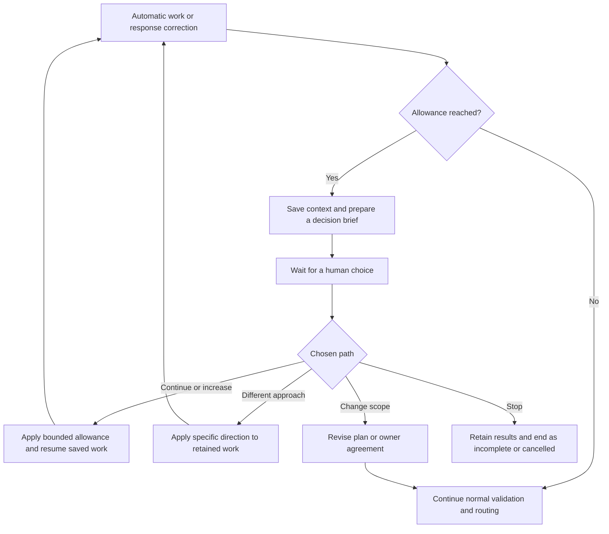

# Ask for direction when automatic work reaches its limit

Proposal — 2026-11-09. No implementation changes are included.

When an implementation allowance or response-correction limit is reached, keep
the job open and ask the human how to proceed. Explain the requested outcome,
what has been tried, what remains unresolved, and the tradeoffs between concrete
next steps. Increasing the allowance must be one of those choices when further
attempts are possible.

Reaching a limit establishes that automatic work must pause. It does not establish
that the task is impossible, that the work is complete, or that a human must debug
the workflow.

## Scope and current behavior

This **fits** the recipes cell's responsibility for orchestration, human review,
and recovery. The proposal is based on current source, not a new job audit.

| Current source | Behavior to change |
| --- | --- |
| [`build.yaml`](../../build.yaml), [`autonomous-budget.yaml`](../../recipes/adaptive2/autonomous-budget.yaml) | A positive `max_iterations` limits consecutive automatic implementation work. Zero disables this particular limit. |
| [`develop.yaml`](../../recipes/adaptive2/develop.yaml) | `autonomous_limit` and `response_repair_exhausted` terminate through the operational-failure helper. Response correction permits the original response plus two correction attempts. |
| [`response-repair.yaml`](../../recipes/adaptive2/response-repair.yaml) | Consultation response correction fails after two retries; a missing usable checkpoint has a separate failure reason. |
| [`inspect.yaml`](../../recipes/adaptive2/inspect.yaml) | Review preparation also permits two corrections, then fails when the response remains invalid. |
| [Earlier adaptive development](../../recipes/adaptive/develop.yaml) | The combined failure message quoted in the request lives here. Its corresponding repair and inspection helpers have the same class of terminal behavior. |

Cover the default adaptive2 build and these equivalent paths in retained adaptive
recipes. Otherwise a user could receive the new checkpoint during implementation
but still lose the job while preparing its review or consulting another owner.
Do not replace the general operational-failure helper: unrelated failures still
need their existing handling.

Consultation debate/depth bounds, unchanged operational blockers, Git retries,
creation's separate review machinery, and runtime time/execution limits are
outside this change. Consultation **response correction** is in scope; increasing
its allowance does not increase debate depth or authorize more delegated work.

The recipe can use existing artifacts, native `input` reviews, receipts, and state
transitions. c2j owns durable waiting, cancellation, runtime budgets, and parent/child
lifecycle behavior; c2ops owns agent execution and checkpoints. Any missing runtime
capability belongs to those owners, rather than a recipe script that simulates it.
Client presentation and notifications belong to the consuming UI owner.

## The human experience

Use a title naming the work and the decision, such as **“Importing contacts needs
your direction.”** The primary document should be understandable without knowing
what a recipe, state, checkpoint, artifact reference, or response schema is.

The explanation must cover:

1. **Your goal:** the requested outcome and relevant agreed constraints.
2. **Progress:** what is done, what has been checked, and what remains uncertain.
3. **What has been happening:** a short account of materially different attempts
   and their results. Say when retries repeated the same unsuccessful approach.
4. **Why we paused:** identify the particular allowance and its count. Explain
   an attempt as another automatic work pass or another try to correct a work
   report, not as a duration or a promise of completion.
5. **The unresolved issue:** explain the conflict in the user's terms. Separate
   a product decision, disagreement between owners, and trouble producing a usable
   work report. A limit alone is not evidence of a disagreement.
6. **Choices:** concrete actions, benefits, costs or risks, and a recommendation
   tied to the evidence. State what the selected action will authorize.
7. **Saved work:** what is retained, whether anything has already been integrated,
   and whether any separately running work remains active.

Keep the main brief concise, but do not impose a length cap that hides an important
decision. Link selected supporting documents and diagnostics for those who want
detail. Do not require the human to read raw errors to understand the question.
Distinguish observations from suspected causes; do not invent cost estimates,
completion estimates, or a requirement conflict to make the brief sound decisive.

### Resolution choices

Generate task-specific labels and explanations within these supported actions.
Offer only choices the workflow can actually carry out. Usually three to five
choices are sufficient; more are appropriate when the decision requires them.

| Choice | What happens | Benefit | Cost or risk |
| --- | --- | --- | --- |
| **Continue for another bounded round** | Resume the saved work with the current allowance and a stated next attempt. | Keeps useful context and progress; appropriate when recent attempts are converging. | Uses more time and resources; the same obstacle may recur. |
| **Increase the allowance** | Grant an explicitly larger number of attempts for the next round. Show both the old and new allowance. | Gives a credible approach more room before another decision is needed. | Delays the next checkpoint and may spend more resources without resolving the cause. |
| **Try a specific different approach** | Follow a described alternative, optionally using a fresh agent session over the retained work. | Can escape an unproductive approach. | May repeat investigation or require revalidation; a fresh session does not itself fix a defect. |
| **Change the agreed scope or constraint** | Return to planning or the relevant owner's agreement with an explicit proposed change. | Can remove the actual conflict or deliver a smaller useful outcome. | Defers an outcome or changes compatibility, behavior, or responsibilities; requires normal approval. |
| **Stop this work and keep the results** | End the work as cancelled/incomplete, retaining its evidence and candidate changes. | Stops further resource use and preserves material for later work. | Leaves the requested outcome unfinished. |

“Try another approach” must name the approach. “Change scope” must name what would
be removed or changed. For a changed assignment, an option might be “Ask the
storage owner to agree to the revised retention requirement.” Do not offer “ignore
the conflict,” “accept the invalid report,” or “mark complete” as shortcuts.

No choice is automatically submitted. A recommendation is advisory. Optional
feedback lets the human supply a different direction; contradictory selections
and feedback require clarification before more work starts. There is no silent
default or timeout approval.

## Example: implementation work needs more room

The following examples are illustrative, not reports of observed jobs.

> **Importing contacts needs your direction**
>
> You asked us to import contacts without creating duplicates. File reading and
> saving contacts are working, and their checks pass. The remaining problem is
> deciding whether two rows with the same name but different email addresses
> represent one person or two.
>
> We tried matching by email, then combining name and email. Both approaches
> still leave ambiguous rows. We have used the five automatic work passes allowed
> since your last decision, so the work is paused. The changes are saved and have
> not been integrated.
>
> **Recommended: put ambiguous rows aside for your review.** This avoids silently
> combining different people, but some rows would need manual attention. We would
> update the plan for your approval before implementing that change.
>
> Other choices:
>
> - **Continue the current approach for up to five more passes.** Keeps the
>   original goal; may repeat the same ambiguity without new matching information.
> - **Increase the next allowance from five to ten passes.** Gives us more room
>   to investigate matching evidence; takes more resources and still may not settle
>   what counts as the same person.
> - **Stop and keep the current work.** Avoids further effort now; the importer
>   remains unfinished.
>
> Which path should we take?

## Example: repeated corrections cannot produce a usable report

> **The storage work is waiting on an agreement**
>
> You asked for uploaded files to expire after 30 days. The storage team agreed
> to build that behavior. The instructions now being submitted instead say to
> keep files indefinitely, so we cannot start that work under the existing
> agreement.
>
> Two automatic attempts to correct those instructions still left the changed
> requirement in place. This is a disagreement about what to build, not evidence
> that file expiration cannot be implemented. No storage implementation has
> started. Both versions of the instructions are saved.
>
> - **Recommended: keep the agreed 30-day expiration and rebuild the request
>   from those instructions.** Preserves the approved behavior; any intended
>   change to retention would need a separate decision.
> - **Ask the storage team to agree to indefinite retention.** Addresses the
>   changed requirement directly; needs a revised plan and agreement before work
>   can start.
> - **Increase correction attempts from two to four for this request.** Allows
>   more attempts to produce instructions matching the existing agreement; does
>   not authorize indefinite retention and may repeat the same problem.
> - **Stop and keep the work so far.** Avoids further effort; storage changes
>   remain unfinished.
>
> Which path should we take?

For a purely mechanical reporting problem, say so instead: “The work report
refers to a test-results file that was not supplied. Two attempts to supply it
still left it missing, so we cannot verify the completion claim.” Do not turn
that into a fictional product disagreement or ask the human to repair JSON.

## Proposed workflow

### Preserve enough context to resume correctly

Before asking, retain the goal, approved scope, current phase and assignment,
session reference, managed Git state, selected documents, validation issues,
rejected responses, correction evidence, pending child identifiers, and the
attempt history needed to explain the obstacle. Preserve original document
identities and rejected proposals separately.

Use ordinary state inputs/outputs and existing artifact references. Export context
explicitly across helper boundaries, following the [scope rules](../NODE_SCOPE_SPEC.md).
Do not reconstruct a continuation from the invalid response, the generated brief,
or an old summary alone. Resuming must preserve the distinction between ordinary
implementation and restricted response correction.

### Prepare a brief without creating another unbounded repair loop

A bounded, read-only synthesis step receives selected evidence and attempt
history. It writes the human brief and proposes choices from supported actions.
The recipe supplies authoritative counts, allowed actions, and continuation data;
the synthesizer cannot change them or declare validation satisfied.

If synthesis fails or its output is unusable, render a deterministic brief from
the known goal, limit, last reliable progress summary, and unresolved issues.
Explain uncertainty and attach diagnostics. Still offer valid continuation and
stop choices. Do not invoke the same exhausted correction loop to repair the
escalation, and do not fail solely because the nicer explanation could not be
generated. An actual runtime failure to persist or display input remains a
separate operational failure.

### Collect and apply the decision

Reuse the [native review helper](../../recipes/adaptive2/review.yaml) and
[`input` contract](../ops/OP_INPUT.md): a primary Markdown brief, selected supporting
documents, a required single-choice resolution, and optional feedback. Keep raw
diagnostics out of the primary document list. Use a follow-up form when a custom
allowance or missing direction is needed rather than assuming conditional fields
or an unrestricted numeric widget exist.

Persist the exact displayed options, selected action, allowance, feedback, and
native receipt. Validate action availability and any number before resuming.
Malformed answers return to the question with a clear explanation and no work
performed. Replaying the same response after restart must not grant a second
allowance or spawn duplicate work.

Both the default build and inline consultation callers must receive these
receipts. Include them wherever existing human-response accounting is used;
otherwise a real decision may fail to renew the suspended caller's allowance.
Use the original request/submission identifiers, not model-generated substitutes.

### Make increasing the limit precise

Recommend **a one-round override**, not a permanent configuration change:

- “Increase from five to ten” grants up to ten new eligible work passes after
  this answer. It does not mean five additional passes or ten total lifetime
  passes. Display that distinction in ordinary language.
- “Continue with five” renews the existing five-pass allowance. It is distinct
  from choosing a larger allowance.
- Response correction keeps its default of two retries. “Increase from two to
  four” grants up to four further correction attempts for the currently unresolved
  response. A later unrelated invalid response starts with the normal default.
- Maintain lifetime evidence of attempts even when the new round's counter starts
  at zero. Count completed correction attempts, not the initial invalid response
  or the act of detecting it.
- The override ends at the next genuine human decision or completion of the
  affected correction episode. Subsequent ordinary rounds use the configured
  allowance unless the human explicitly chooses another override.
- Custom overrides must be finite positive integers; an “increase” must exceed
  the current effective allowance. Do not offer unlimited retry as a recovery
  option. Existing `max_iterations: 0` retains its current disabled meaning.
- A larger implementation allowance does not raise the correction allowance,
  and a correction grant does not permit implementation during correction.
  Existing human-reply renewal rules still apply to the surrounding workflow.

Questions, brief generation, and processing the reply do not spend the granted
allowance. Merely displaying a question or replaying a saved receipt does not
renew anything. Another exhausted round presents a new decision with the previous
choice, additional attempts, and what changed; the earlier answer never authorizes
unlimited continuation.

A missing usable session or uncertain already-started side effects cannot be
fixed by increasing a number. Explain why direct retry is unavailable and offer
only supported alternatives, such as a fresh read-only assessment of retained
work. Keep these conditions distinct from ordinary exhaustion.

### Preserve outcome and lifecycle semantics

While input is pending, the affected work remains unfinished and the job waits.
A waiting child is not a failed child: its parent must not launch a replacement
or close the ticket. The child that owns the blocked work collects the decision,
with enough parent-task context for the human to recognize it. Inline helpers
propagate the decision through their caller instead of generating duplicate asks.

Pausing the affected loop does not imply that already-running sibling jobs stop.
Show their status and avoid resubmitting them. Stopping must follow the existing
cancellation policy for active children and report retained work and side effects.
Do not label cancelled or incomplete work as successful delivery, merge it, or
close dependent work as satisfied. Verify both recipe dispositions and actual
runtime/ticket status during implementation; a `cancelled` output field alone
does not prove runtime cancellation.

Scope changes return through planning and agreement with the responsible owner.
Continuation follows the normal validation, verification, and outcome-review
gates. A grant of more attempts is never approval to weaken a requirement,
replace an agreed assignment, bypass a failing check, or merge a candidate.

Runtime execution/time limits remain independent. Do not promise that a recipe
allowance extends them or that waiting suspends a runtime deadline. Confirm the
deployed runtime's waiting behavior and report any incompatibility to c2j.

## Implementation handoff, if approved

1. Add a focused shared escalation helper for context, brief production, native
   input, and validated decisions. Keep continuation with the owning loop.
2. Route adaptive2 implementation exhaustion and response-correction exhaustion
   through it, including consultation and inspection. Carry effective allowances,
   retained context, and receipts explicitly; preserve successful paths.
3. Apply the same policy to the corresponding retained adaptive paths, including
   the combined `iteration_limit` branch. Do not globally soften operational
   failures or broaden this change to every retry counter.
4. Verify parent waiting and stop/cancellation semantics against the installed
   runtime. If a necessary capability is absent, specify the owning component's
   requirement before claiming end-to-end support.
5. Add the expectations below before implementation, then add native regression
   cases. Preserve existing historical statements and document this proposal's
   changed expectations rather than silently rewriting old assertions.
6. Update build input guidance and adaptive documentation. Validate local recipes
   with `c2j submit --recipe-file ... --run --embed`, then run targeted native cases
   and inspect actual generated decision packets.

No new public correction-limit setting is required: the human can override the
default through the checkpoint. Repository defaults and future jobs are unchanged.
Already submitted jobs retain captured recipes; rollout applies to new submissions
unless c2j offers an explicitly supported migration. Do not assume this proposal
can rewrite a running job or revive a failed one in place.

## Proposed acceptance statements

These are planning statements, not implemented tests. Each expectation is at most
30 words. During implementation, publish them as the normal c2 test-plan artifact.
Paths below are relative to the repository root; `limit-escalation.test.yaml` is a
proposed test file under `recipe-tests/adaptive2/`.

| ID | Expectation | Importance; level/dependencies | Relevant files |
| --- | --- | --- | --- |
| LE-01 | Reaching an implementation allowance preserves work and requests a decision without failing or closing the task. | Critical; integration / c2j input, Git | `recipes/adaptive2/develop.yaml`, `recipe-tests/adaptive2/human-turns.test.yaml` |
| LE-02 | Successful work below its allowance follows normal validation and review without an escalation. | High; integration / c2j | `recipes/adaptive2/develop.yaml`, `recipe-tests/adaptive2/human-turns.test.yaml` |
| LE-03 | Exhausted response correction asks for direction during implementation, consultation, and review preparation while preserving the unresolved evidence. | Critical; integration / c2j artifacts, scripted agents | `recipes/adaptive2/response-repair.yaml`, `recipes/adaptive2/inspect.yaml`, `recipes/adaptive2/develop.yaml` |
| LE-04 | A larger allowance grants exactly the displayed new attempts; reaching it again requires another human decision. | Critical; integration / c2j input | `recipes/adaptive2/autonomous-budget.yaml`, `recipe-tests/adaptive2/limit-escalation.test.yaml` |
| LE-05 | Replaying a saved decision neither renews an allowance nor duplicates delegated work. | Critical; integration / c2j restart, children | `recipe-tests/adaptive2/limit-escalation.test.yaml` |
| LE-06 | Correction extensions preserve validation requirements and never authorize implementation or acceptance of invalid reports. | Critical; integration / c2j, scripted agents | `recipes/adaptive2/response-repair.yaml`, `recipe-tests/adaptive2/build-handoff-recovery.test.yaml` |
| LE-07 | Human direction changes scope only through the appropriate planning and owner-agreement process. | Critical; integration / c2j input | `recipes/adaptive2/develop.yaml`, `recipes/adaptive2/consultation.yaml` |
| LE-08 | A failed explanation step still presents a useful decision using retained facts and supported actions. | High; integration / c2j, scripted agent failure | `recipe-tests/adaptive2/limit-escalation.test.yaml` |
| LE-09 | Stopping retains results, prevents publication, and leaves the outcome cancelled or incomplete rather than successfully delivered. | Critical; integration / c2j lifecycle, Git | `recipes/adaptive2/develop.yaml`, `recipes/adaptive2/workflow.yaml` |
| LE-10 | Parents wait for children seeking human direction without treating them as failed or launching replacement work. | Critical; integration / c2j children, input | `recipes/adaptive2/coordinate.yaml`, `recipes/adaptive/await-child.yaml` |
| LE-11 | Missing safe continuation context never enables blind retries, regardless of the requested allowance. | Critical; integration / c2j checkpoints | `recipes/adaptive2/response-repair.yaml`, `recipe-tests/adaptive2/response-repair.test.yaml` |
| LE-12 | Decision briefs explain the goal, attempts, unresolved issue, and concrete options with benefits and drawbacks without requiring workflow knowledge. | High; live integration / c2j, model, human review | `recipe-tests/adaptive2/limit-escalation.test.yaml`, live review packet |
| LE-13 | Invalid or contradictory answers perform no further work and return a clear clarification request. | High; integration / c2j input | `recipe-tests/adaptive2/limit-escalation.test.yaml` |
| LE-14 | Retained adaptive workflows offer equivalent limit decisions while unrelated operational failures retain their existing outcomes. | High; integration / c2j | `recipes/adaptive/develop.yaml`, `recipes/adaptive/response-repair.yaml`, `recipes/adaptive/inspect.yaml` |
| LE-15 | One-round overrides expire as displayed; later unrelated correction episodes retain the default allowance. | High; integration / c2j input | `recipes/adaptive2/autonomous-budget.yaml`, `recipe-tests/adaptive2/limit-escalation.test.yaml` |

Scripted native tests establish routing, counts, evidence retention, and lifecycle
behavior. They do not establish whether model-written explanations make sense.
Review live packets for a converging implementation, a true scope conflict, and a
mechanical reporting failure, including a repeated escalation after more attempts.
