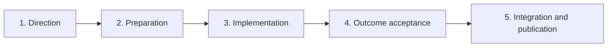
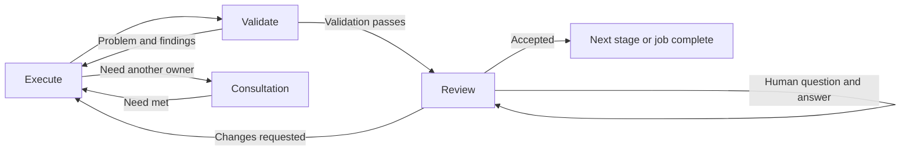
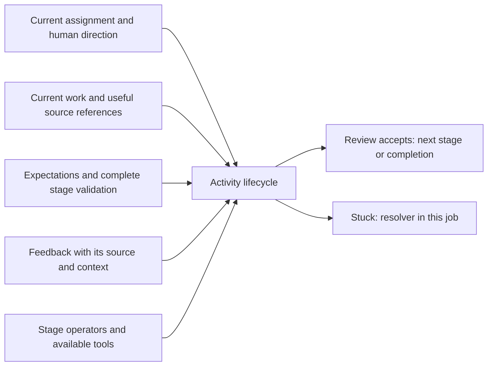
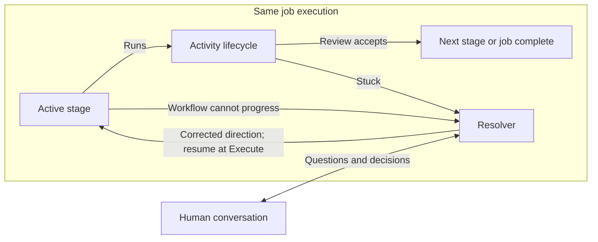

# Adaptive3: one activity lifecycle across five stages

This is the conceptual model for adaptive3, a separate recipe family based on
lessons from adaptive2. The [adaptive3 implementation design](../adaptive3/DESIGN.md)
defines its files, interfaces, reuse and tests. Adaptive2 and the current `build`
entrypoint remain intact. Neither document changes the running recipes.

## The model

Use one cycle throughout the job: **Execute → Validate → Review**.
**Consultation** supplies advice or external work. Every correction returns to
Execute, followed by the stage's full Validate step before Review. Each stage
supplies its purpose, work, expectations, and operators.

The recipe defines the fixed cycle and stage order. Agents do the work and
interpret feedback. Humans interact through agents that explain the actual
documents and results, answer questions, and carry requested changes into Execute.

A resolver cuts across the stages. It can investigate the whole workflow and
arrange whatever correction is needed to get it moving again, using the available
operations and owners. It works inside the same job. `stuck` enters resolution;
an agent cannot choose to end unfinished work.

Human direction carries more weight than agent advice. The workflow preserves
that distinction instead of treating every piece of feedback as another equal
instruction.

There are no mandatory internal handoff files. Work is described through ordinary
activity inputs and native results. Files exist because someone needs their
content, not because the recipe needs a document to move to its next state.

This fits the [recipes cell's purpose](../../PURPOSE.md). Existing runtime and
operation boundaries remain owned by c2j and c2ops.

## 1. The stages

A stage answers **what are we trying to accomplish now?** Every box below uses
the same cycle, with its own validation and reviewer. These boxes are stages only.

When Review accepts the result, the recipe advances to the next stage. Acceptance
in the final stage completes the job. Moving forward is a direct transition,
not another task or decision.

| Stage | Purpose | Acceptance in Review |
| --- | --- | --- |
| **Direction** | Understand the problem, identify owners, compare useful approaches, and agree what to do. | Human approval of the design one-pager. Important questions are addressed or explicitly left open with their consequences understood. |
| **Preparation** | Develop the detail and test expectations needed to implement the agreed direction. | An agent accepts the assignment and test plan as usable and consistent with the approved direction. No routine human approval is added. |
| **Implementation** | Produce the behavior and establish that it works. | Independent assessment accepts the result after the full Validate step. |
| **Outcome acceptance** | Make the result understandable and let the human decide whether to accept it. | The human accepts the validated result and review material. |
| **Integration and publication** | Integrate the accepted work and perform configured publication steps. | Review confirms the actual integration and publication results, completing the job without another human approval. |

The first working turn can establish the request's meaning and draft the design.
There is no separate classification task. Preparation may be brief for a small
fix. Implementation can contain many lifecycle passes. Outcome acceptance may
contain a long conversation without sending work back to Implementation.

The recipe also defines returns to earlier stages, such as Direction for a scope
change. Every return enters Execute and follows the full cycle of that stage.
There are no direct routes to individual checks. Preserve saved work and native
decisions; do not replay completed external effects blindly.

### Variations by assignment

Keep the four familiar kinds of work:

| Kind | How the stage plan applies |
| --- | --- |
| Feature | Agree the capability, prepare, implement, accept, and integrate it. |
| Bug | Investigate the reported behavior as part of Direction; carry a useful reproduction or regression check through Implementation. |
| Explanation | Execute investigates, Validate checks the answer, and Review accepts it. An answer-only assignment then finishes without delivery stages. |
| Oversight | Agree the overall outcome, obtain component work through consultation, and check the combined result. Independent work can proceed in parallel. |

The assignment determines whether this is delivery or an answer-only cycle.
That is not a decision to skip steps after a problem appears. Both use the same
complete lifecycle; changing delivery scope requires human direction.

## 2. The activity lifecycle

A lifecycle answers **how do we work on the current assignment?** Define these
four activities once, then reuse them across stages.

| Activity | Its job | Typical operator |
| --- | --- | --- |
| **Execute** | Carry out the assignment or correct it using feedback: investigate, write a design, prepare tests, change code, or obtain work through a child job. | A working agent using tools; a native operation when the action is already concrete. |
| **Validate** | Run the stage's complete validation and report what passed, failed, or could not be checked. | Commands, hooks, agents, or a combination. |
| **Review** | Judge the result or help a human make a decision about it. | An independent reviewer or a human supported by a review agent. |
| **Consultation** | Resolve a question with an owner, agree external work when needed, obtain it through child execution, and evaluate the result. | Requesting and receiving agents using the same shared activities. |

### How work moves between activities

Consultation returns information or work to its caller. Review can use it to
answer a question while the item remains unchanged. If changes are needed, return
to Execute and then full Validate; consultation does not provide a shortcut.

The recipe wires these transitions directly. Finishing Execute leads to Validate;
passing Validate leads to Review; acceptance advances. Findings or requested
changes return to Execute. No separate routing decision follows acceptance.

The stage defines Validate once. Findings tell Execute what to correct; they do
not select a subset of validation. A wording change, missing image, and code fix
all follow Execute → full Validate → Review in their stage. There is no separate
Repair activity, schema, or retry loop.

This describes control flow, not a fixed number of agent calls. Execute can run
its own checks, but those do not bypass Validate. Review may be agent judgment or
a human decision, as defined by the stage. If work cannot proceed, return `stuck`
and enter the resolver.

## 3. What goes into a lifecycle

Give the operator enough context to work without requiring it to maintain a model
of the workflow.

These are conceptual inputs, not a new `flow` object or an input JSON file.
Pass the specific values a node needs. Read normal recipe outputs and runtime
context directly.

| Input | What it provides | What it must not become |
| --- | --- | --- |
| Current assignment and human direction | The outcome being pursued now, approved scope, and relevant newer instructions. | A copied planning prompt whose obsolete restrictions still govern implementation. |
| Current work and useful source references | The managed workspace, immediate results, and native references for retrieving more. | Every previous inbox and outbox combined into a growing archive. |
| Expectations and checks | What this assignment should establish and the stage's complete validation definition. | A per-correction selection of checks, evidence manifest, or requirements invented by a checker. |
| Feedback and source | What was said, by whom, about which result, and any native human decision receipt. | Agent paraphrases presented as human decisions, or a numeric priority system agents must maintain. |
| Operators and tools | Who executes, validates, and reviews, and the tools available to them. | A dispatcher, another permission model, or configurable routes around the cycle. |

The stage supplies these inputs. In Implementation, for example, the assignment
is the approved behavior, the work is the managed checkout, and feedback includes
current human direction and findings. Validate runs the defined verification;
Review provides independent assessment.

Keep results small: a short summary, the actual operation outputs, and findings
or a request for help when needed. Require extra fields only when used.
Do not require empty questions, packages, file descriptors, and coordination
objects in every response.

A plain answer can stay in native outputs. Code persists through the managed
workspace. Useful files persist as artifacts. The lifecycle returns those results;
it does not produce a mandatory handoff document describing them again.

## 4. Human interaction and feedback

Humans should deal with an agent that can explain the work, not with the recipe's
internal state machine. The review agent presents the underlying documents and
results and answers questions. Changes return to Execute. If a change requires an
earlier stage, the recipe returns there and runs its complete cycle.

Use this same behavior in design review, outcome review, and resolver discussion.
Keep the agent's read-only session while discussing the same item. Give it the
current assignment, the actual item, relevant checks, and native history. It can
retrieve more context without asking the human to locate files.

### Dialogue stays in review

| Human message | What happens |
| --- | --- |
| “Why this approach?” | Answer briefly and keep the same item pending. |
| “What happens if saving fails?” | Explain the behavior from the design or results; inspect further if needed. |
| “Change the design to preserve the draft.” | Return to Direction's Execute with the human wording, then full Validate and Review. |
| “Keep the design; fix the missing error message.” | Return to Implementation's Execute, then full Validate and Review. |
| “This paragraph is confusing; explain the limitation clearly.” | Return to the current stage's Execute, then full Validate and Review. |
| “Why is that necessary? Use the existing API instead.” | Answer and carry the change request into Execute. |
| “Could we use the existing API?” | Discuss the option; clarify briefly if it is unclear whether a change is requested. |

A quick question may require one small read-only model invocation. It does not
resume the working Execute activity, regenerate documents, rerun tests, or require
another approval just to answer. If the answer needs owner advice, consult and
bring the answer back to review.

A clear request to change work is sufficient direction to return to Execute.
Do not ask the human to choose a phase or confirm the same request again. If the
intent is genuinely ambiguous, ask one focused question within the review.

Approval and cancellation remain explicit human decisions with native receipts.
“That makes sense” in a discussion is not merge approval. Resolve conflicting
approval and change instructions within Review before it records acceptance.
Questions do not consume or renew automatic-work allowances.

A logical review conversation can span several native input requests. Submitted
requests remain immutable. Preserve the current item and show answers through
native discussion/results; do not generate answer documents or reattach the
whole review for every turn. Refresh the review agent's context when corrected
work returns.

### Human direction takes precedence over agent advice

Human and agent feedback are not interchangeable. Use the following rules rather
than a scoring system:

| Source | How it affects the work |
| --- | --- |
| Current explicit human direction | Governs the requested outcome, scope, priorities, and accepted tradeoffs. It supersedes conflicting older human direction for the matter it addresses. |
| Existing human approval | Continues to apply to the work actually approved unless later direction or a material change affects it. |
| Agent recommendation or generated plan | Helps implement or question the direction. It cannot silently restore an excluded requirement or overrule a human choice. |
| Actual check or runtime result | Establishes what happened. Interpret its relevance against the current assignment; do not change the recorded fact to match a preferred conclusion. |

A human question is not automatically a scope change. An agent may explain a
consequence, challenge a mistaken factual premise, or recommend a different
choice. Once the human makes a clear decision, subsequent agents must work from
it rather than repeatedly reopening the same settled issue.

For example, if the human excludes concurrent reopen behavior, an agent-generated
test plan cannot reintroduce it as a completion blocker. If a remaining required
test fails, human direction can change what is required, but it cannot make that
execution a passing test. Record the revised decision and the actual result.

Feedback must retain its origin. Pass the human's original message and receipt
to Execute, rather than relying only on an agent's paraphrase. c2j already holds
that provenance; no feedback file or ledger is needed.

## 5. Consultation includes child execution

Consultation works through a question or assignment with the responsible owner.
The conversation stays inline in managed cell workspaces. The receiving agent
checks existing capabilities, challenges assumptions, and suggests alternatives
in its own voice.

If advice settles the issue, return the answer. If work is needed, the receiver
states the proposed assignment as a feature, bug, explanation, or oversight
request. The requester can challenge its scope. Retain the agreed request in
normal consultation outputs and use it as the child's request input.

**Receiver authorship is the lesson to preserve. A required `handoff.md` is not.**
There is no requirement to write, rename, compare, restore, or forward a special
handoff file. A useful specification can be referenced if it already exists.

When agreed work is needed, consultation obtains it through child execution and
native waiting. The child follows the same complete cycle. Its result becomes
input to the caller, whose full Validate and Review evaluate it as part of the
assignment. There is no extra dependency gate after Review accepts.

The child returns problems to Execute. If it gets stuck, its resolver keeps
the same child job alive. The parent retains that dependency; it does not submit
a replacement merely because the child needs help. Independent parent work may
continue. A child that needs parent direction requires a supported nonterminal
request/response path, not intentional failure to wake the parent.

Native job and goal identities remain useful. A parent can inspect prior attempts
and adopt an already-delivered result that meets the need. An old failed attempt
is not a permanent obligation, and a goal marked complete does not establish that
every specific integration requirement has been met. Agents interpret the actual
result and current need. Do not build a second goal or child-status database.

Agreement to an assignment does not approve its eventual publication. Each cell's
existing permission, review, and publication rules still apply. Human cancellation
must reach dependents with its reason and must not silently trigger replacement.

## 6. The resolver cuts across stages

Execute addresses known problems. The resolver can investigate whether
we have the wrong problem, assignment, checks, environment, dependency, or recipe.
It has visibility across stages and can arrange a return to the appropriate
stage's Execute. That stage then runs its full Validate and Review.

The resolver uses the same activities. It can investigate, run diagnostic checks,
consult any relevant owner, obtain external work, arrange environment changes,
correct an assignment, or send work back to design, implementation, or acceptance.
It is not restricted to increasing a retry counter.

Its reach is broad; it uses real operations and the appropriate owners. It cannot
invent a successful check, infer human approval, or acquire credentials by itself.
If a rule is wrong, it can get that rule corrected through its owner and the
applicable decision. The recipe resumes Execute, followed by the stage's full
Validate and Review. The resolver cannot jump past that cycle.

### Stuck keeps the job open

Replace the agent-facing terminal `fail` outcome with `stuck` and a short reason.
Preserve the stage, work, and relevant results. Enter resolution inside the same
job; do not complete it with a report that merely says it is blocked.

| Situation | Response |
| --- | --- |
| A check fails | Preserve its findings and return to Execute, then full Validate and Review. |
| The operator cannot find a workable next step | Return `stuck` and enter the resolver. |
| Automatic correction exhausts its allowance | Pause in the resolver; keep human discussion available. |
| The resolver cannot proceed | Remain in discussion or a durable wait. Do not recursively create another resolver. |
| The human explicitly ends unfinished work | Use the native cancellation/termination path and preserve the decision and results. |
| Review accepts the final stage | Complete successfully. |

An open job does not imply endless agent execution. Native waiting releases the
worker. Automatic allowances remain bounded; human dialogue does not consume
them. Only a human decision intentionally ends unfinished work.

### A resolver episode

1. A fresh diagnostic agent reads the current assignment, latest human direction,
   relevant task results, and captured recipe. Inspection starts directly; it
   needs no new one-pager or dossier.
2. It checks its diagnosis and consults owners when useful. It identifies what
   is already complete and what correction would change the situation.
3. It explains the problem and recommended next action in ordinary language.
   Questions stay in the resolver's review conversation.
4. It sends the correction to the appropriate stage's Execute in the same job.
   Existing direction suffices for ordinary corrections; new scope, grants, and
   exhausted allowances need their actual decisions. The stage runs full Validate
   and Review. The resolver does not choose individual checks or add a second
   correction cycle before returning the work.

Before resuming, recheck facts that may have changed during discussion. For
example, a dependency may already be satisfied. Returning to an earlier stage
changes the current assignment; it does not undo an already-completed merge or
repeat an external action without considering its actual state.

For the assistant review incident, the resolver would identify the overwritten
index and return Outcome acceptance to Execute with that finding. The corrected
result would pass through that stage's full Validate step before human Review.
Consultation with the recipes cell would obtain the lasting fix. See the
[recorded incident](../../recovery-assistant-review-20261112/audit.md).

### Runtime support is part of the design

The recipe can remove deliberate terminal exits and catch ordinary activity
failures. Some expression, schema, checkpoint, or infrastructure failures can
prevent its catch from running. Keeping those jobs alive requires c2j support;
we must verify it rather than promise it from a prompt change.

The required native behavior is:

- Preserve the accepted job, failure, work, and continuation without ending it.
- Enter an in-job resolver without requiring the failed expression or malformed
  response to succeed first.
- Support a corrective action and continuation in the same job when the ordinary
  captured branch cannot proceed.
- Suspend across unavailable workers/services or exhausted runtime limits and
  retain the human's ability to decide or cancel.
- Carry a child's request for direction to its parent while the child stays open.

Treat missing support as an explicit c2j requirement and a test gap. Do not build
another scheduler or use restart scripts as the implementation of this promise.
External resolver jobs and replacement executions are deferred. Pre-submission
validation remains distinct: a rejected recipe has not created an accepted job.

## 7. Files are work products, not the workflow protocol

Create files for people or for the work being done: a design, test expectations,
source code, a screenshot, or a useful log. Do not create files merely to pass
control between stages.

Remove mandatory internal `handoff.md`, `conversation.json`, phase files, evidence
catalogs, and goal ledgers. Do not replace them with the same mechanism under a
new name. Native outputs hold small control values. Native history holds previous
results, decisions, and consultations.

A fresh implementation session receives a current assignment as an input and
references to the approved design and useful results. Synthesize that assignment
from settled decisions; do not concatenate old phase prompts or serialize the
entire context into it. That synthesis does not need its own document-writing task.

### Human work products to retain

The design one-pager keeps the requested sections:

- Problem Description.
- Non Goals.
- What we are planning to do.
- Compat/Upgrade.
- Key challenges/design questions & answers.

Keep every important question and answer, even when that section is the largest.
A one-pager is not a page limit. Useful UI mockups belong here as proposals.

Keep readable test statements under the existing repository guidance: short
expectations in Markdown, relevant filenames, importance, test level and
required dependencies, including critical positive and negative cases. Stable
IDs can help readers; they do not require a parallel machine-enforced result ledger.

The outcome review explains what changed, what others did, how it was tested,
what remains incomplete or excluded, interface/compatibility changes, and any
difference from the approved direction. Use descriptive titles and plain English.
These documents have human readers; a parser should not make every heading or
filename another condition for progressing.

### Minimal transport

Provide immediate inputs and native references for additional history. Agents
use [job inspection](../JOB_INSPECTION_PLAYBOOK.md) to retrieve what they need.
Do not carry every document through every stage or use archives as the default.

Code uses the managed workspace. Useful diagnostics keep descriptive filenames
and the runtime's command context. The existing `inbox/error/` and feedback
conventions are sufficient; no parallel error inventory is required.

For human review, the producer places the primary document and intended
attachments in `outbox/review/`. That directory is the selection. One primary
reference and a review title are enough for orientation; per-file titles, roles,
source lists, and ordering are optional presentation features.

Validate that output and present it unchanged. Do not merge an older verification
artifact over it or reconstruct it from another metadata list. A broken attachment
returns to Execute, then full Validate. Native reference binding or a single
directory transfer between tasks is ordinary transport, not per-file reconciliation.
Prove unchanged attachments survive that boundary before removing old helpers.

Local links in the selected material must work, including screenshots. An old
report with many irrelevant links need not bring its entire history into the
review. The agent can explain the relevant finding, cite the producer, and attach
what is needed. Do not build automatic editorial or link-rewriting machinery.

Large diagnostics stay in stored artifacts. Control results must remain readable
when logs exceed stdout limits. Do not parse truncated previews or duplicate large
artifact-reference inventories into every task and final result.

## 8. Preserve the lessons, replace the mechanisms

This change must carry forward what existing recipes have learned. A smaller
recipe that recreates old mistakes is not an improvement.

The table below is the starting preservation map. During implementation, check
the actual current code and tests, and fill any uncovered behavior before removing
its old mechanism. Historical guides explain why a rule exists; they are not a
reason to retain an obsolete implementation.

| Lesson to preserve | How it survives in this design | Existing reference or coverage to carry forward |
| --- | --- | --- |
| Humans need early alignment and readable outcomes. | Keep direction approval, all important design questions, descriptive titles, and conversational outcome review. | [Adaptive2 purpose and examples](PROPOSAL.md), [review examples](EXAMPLES.md). |
| Latest human direction must reach the work. | Preserve source and meaning of the decision; update the assignment and relevant design rather than replaying obsolete scope. | [Current prompt guidance](../../recipes/adaptive2/prompts.yaml), [direction review coverage](../../recipe-tests/adaptive2/direction-review.test.yaml). |
| Planning instructions can contaminate implementation sessions. | Start a fresh implementation session with the settled assignment. Reuse a review session only for its review conversation. | [Session and recovery lessons](../ASSESSMENT_HANDOFF_ROUTING_AND_RECOVERY.md). |
| The receiving owner should define external work. | Keep receiver-authored scope in native consultation outputs and child request inputs. Remove the mandatory handoff file and byte-based agreement test. | [Current assignment transport lessons](HANDOFF_DOCUMENTS.md), [native transport tests](../../recipe-tests/adaptive2/handoff-documents.test.yaml). |
| Useful work can exist without a final successful job result. | Inspect producing tasks and retrieve selected partial results. Check applicability before using them. Keep current stuck work alive. | [Inspection playbook](../JOB_INSPECTION_PLAYBOOK.md), [inspection recovery tests](../../recipe-tests/adaptive/inspection-recovery.test.yaml). |
| Existing approval and completed dependencies should be reused when applicable. | Use native decisions and actual results; assess current scope instead of creating another ledger or resubmitting blindly. | [Approved recovery](../../recipe-tests/adaptive2/approved-recovery.test.yaml), [cross-parent recovery](../../recipe-tests/adaptive2/cross-parent-recovery.test.yaml). |
| Human conversations must not hit automatic-turn caps. | Keep discussion separate from automatic work and from an explicit grant of more attempts. | [Turn-limit lessons](PROPOSAL_AUTONOMOUS_TURN_LIMITS.md), [human-turn tests](../../recipe-tests/adaptive2/human-turns.test.yaml). |
| Human cancellation has meaning. | Preserve its reason, notify dependents, and do not silently recreate cancelled work. | [Parent-recovery behavior](../ASSESSMENT_AGENT_AUTONOMY_AND_PARENT_RECOVERY.md), [child-result tests](../../recipe-tests/adaptive/child-results.test.yaml). |
| Verification should match the actual assignment. | Keep factual results and independent assessment. Do not inflate local verification into deployment or make excluded behavior mandatory. | [Scoped outcome lessons](../ASSESSMENT_OPERATIONAL_OUTCOMES.md), [public delivery tests](../../recipe-tests/adaptive2/build-delivery.test.yaml). |
| UI evidence must exist and be viewable. | Agents judge applicability and quality; attachment checks ensure selected screenshots can be opened. | [Screenshot plan](../screenshot-improvement-plan.md), [live visual review](../../recipe-tests/adaptive2/visual-review.live.yaml). |
| Packages and environment changes need the existing policy path. | Retain approval/auto-approval before probing requested additions; validate the approved environment. | [Package policy tests](../../recipe-tests/adaptive/package-policy.test.yaml), [package recovery](../../recipe-tests/adaptive/package-recovery.test.yaml). |
| c2j owns workspace persistence, floating refs, and hook permissions. | Keep managed cell workspaces, correct read-only/writable roles, and native hook/Git behavior. Do not reintroduce recipe hash guards. | [Hook guide](../BUILD_HOOKS_USER_GUIDE.md), [const tests](../../recipe-tests/adaptive/hook-const.test.yaml), [hook-authority tests](../../recipe-tests/adaptive/hook-authority.test.yaml). |
| Child submissions and local customization must use the intended build. | Keep the public entrypoint, cell-local hooks, named-cell identity, and existing creation permissions. Do not substitute repository URLs for cell names. | [Default child tests](../../recipe-tests/adaptive2/default-child.test.yaml), [named-cell implementation](../IMPLEMENTATION_NAMED_CELLS.md), [creation workflow](../../recipes/create/README.md). |
| An unchanged rebase should not require the same approval again. | Full Validate still runs. Review can reuse the existing approval for unchanged work; material changes get a focused human review. | [Approval-reuse assessment](../ASSESSMENT_MERGE_APPROVAL_REUSE.md), [equivalence tests](../../recipe-tests/adaptive/approval-equivalence.test.yaml). |
| Tests must exercise the boundaries that broke. | Run the public entrypoint with native artifacts, schemas, workspaces, input, and child behavior where relevant. | [Testing-gap lessons](../ASSESSMENT_RECIPE_TEST_GAP_CLOSURE.md), [current test map](../../recipe-tests/adaptive2/README.md). |

Preserve the behavior, not every old assertion. A test requiring `handoff.md`
should become a test that the receiving child gets the receiver's actual agreed
assignment and needed inputs. Record that replacement and keep its negative case.
Do not delete the test because the old file contract disappeared.

Where this proposal intentionally changes a lesson's earlier implementation,
state that explicitly. Terminal failure and automatic replacement are examples:
the useful lesson is to preserve work and address the real problem; the new policy
is same-job resolution with human-controlled termination.

This preservation map is documentation for the migration. It is not another
runtime manifest that agents must produce on every job.

## 9. Implementation shape

Use existing recipe sequences and shared includes for the stage order and common
cycle. Each stage supplies an assignment, full validation, and a reviewer.
Acceptance goes directly to the next stage. Do not introduce another dispatcher
or a task that decides whether an accepted stage can advance.

Implement this in a separate `adaptive3.yaml` entrypoint and `recipes/adaptive3/`
family. The machinery table below describes what to retain or replace in the
new model; it does not authorize changing adaptive2. See the
[detailed file and interface design](../adaptive3/DESIGN.md) for the concrete plan.

### Command execution is for validation

**If a recipe-level `command_execution` op does something other than validate an
output, it is a sign to reconsider the design.** This concerns command steps in
the recipe, not the Execute activity or commands an agent uses to do its work.

| Need | Use |
| --- | --- |
| Check produced code, an artifact, or review attachments | A validation command or existing verification hook. |
| Do nuanced work, investigate, or correct a result | An agent in Execute, using its normal tools. |
| Bind values, pass references, and follow the cycle | Simple CEL expressions and native recipe state. |
| Manage workspaces, Git, jobs, waits, or human input | The existing native operation. |

Shell or Python steps that write context files, assemble prompts, merge document
sets, maintain ledgers, or duplicate native Git/job operations are warning signs.
Remove that work or use the appropriate existing primitive. A missing reusable
capability belongs with its runtime or operation owner, not in another glue script.

Validation checks the actual work. It should not require an invented internal
document merely so another command can check its format.

| Current machinery | Proposed treatment |
| --- | --- |
| `develop.yaml` stage and work loops | Express the stage order through the shared cycle; accepted Review advances directly. |
| `agent.yaml`, `agent-turn.yaml`, and response correction | Keep one execution path with small activity-specific results. Corrections return to Execute and then full Validate. |
| `inspect.yaml`, `review.yaml`, and `limit-decision.yaml` | Reuse independent review, conversational human review, and in-job resolution. Preserve native receipts. |
| Verification, package, workspace, hook, and Git helpers | Retain working native behavior; failures return to Execute or enter resolution when stuck. |
| Review selection, annotation reconciliation, and required-file gates | Remove rebuilding of the result. Pass the prepared output directly to native input. |
| `accepted-handoff.yaml` and byte-based expectation checks | Remove the internal-file protocol. Preserve receiver ownership and human scope through actual assignments, decisions, and agent judgment. |
| `coordinate.yaml` and consultation | Keep inline owner dialogue, child execution, native waiting, and current-result inspection; use the common lifecycle. |
| Agent `fail` and deliberate terminal recovery exits | Replace with `stuck`, durable waiting, and resolution in the same job. |

### Implementation sequence

1. **Establish the behavior baseline.** Inspect current main and the tests linked
   above. Map each existing rule to a retained behavior, a deliberate replacement,
   or a deletion with a reason. Review command-execution steps against the
   validation-only rule of thumb. Write the change's test statements before code.
2. **Prove one complete lifecycle.** Start with Outcome acceptance. Reproduce the
   corrected-index incident. Show that a question stays in Review and every
   correction returns to Execute, followed by full Validate before Review.
3. **Make adaptive3's stages use it.** Build each stage on that same lifecycle.
   Pass assignments and native references directly. Do not import the old loop
   or internal handoff requirement into the new family.
4. **Connect resolution across stages.** Prove `stuck` retains the same job and
   reaches a useful discussion. Exercise return to a stage's Execute and its full
   cycle. Verify runtime failure interception and nonterminal child help; document
   c2j gaps rather than hiding them behind an external restart.
5. **Run real examples and review the output.** Include a small feature, bug fix,
   owner disagreement, UI change, human scope revision, and resolver episode.
   Review the actual documents and conversations with the user before rollout.
6. **Assess the separate model.** Preserve public hook behavior and publish the
   implementation assessment and actual trial output. Keep adaptive2 and the
   default `build` intact. Any later default switch or public contract removal
   requires its own decision and migration plan.

Do not merely wrap the old controller in new include files. The implementation
must show that duplicate routing rules, required internal documents, and competing
ownership of results were removed.

## 10. How we will validate the change

Use scripted agent decisions to test recipe behavior, and real agents to inspect
whether the human conversation is clear and useful. Neither substitutes for the
other. Do not claim that a mocked answer proves the quality of model judgment.

| Scenario | What must be demonstrated |
| --- | --- |
| Execute reports that work is finished | The next step is full Validate, then Review. It does not advance directly to the next stage. |
| Review accepts the validated result | The next stage starts directly, or the final stage completes the job. No extra approval, routing task, or artifact reconstruction follows. |
| Execute corrects an index that has the same name as an older artifact | The stage's full Validate step and human Review receive the corrected result unchanged. |
| Validate includes two checks but feedback concerns only one | After Execute makes the correction, both checks run again before Review. Findings cannot select a smaller validation path. |
| Attachment validation emits more diagnostics than stdout retains | The small control result remains usable, full diagnostics are stored, and Execute receives the real problem. |
| The human asks a quick question | The review agent answers with the same item pending. No working-stage execution, rewrite, or test rerun occurs. |
| The human requests a change, or both asks and requests a change | The answer and direction survive; work returns to Execute and then full Validate before Review. |
| Human direction conflicts with an agent-generated requirement | The current human scope governs. Facts stay truthful; a still-required failure remains a real gap. |
| An internal handoff file is absent | The next stage or child receives the actual assignment and needed references; no filename or byte-comparison gate blocks it. |
| A child or operator becomes stuck | The same job remains open in resolution. No silent replacement or terminal agent-selected failure occurs. |
| The resolver chooses an earlier stage | It enters that stage's Execute, then full Validate and Review. Saved work remains available and completed external effects are not blindly repeated. |
| A runtime failure bypasses ordinary catches, or a child needs parent direction while open | Exercise the real runtime contract. Unsupported behavior remains an explicit gap in the resilience claim. |
| The human cancels | The native terminal outcome records the human decision and preserves useful results. Dependents do not automatically recreate the work. |
| Work continues through many turns | Native history remains retrievable without growing every inbox and final result into a full archive. |

Also carry forward the preservation tests above: fresh sessions, real workspace
behavior, package policy, screenshots, approval reuse, selected recovery inputs,
and native decision receipts. Run the public build rather than only helper
fixtures that bypass the transformations under examination.

Live examples should let a human quickly answer: What did I ask for? What changed?
What did another cell say? What is unresolved? What decision is needed now? Include
a question answered in one sentence and a scope correction that visibly reaches
the next design. Use the existing [native test approach](../NATIVE_RECIPE_TESTING.md)
and [live trial pattern](TRIALS.md).

The final implementation assessment should compare old and new behavior, list
removed machinery, link the tests and actual examples, and identify remaining
runtime gaps. No recipe implementation or live-job change is part of this proposal.

## 11. Key design questions

| Question | Proposed answer |
| --- | --- |
| Are stages and activities different things? | Yes. A stage supplies the purpose, validation, and reviewer. The shared lifecycle supplies how the work proceeds. |
| Is repair a separate activity? | No. Corrections are Execute assignments. Every correction is followed by the stage's full Validate step and then Review. |
| Does every stage use the same cycle? | Yes: Execute → Validate → Review. Each stage defines its validation and reviewer. Consultation is used when needed. |
| What controls movement? | The recipe follows Execute → full Validate → Review. Problems return to Execute; acceptance starts the next stage. Agents interpret the work and feedback within that cycle. |
| Does the resolver have enough freedom? | It can investigate across stages, change the approach, and arrange owner or environment work. It returns to a stage's Execute; that stage's full cycle still applies. |
| Can a human overrule an agent? | Human scope and direction govern over agent recommendations. An agent can explain a consequence or factual conflict; it cannot silently restore a requirement the human excluded. |
| Does every human message authorize changes? | No. Questions stay in Review. Clear change requests return to Execute. Approval and cancellation remain explicit decisions. |
| When should the recipe use command execution? | Normally to validate an output. Agents perform the work; simple expressions and native operations connect it. Command steps doing workflow bookkeeping are a warning sign. |
| How does a new session know what to do without a handoff file? | It receives the current assignment directly, plus native references to useful work and human decisions. The receiving owner defines an external assignment in its consultation response. |
| Are we eliminating useful design and test documents? | No. Keep documents people read and work actually needs. Remove files created solely to satisfy internal workflow plumbing. |
| How do we avoid losing previous lessons? | Use the preservation map, carry forward behavioral tests, and explain every replaced assertion. Review real output before switching the default. |
| Does `stuck` permit infinite automatic retries? | No. Pause in durable waiting or human discussion when the allowance is exhausted. Keep the job open without keeping an agent running. |
| Can the current runtime guarantee that every accepted job survives errors? | That must be verified. Uncatchable failures and nonterminal parent/child communication have explicit c2j requirements; the proposal does not pretend a prompt can supply them. |
| Are we proposing another parallel workflow family? | Yes. Adaptive3 is a separate opt-in model, preserving working native helpers and lessons. Adaptive2 and the default build remain intact. |

Related context: [general improvement principles](../RECIPE_IMPROVEMENT_GUIDE.md),
[background and historical decisions](../self-improvement/BACKGROUND.md), and
[earlier in-job resolution thinking](PROPOSAL_JOB_RESOLUTION.md).
