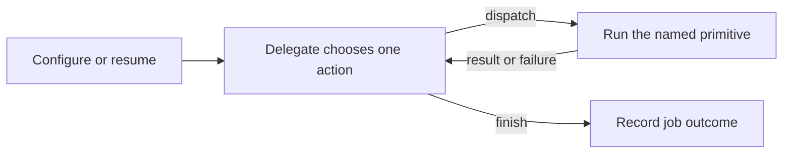

# Let the delegate run the job

**Proposed design.** After each piece of work the delegate asks, “What does this job still owe the requester, and who or what can do it next?” It chooses a primitive and supplies its input. The recipe runs that primitive and brings the result back. The delegate also sees every message the job proposes to show the requester before it is sent.

## The top-level recipe

Use one durable state machine and one resumable delegate session per job. Run the cell’s configuration hook at entry. Give the delegate the original assignment, applicable cell policy, the requester’s actual words, and references to any work being resumed.



The delegate returns either `dispatch(primitive, input)` or `finish(outcome, evidence)`. Each primitive declares its own input and result. Implement dispatch with a fixed set of named recipe includes. Store the delegate’s choice before starting the call. A state for each include can take its inputs from that choice and return to the same delegate state. This is a proposed interface. [State machine guide](../STATE_MACHINE_GUIDE.md)

For example, a delegate dispatching a repair might return the following. The references stand for artifacts already recorded by this job.

```yaml
action: dispatch
primitive: implement
input:
  assignment: Preserve archived cells when upgrading an existing database.
  candidate: <saved candidate reference>
  evidence: [<failed upgrade check>, <original requester instruction>]
```

Implementation returns a new candidate, a short account of the repair and any remaining concern. The delegate can now call Verify on that candidate. If the check passes and the requester asked to see the result before merge, the delegate has Outcome prepare the result and presents it. A job asked only to supply a tested patch can return the patch to its parent.

## What the delegate can call

These are proposed callable boundaries. Several can share an author session or use different entry points to the same recipe.

| Primitive | What goes in | What comes back |
|---|---|---|
| Direction | The request, its source and relevant prior work | The planning author’s understanding of the goal, what already works and a plausible approach. An explanation may answer the request in full. |
| Preparation | Direction, relevant evidence and actual feedback | The planning author’s proposal, design, test statements, assumptions and open choices. |
| Implement | A scoped assignment, selected plan or repair finding, and any saved candidate | The implementation author’s candidate, focused checks and remaining concerns. |
| Assess | A proposal or candidate, the requested behavior and relevant evidence | An independent reviewer’s findings, including what failed and why it matters. |
| Verify | A candidate and the cell’s check configuration | Check results tied to the candidate, base and check inputs, with diagnostics on failure. |
| Consult / Negotiate | An information need, or a requester’s explicit proposal for a change | An answer, an offer accepted by both cells, a refusal or an unresolved question. The exchange owns its round limits. |
| Deliver | An accepted cross-cell agreement | A child job reference and its eventual result. Reuse a child already started for that assignment. |
| Outcome | The assignment, candidate and evidence | A draft account of what was delivered, verified and still owed. |
| Prepare interview | The planner’s proposal and prior interview rounds | Refine’s prepared questions, options and conditional paths for the delegate to inspect. |
| Present | The specific message or prepared interview the delegate selected, with any intended attachments | A send receipt and, when a reply is due, the person’s actual response. A completed Refine interview goes back to its planner as exact Q&A. |
| Integrate | The candidate, applicable permission, verification and commit message | A merge queue receipt, configured publication result, or a concrete failure. |

Extract these boundaries from the existing author, reviewer, verification, consultation, child and merge operations. In particular, split the human send out of the current cycle. A primitive that discovers a question returns a draft. Present is the single outward path for questions, reviews, operator requests, interview packages and final messages. The delegate sees the wording, options and attachments, including all conditional questions before a Refine interview opens. The person can then complete the sitting without a model call between answers. [Current cycle](../../recipes/adaptive3/cycle.yaml) · [Verification](../../recipes/adaptive3/verify-candidate.yaml) · [Consultation](../../recipes/adaptive3/consultation.yaml) · [Child collection](../../recipes/adaptive3/children.yaml) · [Merge queue](../../recipes/adaptive3/merge-queue-submit.yaml)

## What to put in the delegate prompt

- Start from what the requester wants. Direction and Preparation are the usual way to understand a consequential change. A bounded change with a known check can go straight to implementation.
- At each return, read new human guidance and compare the result with the assignment. Pass the next author the relevant original words, evidence and a concrete task. Keep the rest retrievable by reference. An author’s recommendation carries its source.
- Use Verify for evidence about a candidate. Use Assess for independent judgment. Give a local repair back to its author. Reopen planning when a finding changes the proposed outcome.
- Resolve what you can on the person’s behalf. Ask directly for a specific missing decision. Use Refine to explore whether a proposal fits. Respect a requested final review. Distinguish an expressed preference from permission to merge.
- Finish when the assignment is fulfilled. An explanation, a tested patch for a parent and a landed change have different completion evidence.

These are defaults the delegate can apply in context. Give it the primitive catalog and these principles at session start. On later turns supply the result, any new instruction and the relevant references. [Adaptive3 principles](PRINCIPLES.md) · [Refine handoff](../audits/2026-11-25/improvement-plan.md#planning-interviews-with-refine)

## What the recipe still guarantees

The runtime validates the action and its inputs. A malformed call returns a diagnostic within a bounded retry. Primitives retain workspace permissions, independent checks, iteration limits, and durable waits. Integrate checks the required evidence and any outstanding human decision before acting. If new human guidance arrives before a pending send or merge starts, return it to the delegate to reconsider that dispatch. Finish preserves the public job outputs and checks required receipts for the work claimed. Cancellation stops new dispatches.

Persist each invocation and result in job history. After a restart, resume the recorded invocation or collect its result before asking the delegate what comes next. Use the recorded child, presentation or queue receipt to avoid duplicate external effects. If the delegate session is lost, reconstruct it from the assignment, human decisions and recorded work. A bounded job-level dispatch budget catches loops across otherwise healthy primitives. At exhaustion, retain the work and record the impasse.

## How much should disappear?

**Aim to remove about half the top-level routing.** At `0ff0f65`, the outer state machine has 11 named states and 58 outgoing transition entries. Direction, Preparation, Implementation and Outcome account for 26 entries, and Backstop adds nine. Those 35 entries are the clearest opportunity for consolidation. Some of their checks still belong at the primitive boundary. The other 23 include configuration, integration, delivery checks and merge recovery. [Baseline recipe](../../adaptive3.yaml)

Use 29 or fewer outer transition entries as a first comparison, counting dispatch and return edges. Also count equivalent routing moved into adapters, prompts or shared helpers. The useful saving is removing duplicated decisions about the next owner and handoff. Consultation rounds, verification and queue internals are outside this estimate. The percentage is a design target to test on an implementation.

Build one end-to-end path through the loop, then remove the routing it replaces. Replay a routine change, a repair that preserves the goal, a finding that changes the goal, a requested final review and a restart after dispatch. Check that the right work lands, a changed goal reaches the person, and restart sends each message or queue submission once. Compare repeat questions, missed decisions, delegate turns, cost and elapsed time. Count routine delegate dispatches separately from exceptional interventions. [Native recipe testing](../NATIVE_RECIPE_TESTING.md)
