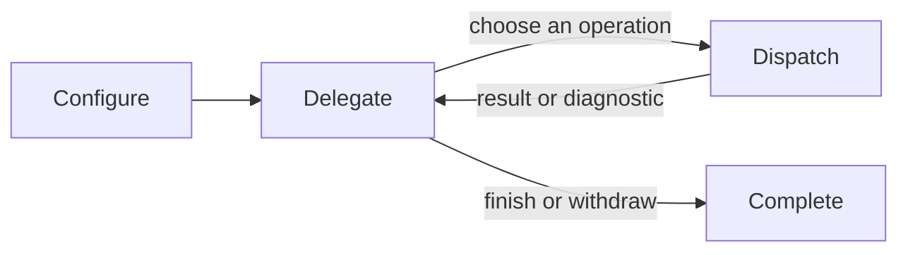

# How the delegate runs a build

The delegate asks “What does this job still owe the requester?” It chooses one operation and gives it an assignment. The operation returns evidence or a failure. The delegate decides what happens next. It writes every message the build presents to the requester, including its final answer.

The public build has four outer transitions. The previous recipe had 58. Dispatch has thirteen entries for selecting a handler, returning a diagnostic or stopping at the limit. After each handler the delegate chooses what follows. Verification, consultation and the merge queue still run their own internal steps. Across the changed production YAML the implementation adds about 250 net lines, including the interview, receipt and recovery work. [Build](../../adaptive3.yaml) · [Dispatcher](../../recipes/adaptive3/dispatch.yaml) · [Dispatch checks](../../recipes/adaptive3/dispatch-check.yaml)

## Sessions and handoffs

Each delegate decision carries a short public activity tag, such as `initial planning`, `revising the plan` or `fixing bugs`. The tag appears in c2j job history as soon as the decision completes and stays visible during the work. A queued submission shows `awaiting merge` once the queue has received it. Finish and Withdraw clear the tag. A UI can display the job’s terminal state on failure or cancellation.

One read-only delegate stays with the job. Direction and Preparation share a planning author. Implementation and Outcome share an implementation author. An independent assessor checks their work. Configured specialists can supply further evidence. A new session gets its assignment and the C2 guide. A continuing author gets the next task, the applicable feedback and selected files.

The delegate returns the operation name, a plain-language instruction, selected document names and a presentation type when needed. The job holds the candidate, actual human submissions, session references, verification evidence and receipts. A model cannot grant itself a merge by describing one. [Delegate prompt and action](../../recipes/adaptive3/delegate.yaml) · [Working in C2](../WORKING_IN_C2.md)

## Operations

| Operation | Use it for | What comes back |
|---|---|---|
| Configure | Reread cell policy after a configuration problem | Settings or the hook diagnostic. [Hooks](../../recipes/adaptive3/hooks.yaml) |
| Direction / Preparation | Understand the assignment and the proposed experience; work out a consequential design | An answer or a proposal with reasoning, examples, assumptions and suggested checks. [Author prompts](../../recipes/adaptive3/prompts/execute.yaml) |
| Implement / Outcome | Make or repair a change; explain what was delivered | The saved candidate, commit description, focused checks or draft result. [Author](../../recipes/adaptive3/execute.yaml) |
| Assess / Verify | Independently review the current proposal or outcome; run cell checks on an implementation | Findings or verification evidence tied to the candidate. [Validation](../../recipes/adaptive3/validate.yaml) |
| Consult / Negotiate / Deliver | Ask an owner for help, request a change, or start work on agreed terms | The answer, agreement or child result. The exchange owns its round limit. [Coordination](../../recipes/adaptive3/consultation.yaml) |
| Children / Packages | Collect outstanding work or obtain tools for the job | Child receipts and evidence, or a checked package proposal and probe result. [Children](../../recipes/adaptive3/children.yaml) · [Packages](../../recipes/adaptive3/packages.yaml) |
| Prepare interview | Explore assumptions in a proposal and earlier answers | A batch of questions and ordered choices for the delegate to inspect. [Interview preparation](../../recipes/adaptive3/prepare-interview.yaml) |
| Present | Ask one question, show selected material, send a prepared interview or obtain permission | The frozen form and exact native submission. [Presentation](../../recipes/adaptive3/delegate-present.yaml) |
| Integrate / Recover publication | Land the verified, accepted change or resume publication from an existing landing | Native merge and publication receipts, or the failing boundary. [Queue](../../recipes/adaptive3/merge-queue-submit.yaml) · [Recovery](../../recipes/adaptive3/recover-publication.yaml) |
| Check delivery | Test an explicitly requested outcome against the landed result | Consumer evidence or a concrete gap. [Consumer check](../../recipes/adaptive3/check-delivery.yaml) |
| Finish / Withdraw | Report what this assignment delivered, or carry a sourced withdrawal back to the requester | The public job outputs and applicable receipts. [Completion](../../recipes/adaptive3/completion-check.yaml) |

## When a person is needed

The delegate answers factual questions from available evidence. On a repeat request it compares the proposed message with the review the person actually saw. It states what changed for them and what their answer would decide. Direct questions travel without planning documents. A document review includes the specific text under discussion.

The planner writes a conceptual 1P, Design and Tests when the work warrants them. A prepared interview can probe implicit decisions anywhere in that material. The native review form can collect several independent choices in one sitting. It offers Skip and Other with room to type. The planner gets the offered options, exact submission, receipt and source references. It decides what to revise or explore next. Conditional paths within one sitting await the Refine client integration. [Review contract](../REVIEW_V2.md)

Permission to act is separate. A short local change can proceed to implementation and present the verified outcome. A prepared plan offers **Revise**, **Review before Complete** and **Take to Completion**. Both completion choices accept comments. Take to Completion allows the independently verified, covered result to land. A job specifically assigned to supply a tested change can return its patch to its caller.

The next delegate turn receives the submitted form. A later request to revise the plan clears its earlier permission. Interrupting an already dispatched operation with an unsolicited message would require a runtime notification.

## Limits and recovery

The native job story records the dispatch and its result. Within a job, sessions resume from stored references. A new job can inspect its predecessor using `resume_from`. Reusing a landing requires the native approval, approved patch and merge producer. The receipt checker verifies the target and landed content before publication.

Consultation retains separate per-exchange and distinct-consultation limits. The job also bounds total dispatches at sixteen times `max_iterations`, with a default of 64. Three consecutive invalid delegate responses stop the job with the diagnostic. Cancellation propagates. Count routine delegate turns separately from exceptional requests for human help. Measure repeat questions, corrections, latency, cost and missed decisions on live jobs. [Principles](PRINCIPLES.md) · [Job inspection](../JOB_INSPECTION_PLAYBOOK.md)
