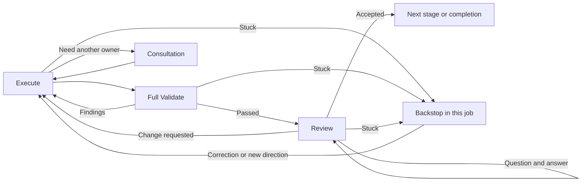

# Adaptive3: implementation design

The initial design below kept adaptive3 opt-in. The subsequent
[default rollout](ROLLOUT.md) makes it the workflow selected by `build.yaml`.

Design for a **separate, opt-in recipe**, based on the agreed
[activity lifecycle](../adaptive2/PROPOSAL_REUSABLE_ACTIVITIES.md).
Adaptive2 and the current `build` entrypoint stay intact. This document specifies the implementation contract. See
[the assessment](IMPLEMENTATION.md) for delivered behavior and validation.

The work fits the [recipes cell's purpose](../../PURPOSE.md). c2j owns durable
execution, permissions, workspaces and job communication. c2ops owns the agent
operations. Missing capabilities at those boundaries need changes there.

## 1. What we are building

Adaptive3 has five stages and one shared activity lifecycle:




Backstop can return to an earlier stage's Execute. Each such return runs
that stage's whole cycle. Consultation can also supply an answer during Review;
if the item changes, it goes through Execute and full Validate again.

Review acceptance directly advances the stage. There is no second readiness
decision, acceptance gate or document preparation step afterward. An answer-only
assignment uses the same cycle and finishes after its answer is accepted.

Agents investigate, write, implement, interpret feedback and decide whether a
problem needs another owner. The recipe controls the cycle, explicit human
approval, durable effects and waits. It does not maintain a second model of the
project's requirements, evidence or goals.

## 2. Files

The source layout below includes the implementation adjustments agreed during development.
Keep the entrypoint in one file rather than adding a chain of build/workflow/develop
wrappers that forward the same inputs.

```text
adaptive3.yaml
recipes/adaptive3/
  README.md
  lifecycle.yaml
  cycle.yaml
  execute.yaml
  validate.yaml
  review.yaml
  consultation.yaml
  backstop.yaml
  agent.yaml
  hooks.yaml
  packages.yaml
  package-probe.yaml
  integration.yaml
  specialists.yaml
  tools.yaml
  schemas.yaml
  prompts/
    context.yaml
    execute.yaml
    validate.yaml
    review.yaml
    consultation.yaml
    backstop.yaml
    packages.yaml
recipe-tests/adaptive3/
  README.md
  statements.md
  ...native suites and small fixtures listed below...
guides/adaptive3/
  DESIGN.md
  IMPLEMENTATION.md       # written as implementation proceeds
  results/README.md       # links actual trial documents and discussions
```

### Recipe responsibilities

| File | Owns | Does not own |
| --- | --- | --- |
| `adaptive3.yaml` | Public inputs, configure invocation, the five named stages, explicit returns to earlier stages, the same-job Backstop and final outputs. | Agent tools, document selection algorithms or a generic workflow dispatcher. |
| `lifecycle.yaml` | The single Execute → full Validate → Review loop. Consultation/package interruptions, automatic attempt accounting and returning `stuck` to its caller. | Stage order, per-finding validation selection or publication approval. |
| `cycle.yaml` | One Execute → full Validate → Review pass, shared by the lifecycle and consultation. | Retry accounting or recursive includes. |
| `execute.yaml` | Performing the current assignment with an agent, or the concrete native operations needed for integration. Supplies stage-specific task text and applies new feedback. | Its own repair loop. A correction is another invocation through the lifecycle. |
| `validate.yaml` | The complete validation for the assignment: checks, applicable hooks and examination of the actual output. Returns findings and original diagnostics. | Rewriting the output or deciding which checks to omit after a correction. |
| `review.yaml` | Independent assessment or a human review conversation, including explicit acceptance and applicable approval reuse. | Rebuilding attachments, editing code, or deciding whether acceptance needs another gate. |
| `consultation.yaml` | Inline owner dialogue, receiver-authored requests, optional child submission, native waiting and bringing the actual result back. | Its own requirements ledger, mandatory handoff files or a different recovery policy. |
| `backstop.yaml` | Diagnose a stuck assignment using job history and tools, discuss it when needed, and arrange a correction in this job. | Replacing the job, fabricating successful checks or a second scheduler. |
| `agent.yaml` | The c2ops call, session start/resume, instructions at session creation, workspace mutability and artifact binding. | Response repair, artifact reconciliation, phase classification or business decisions. |
| `hooks.yaml` | The five existing build hook calls, their public contract and native failure results. | Hook source trust, hash management, settings files in agent inboxes or recovery loops. |
| `packages.yaml` | Package policy, any required approval, approved-environment validation and adoption. | General workflow recovery or its own human-dialogue implementation. |
| `package-probe.yaml` | A fresh environment that checks the approved configuration and reports actual probe results. | Delivery work or authority to expand the approved package request. |
| `integration.yaml` | Native rebase/squash/merge operations, actual integration results and publication against the merged commit. | Asking for another approval or treating a Git hash change as an unapproved content change. |
| `tools.yaml` | The three output validators and their declared worker packages. | Artifact selection, repair or state bookkeeping. |
| `specialists.yaml` | Configured independent assessments using the shared Validate activity. | Another review or consultation protocol. |
| `schemas.yaml` | Small activity-specific response schemas, exported by an empty sequence. | A universal response containing every possible field. |

`README.md` explains use and inspection. `IMPLEMENTATION.md` records what was
actually built, the tests, deliberate departures and remaining runtime gaps.
Do not generate a new design, migration manifest or evidence ledger during each
job; these are repository documentation.

### Why there are no stage recipe files initially

The five stages are visible states in `adaptive3.yaml`. Each calls the same
`lifecycle.yaml`. Stage-specific work lives in Execute, Validate and Review,
with its wording in their prompt includes. Splitting each stage into another
forwarding include would add five interfaces without adding a responsibility.

The lifecycle also supports a checked owner-advice assignment for consultation.
That is a nested use of the cycle, not a sixth delivery stage. Its acceptance
returns advice to the caller; the caller's stage still follows its full cycle.
Keep these purposes a small, built-in set. Do not introduce user-supplied node
graphs, callbacks, route registries or per-check resume locations.

## 3. Keep interfaces small and honest

Aim for three to six inputs per helper. Seven or eight can be reasonable where
the values belong together. An include approaching ten inputs needs a design
review, not a new `context` property containing those ten inputs.

The initial public inputs are `title`, `prompt`, `target_directory`, `documents`,
`require_verification`, `max_iterations`, `resume_from`, `model` and
`reasoning_effort`. Model settings are optional human choices; omitted values use
the worker config. The directory is
repository-relative. The title and prompt are the human request; `max_iterations` controls local work
passes and `resume_from` identifies prior work to inspect. There is no
public session checkpoint: a new adaptive3 job starts its own sessions and can
inspect retained work through `resume_from`.

This is a new entrypoint, so it need not accept adaptive2's private annotations,
coordination state or handoff fields. The public `build` entrypoint now forwards to adaptive3.

Declare schema v2 on each recipe with a typed contract. Keep the final public
outputs to `summary`, `work_kind`, selected `artifact_refs`, native `reviews`,
and actual `merge`/`publication` results when those effects occurred. Do not export
the entire controller state or every intermediate artifact as the job result.

### Include contracts

Agent activities also accept the optional two-field `agent_settings` value.
Names below describe the input contract. Optional inputs are omitted
when unused; they are not populated with empty objects in every agent response.

| Include | Inputs | Main outputs |
| --- | --- | --- |
| `lifecycle` | `purpose`, `request`, `target_directory`, `documents`, `feedback`, `settings`, `require_verification`, `max_iterations` | Accepted result and selected artifacts, or a requested earlier stage with feedback, or `stuck` with its source. |
| `execute` | `purpose`, `request`, `target_directory`, `documents`, `feedback`, `settings`, `session` | Agent response, produced artifacts and checkpoint; native results for concrete integration work. |
| `validate` | `purpose`, `request`, `target_directory`, `documents`, `work`, `settings`, `require_verification`, `feedback` | `passed`, `changes` or `stuck`; findings, check results and diagnostic references. |
| `review` | `purpose`, `request`, `documents`, `title`, `primary`, `validation`, `feedback` | Acceptance and its native receipt, a change request, or `stuck`. Questions remain inside this include. |
| `agent` | `prompt`, `schema`, `documents`, `session`, `read_only` | Validated response, native checkpoint and artifacts. c2j records children. |
| `consultation` | `cell`, `request`, `documents`, `feedback`, `mode`, `max_iterations`, `job` | Receiver's answer or agreed request, selected outputs, and actual child result when execution was requested. |
| `backstop` | `stage`, `request`, `problem`, `documents`, `feedback`, `prior_job`, `automatic` | Corrected direction and the stage to resume; native human response when one was needed. |
| `hooks` | `hook`, `request`, `target_directory`, `documents`, `settings`, `publication` | The native hook result, settings from configure, and exported artifacts. |
| `packages` | `requests`, `reason` | Approved and validated configuration, or findings for Execute/resolution. |
| `package-probe` | `config`, `checks` | Probe results and diagnostics. |
| `integration` | `operation` | Native candidate, merge or publication-related execution result. Reads managed Git context itself. |

The lifecycle's eight inputs are a deliberate wide boundary: assignment,
workspace focus, immediate work, feedback, actual hook configuration and two
policy values. Validate also needs the final title and primary-document selection
to check what Review will actually present. Neither passes all its inputs to every
child. Execute uses settings for hooks and selects only the applicable prompt
addition for its agent; the agent wrapper sees no hook configuration or stage policy.

`settings` is the actual configure-hook settings value. `feedback` is the actual
response/findings with its source, and `validation` is the actual validator result.
These are meaningful native records, not containers for unrelated recipe state.
Keep their schemas explicit. Do not add sessions, job lists, document history or
permission policy to them to save input slots.

The hook boundary has more fields because it implements an existing public API.
That does not justify forwarding that API through every internal include.

### Where state lives

| Information | Owner and access |
| --- | --- |
| Cell, job identity, managed ref and workspace | Read runtime context at the consuming operation. Do not forward copies. |
| Current stage | The entrypoint's active state. Pass the purpose to the lifecycle; no phase file. |
| Current work | Managed repository plus the immediate producer's selected artifact references. |
| Working session | The active lifecycle's native checkpoint. A stage change starts a fresh working session. |
| Review conversation | Review's own read-only session and native input results. It never resumes the implementation session. |
| Human approval/direction | Native review receipt and original human message. Previous decisions remain inspectable in job history. |
| A submitted child | Native submit outputs and wait result. Do not copy its evolving status into another map. |
| Automatic attempts | One local lifecycle counter between meaningful direction/resolution events. Human dialogue does not spend it. |
| Older work | Producer task/job references, retrieved when needed through c2j inspection. |

Use `states.*.outputs`, sequence outputs and small transition payloads. A payload
may carry the new feedback and its source when returning to Execute. It must not
accumulate the entire job. Follow the [scope rules](../NODE_SCOPE_SPEC.md): nested
includes cannot magically read an outer sibling's outputs. Export and pass a
needed value explicitly, or keep tightly coupled work in the same scope.

## 4. What each stage actually does

Validate always runs the **whole definition for that purpose**, even when the
latest correction sounds small. Checks can conclude that something is inapplicable
to the assignment; feedback cannot select a shorter validation path.

| Stage | Execute | Full Validate | Review and acceptance |
| --- | --- | --- | --- |
| Direction | Investigate, consult owners, frame feature/bug/explanation/oversight, write the one-pager and useful UI mockups. | Check alignment with current human direction, material ownership/API claims, unresolved choices, and the actual review files. Include configured design advice. | Human conversation and explicit direction approval. An accepted answer-only request completes here. |
| Preparation | Develop the needed design detail and test statements from approved direction. | Check scope consistency, usable test expectations, dependency boundaries and configured plan assessments. | Independent agent accepts the plan. No routine extra human checkpoint. |
| Implementation | Implement or correct the work; arrange agreed external work; prepare a candidate through native Git and the prepare hook. | Run the verify hook and required checks; examine results against test expectations, changed behavior and UI evidence. Validate any selected review files. | Independent agent assesses the result. Changes return to Execute. |
| Outcome acceptance | Produce a short outcome review with selected supporting files, based on the actual implementation and results. | Run the stage's complete checks for truthful claims, current scope, verification applicability, open dependencies and usable attachments. | Human conversation and explicit acceptance. Unchanged approved work can reuse its native approval after validation. |
| Integration/publication | Merge through native operations and run configured publication after merge. | Check the actual merge/publication results against the approved outcome, including a failed or incomplete publish. | Agent confirms the result; acceptance completes the job. No further routine human approval. |

Preparation is about design/test detail; the existing `prepare.yaml` **hook** is
candidate preparation and still runs before candidate verification. The shared
names must not accidentally move the hook to the wrong point.

Outcome acceptance does not silently edit implementation. If a requested change
affects behavior, Review returns to Implementation's Execute. A scope change
returns to Direction's Execute. A correction to the outcome explanation returns
to Outcome acceptance's Execute. In every case the destination runs full Validate
and Review. There are no returns to individual checks.

If upstream moves before merge, Integration returns to Implementation's Execute
to refresh the candidate and run its whole cycle. Outcome acceptance then runs
its whole cycle as well. Its Review can reuse the prior approval when the approved
edit is unchanged; otherwise it presents the change since that approval. A
publication failure after a successful merge must not replay the merge blindly.
Read the recorded native effect before trying the remaining work.

### Response shapes

Require only fields that drive a transition or explain a result:

- Execute: `status` (`ready`, `consult`, `packages`, `stuck`) and a short `summary`.
  A ready human document can also name `title` and `primary`; consult/package
  branches carry their actual request. Direction identifies the work kind.
- Validate: `status` (`passed`, `changes`, `stuck`), a short summary and findings
  when there are findings. Full logs are artifacts, not a giant response field.
- Review: acceptance, changes or stuck, with the actual human receipt when
  applicable. A change names an earlier stage only when that is necessary.
- Receiver advice: an answer and, when needed, the receiver's proposed work type,
  title and assignment. A child request is the receiver's words, not a regenerated
  requester handoff.

These are separate schemas. Do not require empty `files`, `questions`, `packages`,
`goals`, `evidence` and `coordination` values on every response. A malformed response
produces feedback for Execute, followed by full Validate; it does not start a
parallel report-repair workflow.

## 5. Prompt organization and human language

Retain the existing **empty-sequence include** pattern. Prompt files export named
strings; they create no worker task, artifact or extra job. Use ordinary named
templates, with literal caller text treated as data. No `printf`, double template
evaluation or generated prompt files.

| Prompt file | Content and small input surface |
| --- | --- |
| `context.yaml` | Standing explanation of jobs, cells, persistence, tools, inspection and how to ask for help. Static apart from runtime identity/path context. |
| `execute.yaml` | Assignment wording by purpose, current request, human feedback and applicable hook guidance. |
| `validate.yaml` | Complete validation expectations by purpose; how to report actual failures and missing UI evidence. |
| `review.yaml` | Independent review, human conversation, descriptive form titles and choice labels. |
| `consultation.yaml` | Requester/receiver language, challenge existing assumptions, receiver-authored work and child-result evaluation. |
| `backstop.yaml` | Diagnose the real blocker, preserve useful work, discuss it plainly and return a concrete correction. |
| `packages.yaml` | Request format, policy/approval explanation and approved-environment validation. |

Keep each prompt include to the named values its text uses, generally zero to
five. Splitting by consumer avoids the current all-purpose prompts include with
seventeen input names. Long-standing instructions are installed when a session
starts; current assignments and human feedback arrive in the turn prompt.
Bind worker-specific paths at the consuming operation, where
`context.environment.op` is valid, rather than during an earlier prompt include.

Illustrative standing context:

> You are working in cell {{ cell }} in job {{ job }}. c2j saves changes in this
> cell's managed repository after each task and retains files you put in outbox.
> The recipe handles integration and waits for delegated work. Use your tools to
> investigate and complete the assignment. Run `c2j self` to see your current
> context and available capabilities; use `c2j cells` to discover other owners.
> Use job log, fields and artifact commands when you need earlier results.
> Give the latest explicit human direction precedence over older generated plans.

The implemented context should also explain how to ask for a package or another
owner's help. It should point to inspection help, including the distinction between
intermediate task outputs and a final job result. Keep longer command examples in
the [inspection playbook](../JOB_INSPECTION_PLAYBOOK.md), with a short usable example
in the context. Do not dump runtime configuration into the prompt.

Illustrative consultation:

> I'm notebook. I'd like storage to retain the last three saved versions so users
> can undo an accidental overwrite. Can the existing API do this? If a change is
> needed, suggest the feature request you would implement and explain any changes
> you recommend to this proposal.

> I can add this using the existing versioned update API. I suggest counting the
> current version among the three and not consuming a slot for an identical save.
> A separate restore endpoint would duplicate the update behavior we already have.
> My proposed feature is: …

Illustrative human review:

> **Approve notebook feature: restore a previous saved version**
>
> This keeps the three most recent different saves and lets the user restore one.
> Storage will retain the versions; notebook will show the history and restore
> action. The open choice is whether three versions is enough.

Questions get direct answers. “Change this” returns to Execute with the original
human words. Avoid boilerplate about what kind of document the human is reading,
third-person declarations that a cell “agrees to a bounded feature,” and claims
about work not performed that do not help the decision.

Use a clear acceptance choice alongside an option to discuss or request changes,
with a text field for that message. The review agent distinguishes a question
from a change; the human does not choose an implementation/design phase. Keep the
same item pending during questions. An approval combined with a conflicting change
must be resolved in this conversation before recording acceptance. Cancel uses
the native job action. Actual input receipts, not model-generated booleans, prove
human acceptance.

Keep the one-pager's established sections and all consequential Q&A. Keep the
outcome report's changes, external work, tests, omissions, API/encapsulation
changes and differences from approved direction. These are writing guidance,
not a parser requiring an exact heading or document filename to advance.
Retain useful change-size estimates and actuals from the recent adaptive2 work as
review information, with assumptions and delegated work distinguished. They are
not another numeric completion gate or a reason to rewrite the approved estimate.

## 6. Files and review attachments

The producer chooses the human-facing files by writing them under `outbox/review/`
and identifying the primary document. Descriptive filenames are encouraged.
Use `outbox/error/` for useful command diagnostics. Other outputs stay with their
producer unless a consumer actually needs them. Code stays in the managed repo.

The recipe binds the selected collection once. Validate reads it; Review passes
**the same names and artifact identities** to native input. It does not add an
older index, union every historical outbox, or reconstruct a “more complete” packet.
If a file needs correction, Execute produces the corrected review collection.
Native history retains the prior collection for inspection.

Validation consumes work separately from its diagnostics: a native check's
`_c2j/` logs remain at that task and are retrieved when needed. Returning findings
does not require attaching every log to the human review or copying logs through
all later stages.

An agent preparing a review may retrieve and copy a useful screenshot or test
result. This is editorial work on the output people will read. The recipe does
not require `source_paths`, a per-file lineage graph, an evidence manifest or
mandatory internal `handoff.md`. No `conversation.json` or phase/state files.

Bind immediate work under `inbox/work/` and current diagnostic files under
`inbox/work/error/`. Keep original human wording in native inputs, with uploaded files
bound separately when present. Prompts refer to these locations rather than
enumerating every filename. Older task/job references remain available through
inspection. Do not put large artifact bodies into CEL strings or final results.

The `review_files` task in `tools.yaml` checks that the primary file exists, local links resolve within
the selected set, images can be opened, and display metadata fits the native input
contract. Agents judge whether screenshots show the requested behavior. A link
to a nonexistent capture or an explanation of why it is missing is not a capture.

Validate display titles **after** their final formatting. Review does not run a
second formatter that can invalidate the checked title. A short status/count is
the command result; full diagnostics go to a file. Never parse a potentially
truncated stdout JSON report containing every missing link or changed file.

## 7. Hooks remain cell-owned customization

Preserve the existing `.c2/recipes/hooks/build/` paths and `c2.build-hook/v1`
contract. Sharing that public extension surface does not make adaptive3 an
adaptive2 wrapper. Each model owns its orchestration.

| Hook | Adaptive3 placement |
| --- | --- |
| `configure.yaml` | Once at job setup. Capture actual settings; failure enters resolution. |
| `before_design.yaml` | Direction's Execute on each framing/revision pass. Research and alternatives become available work. |
| `prepare.yaml` | Implementation's Execute after native candidate preparation and before full Validate. Its repository changes persist. |
| `verify.yaml` | Full Implementation validation, including unchanged or delegated outcomes. Required-but-skipped verification returns findings. |
| `publish.yaml` | Integration Execute after a successful merge, against that merged commit. Its failure stays recoverable. |
| `package-policy.yaml` | The package service, before running requested tools. |

Configured specialists run in full Validate: `before_design` on Direction,
`plan_assessment` on Preparation, and `outcome_assessment` on Implementation.
Outcome validates the human report without repeating the specialists. Both general
and specialist assessors receive the corresponding assessment guidance. Required
findings return together to Execute; optional advice has no independent veto.
The existing consultation `key` may identify a public hook declaration, but it
does not become an agent-maintained work/dependency identifier.

Keep configure prompt additions at their corresponding purposes. Hook variables
remain hook data. `require_design: false` does not disable delivery direction
approval. `require_verification` remains a recipe input.

The v1 hook API currently takes `settings` as an artifact. Keep that representation
**only at the hook adapter boundary**, using a native value artifact. Internally,
read the actual configure outputs. Do not add `build-settings.json` to agent
inboxes. A future hook API can accept a typed value without forcing a migration
into this project.

Use native `cell://` resolution, `const` and hook permissions. Configure,
before-design, verify and publish retain their read-only repository behavior;
prepare is writable. Let c2j select current/upstream hook code. Do not compare
hashes to enforce immutability or add recipe-owned permissions. Missing hooks
are skipped; malformed hooks and permission failures are actual findings.

Local hooks can use their normal operations, including deployment or generation.
The rule against recipe command glue applies to the shared orchestration; it
does not remove a project's ability to run its real build/publish automation.

## 8. Consultation, children and recovery

All owner dialogue stays inline, including nested questions, using the receiving
cell's managed read-only workspace. The receiver investigates existing behavior,
challenges the proposed shape when appropriate and authors any feature, bug,
explanation or oversight request. Acknowledging a message is not required as a
separate deliverable.

The consultation helper uses the shared lifecycle for checked receiver advice.
The caller interprets that advice and can send a follow-up. Child delivery is a
concrete Execute action after agreement and the applicable direction approval.
Direction/planning callers request advice; implementation callers can request
delivery. Do not copy a design-phase prompt into a delivery job.

Child submission takes the receiver's assignment and selected native artifact
references directly. Target a named cell. During adaptive3 trials, submit the
explicit adaptive3 recipe selector; the ordinary `build` selector still names
adaptive2. Resolve the selector for the trial/release once, and test that actual
descendants use it. Do not silently fall back to adaptive2 or generate our own IDs.
Any destination that deliberately needs a different workflow is an explicit
consultation decision, not an unobserved default.

Use native submit and wait operations. Independent consultations can run in
parallel through native sequences. Their tasks and submit outputs provide
identity; do not add synthetic work keys or keep polling in agent sessions.
Keep useful exchanges visible in native task responses, with a brief summary in
the human design/outcome document when relevant.

The shared context can permit a small validation/clarification child through the
agent's normal tools when the task's native grants allow it. Explain supported
submission choices: inspect CLI help, submit an actual recipe, or use the supported
workspace submission path when an unpublished snapshot is needed. Such an
experiment is different from authorizing delivery before direction approval.
Most external delivery goes through consultation. c2j records tool-submitted
children automatically; the agent must not recreate that tracking.

A stuck adaptive3 child enters its own Backstop and retains its identity. Its
parent must be able to receive a help event while that child remains open; this
needs a verified native communication/wait contract. A terminal failed older or
external child returns to the requesting agent with its ID, outcome message and
selected result/error directories. That agent decides whether to recover, retry,
adopt an existing attempt or continue without it. Resolution is for a stuck or
unavailable requester, or renewal of its local allowance. A corrective cancellation
may justify a corrected attempt; a stop request must be respected.

Use both identities for their actual purposes: jobs identify attempts and their
results; goals identify the desired outcome and other attempts that may have
completed it. Retrieve current native information when evaluating a dependency.
Do not enforce an obsolete prerequisite after the human changes scope, and do
not treat a goal status alone as proof that the current assignment was satisfied.

`resume_from` enters Backstop first. It inspects exact prior work and human
decisions, returns selected documents and original approval/merge records, and
chooses the remaining stage. Configuration preserves that choice. The destination
runs its complete cycle; earlier stages need not have run in this job. Unfinished
code is restored in the managed workspace during Implementation. A completed
merge goes to remaining publication. Changed scope returns to Direction.

### Stuck and Backstop

Catch supported operation failures and preserve their original diagnostic. A
correctable finding returns to Execute. Repeated inability to make progress or
exhausted automatic attempts produces `stuck` and enters the same-job Backstop.
Backstop can investigate across stages, consult owners and arrange environment
work. It returns concrete direction to a stage's Execute, never to one check.

Human discussion stays open without consuming or granting automatic attempts.
A clear resolution can grant a bounded new attempt or change direction. Waiting
uses native input/wait operations and consumes no model turns. Backstop must
not recursively spawn more Backstops or automatically retry itself forever.
An explicit human cancellation remains the terminal stop mechanism.
Automatic loops have finite, independent allowances. `max_iterations` defaults
to four work passes; values below one use that default. Owner exchanges and
package attempts default to three; direct child results permit three automatic
continuations. Each receiving owner has four local passes and nesting is limited
to four suspended owners. Merge chasing permits three automatic returns through
Implementation and Outcome, retaining its count across those visits.

Backstop can grant 1–20 more attempts to the paused loop while retaining
other counters. It can make two automatic corrections before needing explicit
human continuation. Questions neither consume nor grant attempts. These are
recipe-state counters, not files or a parallel job ledger. No production execution
timeout is added; runtime limits and cancellation remain runtime responsibilities.

## 9. Reuse from adaptive2: preserve behavior, choose the code

Baseline inspected for this design: recipes commit `c0c69bd`. Some newer fixes
already remove older machinery; work from that source rather than restoring the
stashed adaptive2 edits.

| Existing source | Adaptive3 treatment |
| --- | --- |
| [`adaptive2/prompts.yaml`](../../recipes/adaptive2/prompts.yaml) | Extract context, current-human-direction, inspection, scope, screenshots and writing lessons into the smaller prompt includes. Remove mandatory handoff/ledger wording and obsolete restrictions. |
| [`adaptive2/agent-turn.yaml`](../../recipes/adaptive2/agent-turn.yaml) | Reuse native start/resume, new-session instructions and explicit read-only/writable branches. Drop artifact normalization, retained-history union and terminal agent-failure wrapper. |
| [`adaptive2/develop.yaml`](../../recipes/adaptive2/develop.yaml) | Use as a behavior inventory, not as the new controller. Replace its 1,698-line orchestration and nineteen input values with the stage entrypoint and common lifecycle. |
| [`adaptive2/review.yaml`](../../recipes/adaptive2/review.yaml), [`inspect.yaml`](../../recipes/adaptive2/inspect.yaml) | Reuse native forms/receipts and independent assessment. Replace review selection/reconstruction and attachment rejection that terminates the job. |
| [`adaptive2/limit-decision.yaml`](../../recipes/adaptive2/limit-decision.yaml) | Reuse the distinction between discussion and explicit continuation, plus read-only explanation. Remove resolver context/discussion files and duplicate routing policy. |
| [`adaptive2/consultation.yaml`](../../recipes/adaptive2/consultation.yaml), [`coordinate.yaml`](../../recipes/adaptive2/coordinate.yaml) | Reuse owner workspaces, separate sessions, receiver judgment and native submission. Replace handoff-file gates, conversation aggregates and accumulated document maps. |
| [`adaptive2/dependency-requirements.yaml`](../../recipes/adaptive2/dependency-requirements.yaml) | Preserve the recent lesson that obsolete prerequisites must not block current scope. Use actual source results and agent judgment; do not copy the coordination-history projection into a new ledger. |
| [`adaptive/hook-*.yaml`](../../recipes/adaptive/hook-verify.yaml) | Extract native hook invocations and contract checks into adaptive3's adapter. Leave existing helpers unchanged. Remove generated agent-facing settings/reports from the shared call path. |
| [`adaptive2/packages.yaml`](../../recipes/adaptive2/packages.yaml), [`adaptive/package-policy.yaml`](../../recipes/adaptive/package-policy.yaml) | Preserve policy → approval when needed → fresh-environment probe → adoption. Reuse the narrow policy include unchanged if its tests pass. Replace shell/Python proposal/adoption glue with agent work and validation. |
| [`adaptive/git-candidate.yaml`](../../recipes/adaptive/git-candidate.yaml) | Extract approved-edit equivalence validation into `tools.yaml: approved_change`. Preserve binary/path/mode correctness; remove the large stdout candidate inventory and report construction. |
| [`adaptive/await-child.yaml`](../../recipes/adaptive/await-child.yaml) | Reuse the native soft-wait operation and result semantics directly. Do not inherit generated error documents or terminal recovery policy. |
| [`adaptive2/review-links.yaml`](../../recipes/adaptive2/review-links.yaml) | Port useful attachment checks into `tools.yaml: review_files`; check the producer's set without constructing a different set. |
| [`recipes/create/`](../../recipes/create/README.md) | Keep as the existing creation service. Negotiate new ownership with root and preserve its narrowly granted creation/push operations; do not clone it into adaptive3. |

Do not modify shared helpers as a side effect of this implementation. Reuse a
narrow stable helper by reference; extract the needed portion when its behavior
is entangled with adaptive2. The new model must not execute the old controller
behind a new entrypoint.

## 10. Where code belongs

Most implementation is YAML, prompt text and short CEL expressions. Use native
ops for workspaces, Git, jobs, waits and human input. No shell command should
exist solely to generate prompts, transform recipe state, compose a packet or
read a JSON file that an earlier command wrote for the recipe.

The proposed executable code is limited to output validation:

| File | Why code is justified | Limits |
| --- | --- | --- |
| `tools.yaml: review_files` | Read real file contents, resolve local Markdown/HTML links and check image readability and final metadata. | Produces findings; never copies, renames, selects or repairs the review files. |
| `tools.yaml: approved_change` | Establish whether the candidate is the approved edit rebased onto the new base, including binary files and modes. | Reads Git and may use a temporary index. Does not manage the real worktree or merge. Uncertain comparison requests review. |
| `tools.yaml: package_config` | Validate that a proposed/adopted configuration matches the approved package change and preserves unrelated settings. | Does not install tools, alter config or make an approval decision. |

The three tasks embed their Python in `tools.yaml`, as requested during
implementation. This makes the code part of the captured recipe and avoids a
companion-file resolver. They use declared worker packages, bound inbox files,
and the managed worktree. None generates workflow state or review packets.

For packages, the working agent proposes the actual configuration as an artifact;
it does not yet install it as the parent's live `.c2/config`. Keep the existing
request shape: package `reference`, an argument-array `check`, and a plain reason
for needing it. Policy or human approval comes **before** running newly requested
tools. The fresh probe environment installs only the approved proposal and checks
it, then the working agent adopts the validated change and the configuration
validator checks that adoption. Preserve denial feedback and useful work. Verify
how the current runtime applies changed `.c2/config` to a new task; do not assume
editing a file changes the current process's environment.

Avoid introducing a generic validation framework. Each script has a small CLI,
a bounded result and diagnostic files. Use existing test/build commands or hooks
for project validation. Job-model behavior stays in native recipe tests.

### Runtime questions to prove before claiming resilience

| Capability | Current evidence and implementation decision |
| --- | --- |
| Catch ordinary operation failures and retain diagnostics | Supported by the [failure contract](../RECIPE_FAILURE_HANDLING_USER_GUIDE.md); test actual failed agent, hook and Git operations through the new entrypoint. |
| Recover from every error after a job is accepted | The current guide excludes template/schema/authoring errors from ordinary catches. Request c2j support for durable suspension and same-job resolution; do not claim the recipe already guarantees it. |
| Wake a parent for a still-open child's help request and reply to that child | Verify available native APIs. Missing support is a c2j requirement; no shell polling or deliberate child failure to wake the parent. |
| Backstop or unavailable worker cannot run | Needs a runtime-owned durable pause/notification path. A broken agent cannot implement its own fallback merely through another prompt. |
| Deliver validator source from the captured recipe | Prove native source/artifact packaging or use a packaged operation. No worker-local checkout assumptions. |
| Apply and probe approved worker configuration | Reuse established fresh-task/job semantics, with native permission checks; report any missing environment transition to c2j. |

Same-job resilience is a release requirement. Unsupported cases remain explicit
blockers to that claim, even if ordinary happy paths are ready for opt-in trials.

## 11. Tests and implementation order

Create `recipe-tests/adaptive3/statements.md` before recipe code. It describes
observable behavior, with filenames, priority, unit/integration and dependencies,
following this repository's test-statement rules. Bring forward the behavior from
old tests, not assertions about old internal documents.

| Planned native suite | Main scenarios |
| --- | --- |
| `lifecycle.test.yaml` | Full Execute/Validate/Review order; both checks rerun after a correction concerning only one; acceptance advances directly. |
| `stages.test.yaml` | Five-stage flow; answer-only completion; real scope change returns to Direction; no stage-specific bypass. |
| `review.test.yaml` | Question stays in Review; change reaches Execute; latest human wording wins; explicit native acceptance and cancellation. |
| `artifacts.test.yaml` | Corrected same-name index reaches validation and review unchanged; no historical union; large diagnostics do not corrupt control outputs. |
| `prompts.test.yaml` | No worker task for prompt includes; quotes/percent/template-like text stay literal; fresh implementation session and resumed review session. |
| `hooks.test.yaml` | Real cell-local hooks, const/writable behavior, v1 settings only at hook boundary, required verification and failed publish recovery. |
| `consultation.test.yaml` | Top-level/custom/nested owner advice inline; receiver request reaches the child; no handoff-file requirement; adaptive3 descendant selection. |
| `recovery.test.yaml` | Caught failure reaches same-job resolution; partial result inspection; no blind recreation after cancellation; obsolete prerequisite no longer blocks revised scope. |
| `packages.test.yaml` | Allow/deny policy; no pre-approval probe; exact approved configuration; probe/adoption failure preserves parent work. |
| `integration.test.yaml` | Native Git operations; unchanged rebase reuses approval after full cycles; changed result gets focused review; publication failure does not duplicate merge. |
| `build.test.yaml` | Run the real `adaptive3.yaml` entrypoint with native artifact transport, schemas, input receipts and child behavior. |
| `live.live.yaml` | Actual one-pager, brief human Q&A, receiver disagreement, scope revision, UI screenshots and a useful Backstop discussion. |

Use small fixtures per boundary, plus validator unit tests for byte/content
properties that native routing mocks cannot establish. Mock agent choices to
test orchestration; use live agents to evaluate readability and judgment. Preserve
the existing adaptive2 suite unchanged as protection for the separate model.

Implement in this order:

1. **Prove runtime boundaries and write statements.** Especially scope passing,
   validator delivery, catches, nonterminal child help and package environments.
   Record external requirements before building a substitute scheduler.
2. **Build one complete cycle around an outcome review.** Implement the prompt
   includes, agent wrapper and lifecycle. Test dialogue, changes, full validation
   and preservation of the corrected review collection through native input.
3. **Wire the five stages in `adaptive3.yaml`.** Add stage-specific execution and
   validation, hooks and Git effects. Keep the common lifecycle unchanged.
4. **Add owner consultation, package service and same-job resolution.** Port the
   preservation cases, including current human scope and partial result inspection.
5. **Run real examples and publish their actual review material.** Make it easy
   to see the original request, receiver's proposal, human decision and outcome.
   Review document quality before widening use.
6. **Assess the implementation against this design.** List files/interfaces that
   grew, remaining external gaps and any lessons deliberately replaced. Keep
   `build` on adaptive2; switching defaults requires a later decision.

Do not set success targets based only on line counts or property counts. The
useful test is whether a reader can follow the cycle and whether each helper has
one responsibility. An interface or nested schema that keeps growing is a reason
to revisit that boundary before adding another flag.

## 12. Decisions to carry into implementation

| Question | Decision |
| --- | --- |
| Is this an adaptive2 cleanup or a separate model? | Separate adaptive3 entrypoint, source and tests. Adaptive2 remains usable and unchanged. |
| Does a correction get partial validation? | No. Execute, the destination's full Validate, then Review. |
| Does acceptance need another routing decision? | No. The entrypoint directly follows its declared next stage. |
| How do we avoid large include contracts? | Keep state local, read native context directly, pass only consumed values and remove forwarding layers. Do not hide unrelated fields in an object. |
| Do we preserve local hooks? | Yes, their purpose, paths, public API and native permissions. Isolate their representation from agent context. |
| Where are prompts? | Separate empty-sequence includes, grouped by consumer, with ordinary named templates. |
| Who writes an external assignment? | The receiving owner. Send that native request directly when delivery is agreed. |
| Can an agent decide the job is dead? | No. It reports stuck; resolution stays in the same job. Runtime gaps must be closed before claiming universal resilience. |
| Do we need more internal documents? | No. Retain useful human work products and actual diagnostics; use native outputs/history for workflow state. |
| When do we write code? | For real output validation or an operation capability owned by c2j/c2ops, not recipe bookkeeping. |

Further references: [hook contract](../BUILD_HOOKS_USER_GUIDE.md),
[native tests](../NATIVE_RECIPE_TESTING.md),
[artifact set bindings](../C2J_ARTIFACT_SET_BINDINGS_USER_GUIDE.md),
[input and receipts](../ops/OP_INPUT.md),
[source preservation lessons](../adaptive2/PROPOSAL_REUSABLE_ACTIVITIES.md#8-preserve-the-lessons-replace-the-mechanisms).
