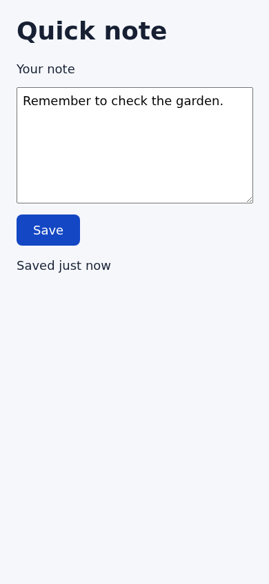

# Button contrast
The Save button now uses a dark blue background and white text.

## Complete changed-file accounting

The candidate inventory lists exactly one modified file: `index.html`.
The complete change replaces `button{background:#777` with
`button{background:#1447c4`. White text, markup, layout, and behavior are
unchanged. No files were added, deleted, or renamed.

Candidate: `0ed267b81255625a97fd8b6ed8d2da6e4f0a4a5f` →
`82e487b345dd699d41b7d4494151283f130f5b1c`.
See the [inventory](merge-candidate.json) and [complete diff](merge-candidate.diff).
The merge review independently checked the Git file inventory, candidate bytes,
and full-index diff against these artifacts; all agree.
