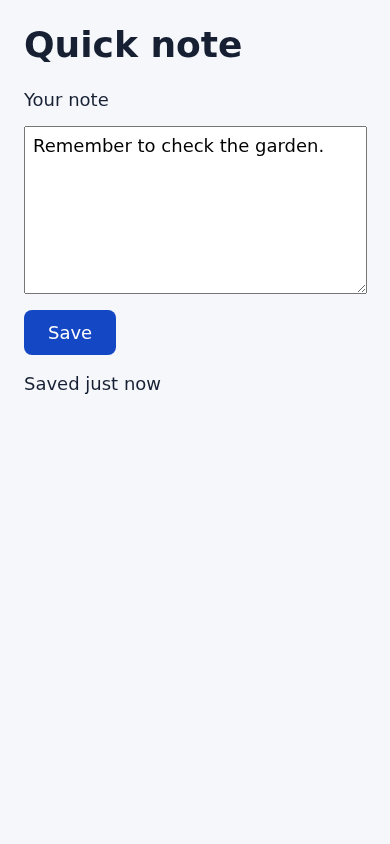

# Merge Save button contrast improvement

The Save label needed stronger contrast. This candidate changes its background
from gray to dark blue, increasing white-text contrast from 4.478:1 to 7.698:1
without changing layout or behavior. I recommend **approve**; the human decision
is whether to merge this one-color change.

Proposed commit subject: `Improve Save button contrast`

## What changed

Only `index.html` changes: the button background moves from `#777` to `#1447c4`.
The [complete accounting](implementation.md), [diff](merge-candidate.diff), and
[inventory](merge-candidate.json) identify the exact candidate:
`0ed267b81255625a97fd8b6ed8d2da6e4f0a4a5f` →
`82e487b345dd699d41b7d4494151283f130f5b1c`.

Actual implemented page, captured in Chromium at 390×844; this is not a design mockup:

## What we needed others to do

No dependency work is needed for this static CSS change. No separate specialist
reports or child outcomes were supplied; none are claimed complete. The
[assessment](assessment.md) recommends approval and reports no blocking findings;
it is an agent review, not human approval.

## How we tested

[VIS-1](test-statements.md) checks Save readability at a 390-pixel phone width.
The [execution report](test-results.md) records Chromium rendering the actual
page. I inspected that capture and independently confirmed the contrast ratios,
background-only change, and agreement between the supplied diff and Git.
The assessment marks VIS-1 passed. No failed or skipped product tests were
reported. [Verification](verification.md) records the checks and unsuccessful
diagnostics, including unavailable tooling and their resolutions.

## What we did not do

No production deployment or backend testing is part of this static-page change.
I did not rerun Chromium; visual evidence is limited to the supplied phone
capture. Save behavior remains the existing static fixture. There are no adverse
product findings in the supplied evidence or this review.

## Interfaces and upgrade

No API, dependency, storage, or interaction changes; no migration is needed.

## Changes from the approved plan

No `approved-direction/one-pager.md` or earlier `approved/` review was supplied,
so I cannot verify agreement with a separate approved plan. The result meets the
stated request: stronger Save contrast with the actual phone screenshot and no
backend or deployment work. No deviation from that request was identified.

---

Read more: [implementation and file accounting](implementation.md) ·
[assessment](assessment.md) · [verification and limitations](verification.md) ·
[test results](test-results.md).
