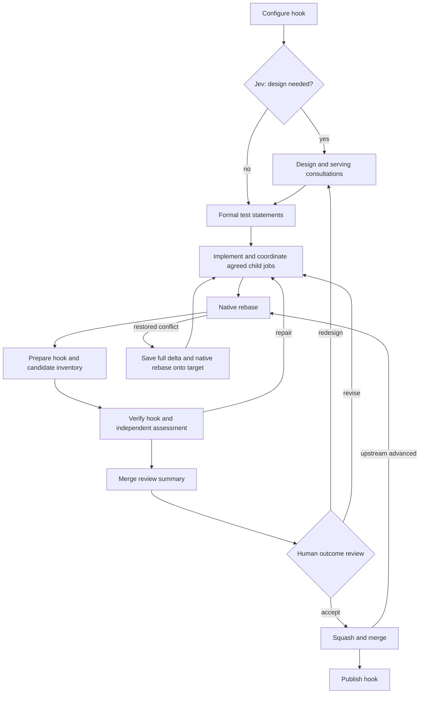

# Adaptive build

The root `build.yaml` selects this implementation. Execution, artifact, Git, and
serving-consultation helpers are owned here; there are no kernel recipe includes.
Existing build recipes remain available. One adaptive loop replaces light/heavy
routing.

See [the process diagrams](../../ADAPTIVE_BUILD_PROCESS.md) for the main workflow,
mandatory serving consultation, native rebase recovery, and approval reuse.



Seven prompt roles: design decision (`classify.yaml`), design, test statements,
implementation (`agent.yaml`), independent assessment and merge summary
(`inspect.yaml`), and serving agreement (`consultation.yaml`). Configured
specialists reuse assessment. Hooks return structured values and evidence directly;
there is no report-rendering agent or artifact-inspection task per hook.

Authored prompts and human-review wording live in [prompts.yaml](prompts.yaml),
an empty-sequence include with named text outputs. It creates no worker tasks.
Consumers select text and format runtime values at their own scope; schemas,
permissions, artifact bindings, and decisions stay in the consuming recipes.
See [shared prompt authoring and validation](../../guides/IMPLEMENTATION_SHARED_PROMPTS.md).

A serving consultation **must agree before another cell's child job is submitted**.
The coordinator owns submission, waiting, stable keys, and recorded results. Cell
creation retains the shared root-owner agreement and readiness gates. Creation
alone never satisfies the original feature request.

Formal Markdown test statements precede implementation. Stable IDs identify
expectations, filenames, importance, test level, dependencies, and negative cases.
Implementation cannot replace this baseline; redesign revisits the plan while
preserving expectations and documenting required deprecations.

Design normally needs no human approval. One outcome review presents
`merge-review.md`, expectations, test outcomes, independent findings, and supporting
design/implementation documents. c2j annotations prioritize documents and retain
identity-checked sources. Review can restart design with feedback. Specific agent
questions and the configurable iteration limit are additional human checkpoints.
Review metadata omits self-links when an agent reuses or revises a document with
the same name; annotations and valid links to other current documents are retained.

Native rebase failures enter repair only with restored workspaces and complete
structured diagnostics. Conflict recovery saves the entire binary delta before
adopting the recorded target through another native rebase. Equivalent changes can
reuse approval after fresh verification; changed content or hook policy requires
new review. Upstream chasing and conflict repairs are bounded. Publication failure
fails the job even when the preceding merge succeeded.

Helpers take specific inputs; there is no shared `flow` object. Decisions read
verification, assessment, candidate, and coordination outputs directly. Native
state run history supplies iteration and recovery counts. Documents, annotations,
and changing sessions cross scope boundaries explicitly. Existing hook contracts
still receive a `build-settings.json` artifact for compatibility; the main loop
receives only the configure outputs it uses.

c2j enforces declared hook output contracts. Hook values and artifact references
pass through unchanged, without custom provenance checks or name prefixes. Only
current verification evidence is bound alongside formal documents. Native loading
or binding-collision failures return to implementation at the next existing task.
Child and specialist documents use consumer-specific aliases when their names
would otherwise collide; those aliases never change hook outputs.

Agent prompts contain the request and current assignment, not serialized workflow
state. Standing instructions are inserted only for new sessions. Agents discover
task permissions, availability, routes, and child restrictions using `c2j self`.

Current verification failures bind native command/extension execution logs under
`error/`. Human feedback and assessment aliases appear under `feedback/`; original
documents remain available for source links. Hook settings remain recipe data.
Verification and recovery prepare these bindings where the failure occurs.
Agents receive the resulting files and a directory-level instruction, without an
event record, failure object, or filename inventory. Typed operation results still
control verification and merge gates; log text is not parsed to infer success.
This requires the version-2 [execution diagnostics](../../GUIDE-Command-Failure-Diagnostics.md)
contract and self discovery (validated with c2j `f1a153b898c5`). Historical version-1
streams are supported without inventing ordering. Missing diagnostics produce an
explicit error note, and cancellation still stops execution.

Implementation tasks may run bounded validation assigned by the test plan.
Automatic child-job outputs are consumed and their results retained; serving
prerequisite work still uses the existing coordinator. Read-only reviews and
negotiations cannot submit jobs. Empty-key capability blockers and explicit
assessment interventions request focused human direction. Repeated unchanged
assessment findings also request intervention instead of repeating the same turn.

See [the direct-state implementation report](../../guides/IMPLEMENTATION_DIRECT_RECIPE_STATE.md)
for the ownership of state values and validation results.

Tests are in `../../recipe-tests/adaptive/`. Run with c2j supporting structured
rebase failures and review annotations:

```sh
c2j test run --directory recipe-tests/adaptive --parallelism 2
```

The new suites exercise the actual root entry with mocked agent decisions and
human responses, and native Git, rebase, merge, hook, and child-job operations.
Legacy route-specific suites use `recipe-tests/fixtures/legacy-build.yaml` to retain
coverage of the still-available previous implementation.
