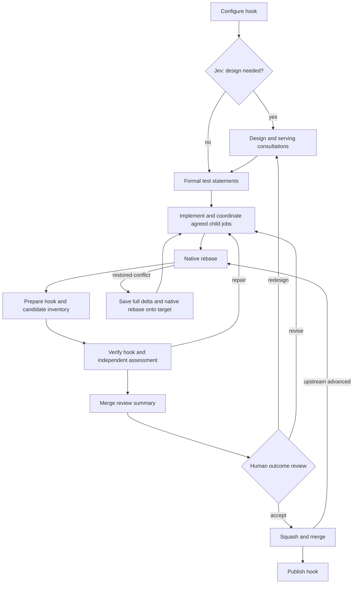

# Adaptive build

The root `build.yaml` selects this implementation. Execution, artifact, Git, and
serving-consultation helpers are owned here; there are no kernel recipe includes.
Existing build recipes remain available. One adaptive loop replaces light/heavy
routing.

See [the process diagrams](../../ADAPTIVE_BUILD_PROCESS.md) for the main workflow,
mandatory serving consultation, native rebase recovery, and approval reuse.



Seven prompt roles: design decision (`classify.yaml`), design, test statements,
implementation (`agent.yaml`), independent assessment and merge summary
(`inspect.yaml`), and serving agreement (`consultation.yaml`). Configured
specialists reuse assessment. Hooks return structured values and evidence directly;
there is no report-rendering agent or artifact-inspection task per hook.

A serving consultation **must agree before another cell's child job is submitted**.
The coordinator owns submission, waiting, stable keys, and recorded results. Cell
creation retains the shared root-owner agreement and readiness gates. Creation
alone never satisfies the original feature request.

Formal Markdown test statements precede implementation. Stable IDs identify
expectations, filenames, importance, test level, dependencies, and negative cases.
Implementation cannot replace this baseline; redesign revisits the plan while
preserving expectations and documenting required deprecations.

Design normally needs no human approval. One outcome review presents
`merge-review.md`, expectations, test outcomes, independent findings, and supporting
design/implementation documents. c2j annotations prioritize documents and retain
identity-checked sources. Review can restart design with feedback. Specific agent
questions and the configurable iteration limit are additional human checkpoints.
Review metadata omits self-links when an agent reuses or revises a document with
the same name; annotations and valid links to other current documents are retained.

Native rebase failures enter repair only with restored workspaces and complete
structured diagnostics. Conflict recovery saves the entire binary delta before
adopting the recorded target through another native rebase. Equivalent changes can
reuse approval after fresh verification; changed content or hook policy requires
new review. Upstream chasing and conflict repairs are bounded. Publication failure
fails the job even when the preceding merge succeeded.

Small state travels through inputs/outputs. Documents, diffs, logs, and transcripts
are artifacts. Existing hook contracts still receive a `build-settings.json` value
artifact for compatibility; the workflow itself uses typed settings.

c2j enforces declared hook output contracts. Hook values and artifact references
pass through unchanged, without custom provenance checks or name prefixes. Only
current verification evidence is bound alongside formal documents. Native loading
or binding-collision failures return to implementation at the next existing task.
Child and specialist documents use consumer-specific aliases when their names
would otherwise collide; those aliases never change hook outputs.

Caught verification command failures forward c2j's stored stdout/stderr references
to the implementation turn, with exit code and timeout details in the failure.
This requires c2j's [command failure diagnostics](../../GUIDE-Command-Failure-Diagnostics.md)
contract (implemented in c2j `bcb7040`). Failures without stream evidence still
return to implementation with their original error.

Tests are in `../../recipe-tests/adaptive/`. Run with c2j supporting structured
rebase failures and review annotations:

```sh
c2j test run --directory recipe-tests/adaptive --parallelism 2
```

The new suites exercise the actual root entry with mocked agent decisions and
human responses, and native Git, rebase, merge, hook, and child-job operations.
Legacy route-specific suites use `recipe-tests/fixtures/legacy-build.yaml` to retain
coverage of the still-available previous implementation.
