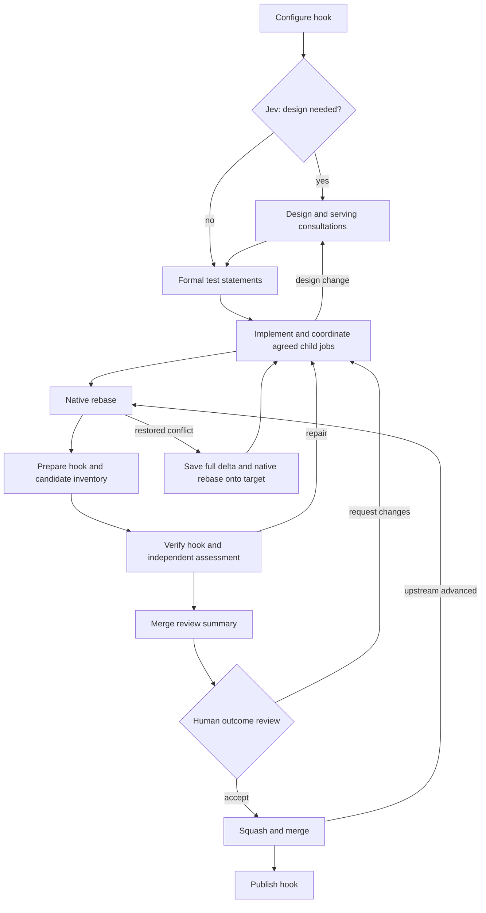

# Adaptive build

The root `build.yaml` selects this implementation. Execution, artifact, Git, and
serving-consultation helpers are owned here; there are no kernel recipe includes.
Existing build recipes remain available. One adaptive loop replaces light/heavy
routing.

The public build accepts an optional `title` alongside the required `prompt`.
When supplied, the title precedes the request in classification and agent context
and is preserved in the build's `title` output. Omitting it keeps the request
unchanged and returns an empty title.

See [the process diagrams](../../ADAPTIVE_BUILD_PROCESS.md) for the main workflow,
mandatory serving consultation, native rebase recovery, and approval reuse.



Seven prompt roles: design decision (`classify.yaml`), design, test statements,
implementation (`agent.yaml`), independent assessment and merge summary
(`inspect.yaml`), and serving agreement (`consultation.yaml`). Configured
specialists reuse assessment. Hooks return structured values and evidence directly;
there is no report-rendering agent or artifact-inspection task per hook.

Authored prompts and human-review wording live in [prompts.yaml](prompts.yaml),
an empty-sequence include with named text outputs. It creates no worker tasks.
Consumers pass named inputs to ordinary templates and resolve worker paths at
the actual operation; schemas,
permissions, artifact bindings, and decisions stay in the consuming recipes.
See [shared prompt authoring and validation](../../guides/IMPLEMENTATION_SHARED_PROMPTS.md).
The [readability cleanup](../../guides/IMPLEMENTATION_RECIPE_READABILITY.md)
explains artifact identity and the template changes. The public build, creation,
and consultation contracts now use schema v2: annotations travel as native arrays
with typed artifact references, and sessions use `checkpoint`. No annotation JSON
strings or transport sidecars are needed. Internal helpers without input schemas
remain unversioned and already pass native values directly. See the
[schema v2 migration](../../guides/IMPLEMENTATION_RECIPE_SCHEMA_V2.md).

A serving consultation **must agree before another cell's child job is submitted**.
Agents return `requests` for consultation or execution. The coordinator assigns
internal references and owns submission, goal waiting, and recorded results. Cell
creation retains the shared root-owner agreement and readiness gates. Creation
alone never satisfies the original feature request.

Classification retains bounded repository context in `repository-context.json`.
Jev currently requires inline state, so only complete context whose serialized
JSON fits within 8 KB is passed inline. Larger context, unreadable documents, or
malformed/truncated command output require design. This avoids parsing c2j's
stdout preview as a complete large JSON document.

Workspace selection uses registered cell names. Owner steps read
`context.workflow.cell`; Git repository locations remain separate metadata.
The default root cell is `root`. Target resolution enters the named cell's
workspace through c2j and leaves unavailable targets unknown. See the
[named-cell migration report](../../guides/IMPLEMENTATION_NAMED_CELLS.md), including
delegated registration and the separate submission authority required for creation.

Formal Markdown test statements precede implementation. Stable IDs identify
expectations, filenames, importance, test level, dependencies, and negative cases.
Implementation cannot replace this baseline; redesign revisits the plan while
preserving expectations and documenting required deprecations.

Design normally needs no human approval. One outcome review presents
`merge-review.md`, expectations, test outcomes, independent findings, and supporting
design/implementation documents. c2j annotations prioritize documents and retain
identity-checked sources. One current overview is primary; evidence is supporting or diagnostic.
Users select “Request changes”; Codex routes the feedback to implementation or design. Specific agent
questions are additional human checkpoints. Exhausted limits stop the attempt for
authorized goal recovery; they do not produce an input form.
Review metadata omits self-links when an agent reuses or revises a document with
the same name; annotations and valid links to other current documents are retained.

Native rebase failures enter repair only with restored workspaces and complete
structured diagnostics. Conflict recovery saves the entire binary delta before
adopting the recorded target through another native rebase. Equivalent changes can
reuse approval after fresh verification; changed content or hook policy requires
new review. Upstream chasing and conflict repairs are bounded. Publication failure
fails the job even when the preceding merge succeeded.

Helpers take specific inputs; there is no shared `flow` object. Decisions read
verification, assessment, candidate, and coordination outputs directly. Native
state run history supplies iteration and recovery counts. Documents, annotations,
and changing sessions cross scope boundaries explicitly. Existing hook contracts
receive their declared `build-settings.json` artifact; the main loop
receives only the configure outputs it uses.

c2j enforces declared hook output contracts. Hook values and artifact references
pass through unchanged, without custom provenance checks or name prefixes. Only
current verification evidence is bound alongside formal documents. Native loading
or binding-collision failures return to implementation at the next existing task.
Child and specialist documents use consumer-specific aliases when their names
would otherwise collide; those aliases never change hook outputs.

Agent prompts contain the request and current assignment, not serialized workflow
state. Standing instructions are inserted only for new sessions. Agents discover
task permissions, availability, routes, and child restrictions using `c2j self`.
New-session instructions identify the job and explain automatic persistence.
Direct child jobs are exceptional, authorized clarification or validation runs;
project work normally uses the recipe's consultation and execution coordination.

Current verification failures bind native command/extension execution logs under
`error/`. Human feedback and assessment aliases appear under `feedback/`; original
documents remain available for source links. Hook settings remain recipe data.
Verification and recovery prepare these bindings where the failure occurs.
Agents receive the resulting files and a directory-level instruction, without an
event record, failure object, or filename inventory. Typed operation results still
control verification and merge gates; log text is not parsed to infer success.
Repair and review bind explicitly declared deliverables, not the complete producer
artifact inventory. Original artifacts remain accessible on the producing task;
their identities remain available internally for correcting response references.
Per-turn guidance keeps scratch/downloaded trees out of outbox and favors an index
of individually accessible evidence over archives. See the
[artifact selection fix](../../guides/FIX_REVIEW_ARTIFACT_SELECTION.md).
This requires the version-2 [execution diagnostics](../../GUIDE-Command-Failure-Diagnostics.md)
contract and self discovery. Current gap-closure validation used c2j `0252e9b`.
Missing diagnostics produce an explicit error note; cancellation stops execution.

Implementation tasks may run bounded validation assigned by the test plan.
Automatic child-job outputs are consumed and their results retained; serving
prerequisite work still uses the existing coordinator. Read-only reviews and
negotiations cannot submit jobs. Actionable assessment findings return to the
working agent. Unexplained blockers, repeated unchanged findings, invalid-response
exhaustion, and iteration limits stop the attempt with operational recovery
instructions. Only explicit product decisions create ordinary human questions.

Read-only tasks use `perms.inherit: true` with `jobs.submit: false`, preserving
credentials from the configured Git profile. Cell registration uses the same
inheritance mode while granting creation and denying submission. This requires
c2j `eb636a5` or later; see the [permission regression fix](../../guides/FIX_INHERITED_TASK_PERMISSIONS.md).

See [the direct-state implementation report](../../guides/IMPLEMENTATION_DIRECT_RECIPE_STATE.md)
for the ownership of state values and validation results.

Tests are in `../../recipe-tests/adaptive/`. Run with c2j supporting schema v2,
structured rebase failures, review annotations, and named cells (validated against
`eb636a5`):

```sh
c2j test run --directory recipe-tests/adaptive --parallelism 2
```

The new suites exercise the actual root entry with mocked agent decisions and
human responses, and native Git, rebase, merge, hook, and child-job operations.
Legacy route-specific suites use `recipe-tests/fixtures/legacy-build.yaml` to retain
coverage of the still-available previous implementation.

## Goals and package requests

Monitor goals rather than individual job attempts. Native goal waits consume the
successful attempt's result even if an earlier attempt failed. Explicitly failed
goals remain blocking. Agents return only direct `requests`; old response fields,
translation helpers, carried coordinator maps, and job-ID fallback targets are
removed. Native state history supplies agreement and submission records, exposed
as `coordination`. Independent requests can share a batch. Repeated execution of
an agreement reuses its goal. Evidence lives under `coordination/` and `goals/`.

Cell creation must be explicit and root-owned. An inaccessible workspace does not
prove a cell needs creation; the agent investigates before requesting that action.

Working agents receive package-request syntax in their instructions. Return
`next: blocked`, an explanatory `summary`, and for each `packages` entry a
`reference` and a bounded `check` argv array. For example:

```yaml
packages:
  - reference: uv:ruff==0.11.2
    check: [ruff, --version]
```

The version illustrates syntax, not a version recommendation. Trusted exact
reference/probe pairs in `package-policy.yaml`'s `approved` output can proceed
without another question; the default policy is empty. Other requests receive
one specific approval. The recipe validates the exact config in a child goal,
preserves config comments and unrelated values, adopts only a successful matching
proposal, and resumes the blocked work. A changed parent config prevents adoption.
Native package-state outputs retain decisions: identical refusals reuse feedback;
identical approvals reuse their validation goal; changed probes need authorization.
Failed-goal attempts supply their actual diagnostic files under `error/`. The
pre-adoption config is retained. Setup failure before an agent starts preserves
the original cause for executor repair and a native restart within the same goal.
A revised config uses the pre-adoption restart scope; there is no automatic rollback.
Packages persist in the job workspace and become cell defaults only after merge.
Application libraries belong in normal dependency manifests. Memory and Docker
access are separate capabilities, not package declarations.

Every review explicitly identifies its current brief. When none was authored, a
fresh brief uses the current title, questions, and explanation. Only cited sources
with matching artifact identities and decision-required evidence are attached;
stale briefs and unrelated accumulated documents are excluded.

See the [gap-closure plan](../../guides/PLAN_ADAPTIVE_GAP_CLOSURE.md) and
[implementation assessment](../../guides/ASSESSMENT_ADAPTIVE_GAP_CLOSURE.md)
for changes, validation, and runtime boundaries.
